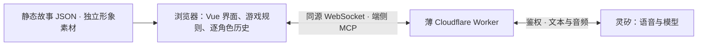

# 

**轻松开口，认真推理。**

[](https://github.com/nighca/lie/actions/workflows/ci.yml)


与三名 AI 角色自由语音交流，对照各自的说法，最后选出事件的责任人。画面轻松，人物却未必把话说全——问什么、先问谁、相信哪一句，由你决定。

首案 **《空盒里的纪念章》**：同一个白盒，五分钟后只剩衬垫。闭馆的社区摄影小展里，三个人各有一段经历。

中文界面采用明亮黄蓝、深蓝描边与原创卡通人物，给推理留一点轻松的反差。

> 本地与[线上开发预览](https://lie-game.nighca.workers.dev/)已启用真实语音，当前按用户决定临时关闭应用访问鉴权。三位角色已配置不同音色；线上真实语音协议链路已验证，整合版真人试玩、角色行为与多人体验仍在验收。

## 一局怎么玩

| 接案 | 开口问话 | 换个人聊 | 做出指认 |
| --- | --- | --- | --- |
| 读公共背景，认识在场人物 | 用自己的话提问、追问 | 对照说法，回看各人的只读转写 | 点击人物，查看结果 |

选错可以返回继续调查；选对后揭晓完整经过，再开一局。角色交流只有语音，切人、开始、结束和最终指认保留按钮操作。没有文字聊天输入，也不要求填写推理说明。

## 本地体验

需要 **Node.js 24.22.1+ 的 24.x 版本**与 **npm 11**。

```sh
npm ci
npm run dev
```

打开 **[本地开发演示](http://127.0.0.1:5176/?demo=1)**。点击“模拟说话”，再点击“结束模拟发言”，体验假数据问答与指认流程。此模式不采集麦克风、不调用模型、不播放声音，仅在 Vite 开发环境启用；生产构建忽略 `demo=1`。

真实接口使用同源 Worker 提供的页面与 `/api/voice`，需要单独配置服务端凭据和受限测试访问方式。未就绪时会显示错误，不会自动替换成假回答。接入步骤见 [Web 应用说明](apps/web/README.md)与 [网关说明](apps/gateway/README.md)。不要把管理 key 放进前端变量、URL 或提交记录。

## 工程与验证

```sh
npm run typecheck
npm test
npm run build
```

发布基线 `97b434e` 通过 **68 项自动化测试、类型检查和完整构建**；[GitHub Actions](https://github.com/nighca/lie/actions/workflows/ci.yml)在 main 更新或手动触发时执行干净安装与这些检查。自动化覆盖内容校验、指认规则、角色上下文、异步归属、语音协议、UI 流程和 Worker 边界；真实服务另行验收。私有仓库的 CI 徽章可能需要登录后才能显示。

完整页面已在 Codex 内置浏览器验证模拟问答、切人独立历史、错误指认后继续、正确揭晓与重开。独立技术探针也曾打通 Cloudflare → 灵矽 WSS、端侧 MCP 和文本触发 PCM 返回；这不等于真实麦克风、ASR、播放与多人隔离已经通过。详见 [验证记录](docs/validation.md)。

## 架构一眼看清



故事以公共背景和各角色设定的纯文本为主，只保留程序需要的少量元数据；形象通过独立资源配置复用。同一玩法下，新增故事通过内容包与配置完成。游戏内容和单局逻辑在浏览器运行，完整答案可被开发者工具检查；平台管理凭据留在托管端。无需游戏数据库或传统常驻服务端。

| 位置 | 职责 |
| --- | --- |
| [apps/web](apps/web) | Vue 页面、浏览器对话编排与显式展示视图 |
| [packages/game-core](packages/game-core) | 独立 TypeScript 内容校验、会话、指认与角色上下文 |
| [packages/ui](packages/ui) | 统一视觉的公共 Vue 组件 |
| [packages/voice](packages/voice) | 灵矽协议、PCM、麦克风与播放 |
| [apps/gateway](apps/gateway) | 静态资源与薄语音网关，不处理案件规则 |

## 继续了解

- **玩法与内容：** [首版玩法](docs/gameplay-proposal.md) · [完整剧情与作者核查，含剧透](docs/case-options.md)
- **产品与美术：** [视觉方向](docs/visual-direction.md) · [界面设计规范](design/ui/spec.md) · [可复用形象](design/appearances/README.md)
- **工程与上线：** [架构设计](docs/architecture.md) · [开发说明](docs/development.md) · [部署方案](docs/deployment-options.md) · [验证记录](docs/validation.md)
- **项目协作：** [计划与决策](docs/project-plan.md) · [AI agent 协作规范](AGENTS.md)
