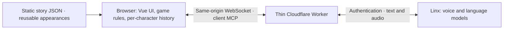

# 

**Easy conversation. Serious deduction.**

English · [简体中文](README.zh-CN.md)

[](https://github.com/nighca/lie/actions/workflows/ci.yml)


Talk freely with AI characters, compare their accounts, and identify who is responsible. The artwork is playful; the characters may leave things unsaid. What to ask, whom to question first, and which story to trust are up to you. The game interface is in Chinese.

[Play the development preview](https://lie-game.nighca.workers.dev/) · [Create a case](https://lie-game.nighca.workers.dev/editor)

## Play a case

| Read the brief | Ask questions | Talk to someone else | Make your accusation |
| --- | --- | --- | --- |
| Learn the public background and meet the characters | Start a voice conversation; ask follow-ups and interrupt naturally | Compare accounts and revisit read-only transcripts | Select one person and see the result |

A correct accusation reveals the full story. A wrong accusation ends the attempt without revealing the answer; try again by starting a new game. Character conversations use voice only. Switching characters, starting or ending a conversation, and accusing someone use buttons; there is no text-chat composer or written deduction form.

The questioning budget is shared across all characters. It counts time while voice is enabled, including pauses, waiting and replies; connection setup does not count. Running out of time ends questioning and moves to accusation, without automatically losing or revealing the truth. Leaving an active investigation asks for confirmation and discards that attempt rather than saving progress.

| Case | Characters | Questioning budget |
| --- | ---: | ---: |
| **空盒里的纪念章** — a medal disappears before a photography club group photo | 3 | 8 minutes |
| **压轴怎么是鸭叫** — a puppet show's piano finale unexpectedly becomes duck quacks | 4 | 10 minutes |
| **盐和糖的小乌龙** — a community baking session produces unexpectedly salty cookies | 4 | 9 minutes |

Case sizes vary; the engine does not hardcode three suspects.

## Make and share your own mystery

The editor has three freely navigable steps: story setup, characters, and the ending. Write a public background and a plain-text profile for each character, choose reusable appearances, select the single correct target, and set the time budget. Eight presets provide portraits, state images and configured voices; appearance names are separate from story character names.

Incomplete drafts autosave in the current browser. Trial play uses the same game engine. Sharing compresses the complete case into the URL fragment, so a friend can open it without a story database or an account. The current full-link budget is 16,000 characters; cross-browser boundary acceptance is still pending. Editing a draft does not change links already sent.

Official contribution preparation lets an author copy or download JSON and continue on GitHub. It does not automatically create a PR or publish a case; the current private repository is not open to external submissions. See the [editor implementation](docs/game-editor-implementation.md) and [case authoring guide](content/games/README.md).

## Run locally

Use **Node.js 24.22.1 or newer within 24.x** and **npm 11**.

```sh
npm ci
npm run dev
```

Open the [local development demo](http://127.0.0.1:5176/?demo=1), choose a case, then click **“开始模拟对话”**. Fake turns repeat until you click **“结束对话”**. This mode captures no microphone, calls no model and plays no audio. It is available only in Vite development; production builds ignore `demo=1`.

Real voice needs the same-origin Worker and server-side Linx bindings. After configuring those locally:

```sh
npm run build
npm run dev --workspace @lie/gateway
```

Use `http://127.0.0.1:8787/` for the Worker-served app and `/api/voice`. A missing service or configuration produces an error, never a silent switch to fake answers. See the [web application notes](apps/web/README.md), [gateway notes](apps/gateway/README.md) and [development guide](docs/development.md) for details and historical experiments. Keep management keys and private bindings out of frontend variables, URLs and Git history.

## Checks and deployment

```sh
npm run typecheck
npm test
npm run build
```

Automated checks cover content validation, accusation rules, character context, asynchronous ownership, voice transport, UI flows and Worker boundaries. Fake-provider success does not certify real microphone capture, recognition, playback or model behavior. Real-service evidence is recorded separately in the [validation log](docs/validation.md) and [case follow-up](docs/case-live-followup.md).

[GitHub Actions](https://github.com/nighca/lie/actions/workflows/ci.yml) runs a clean installation, checks, build and deployment dry run on `main` pushes or manual dispatch. If that commit is still the latest `main`, it deploys the verified build to Cloudflare using repository secrets. Older builds skip deployment. The [editor milestone deployment record](docs/deployments/2026-10-24-editor-milestone.md) distinguishes successful CI from the actual active deployment. A private repository's CI badge may require login.

Local and online development previews support real voice. Application authentication is temporarily disabled by the project owner's decision; provider credentials remain on the Worker. Production access, concurrency allocation and account-wide spending controls are still deferred. A browser's questioning timer is not a hard provider spending cap. Continuous-voice user testing and bounded real-model checks do not establish unrestricted multi-user readiness; see the [online voice preview boundaries](docs/online-voice-preview.md).

## Architecture



Stories primarily contain plain-text public backgrounds and character profiles, with only the metadata the engine needs. Additional cases use content packages and presentation configuration. Game content and session logic run in the browser; complete answers are inspectable in developer tools. Provider management credentials stay on the hosted side. No game database or traditional always-running server is required.

| Location | Responsibility |
| --- | --- |
| [apps/web](apps/web) | Vue pages, browser conversation orchestration and presentation |
| [packages/game-core](packages/game-core) | Independent TypeScript content validation, sessions, accusation and role context |
| [packages/ui](packages/ui) | Shared Vue components and visual styling |
| [packages/voice](packages/voice) | Linx protocol, PCM, microphone capture and playback |
| [apps/gateway](apps/gateway) | Static assets and thin voice transport; no case rules |

## More about the project

- **Gameplay and content:** [gameplay proposal](docs/gameplay-proposal.md) · [first-case story and author checks — spoilers](docs/case-options.md)
- **Product and artwork:** [visual direction](docs/visual-direction.md) · [UI specification](design/ui/spec.md) · [reusable appearances](design/appearances/README.md)
- **Engineering and release:** [architecture](docs/architecture.md) · [development](docs/development.md) · [deployment options](docs/deployment-options.md) · [validation](docs/validation.md)
- **Project collaboration:** [plan and decisions](docs/project-plan.md) · [AI agent collaboration](AGENTS.md)
