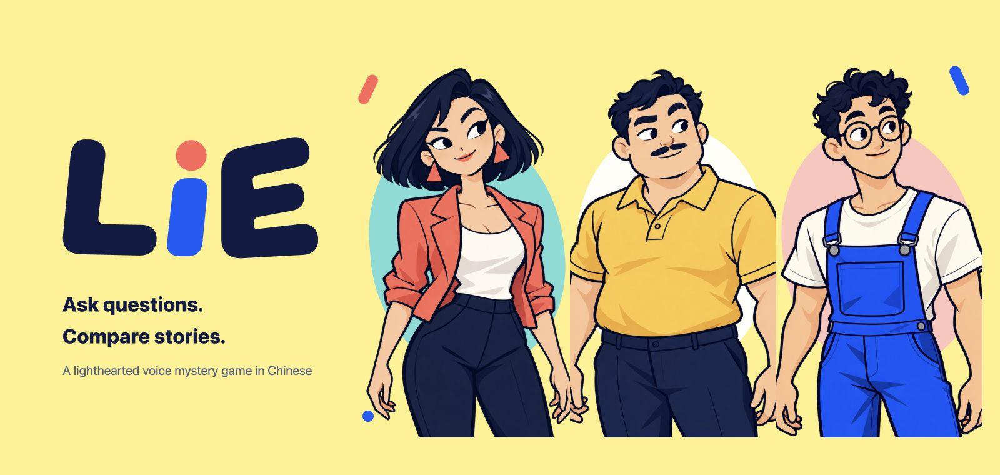
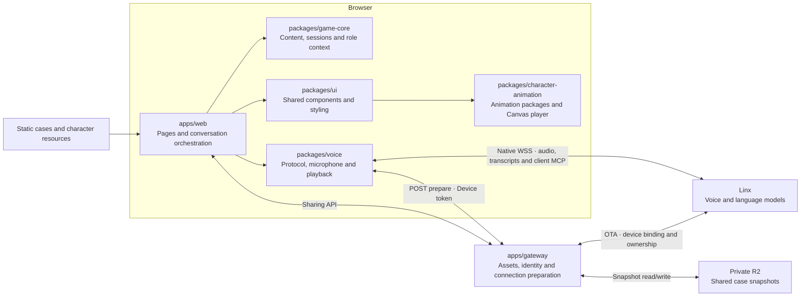

# 

**Easy conversation. Serious deduction.**

English · [简体中文](README.zh-CN.md)

[](https://github.com/nighca/lie/actions/workflows/ci.yml)
[](docs/coverage/README.md)




LIE is an AI voice detective game and a platform for creating your own mysteries. Talk freely with AI characters, compare their accounts, and identify who is responsible. The artwork is playful; the characters may leave things unsaid. What to ask, whom to question first, and which story to trust are up to you. Play and create in desktop or mobile browsers, with no app to install. The game interface is in Chinese.

[Play LIE](https://lie.agency/) · [Create a case](https://lie.agency/editor) · [Watch the demo (3:07, with audio)](media/promo-video/lie-demo.mp4) · [Mobile demo (2:09)](media/promo-video/lie-mobile-demo.mp4)

**Comic promos:** [Desktop / landscape](https://www.youtube.com/watch?v=muUv193P4Go) · [Mobile / vertical](https://www.youtube.com/shorts/ld7W5MRuGD8)

## Play a case

| Read the brief | Ask questions | Talk to someone else | Make your accusation |
| --- | --- | --- | --- |
| Learn the public background and meet the characters | Start a voice conversation; ask follow-ups and interrupt naturally | Compare accounts and revisit read-only transcripts | Select one person and see the result |

A correct accusation reveals the full story. A wrong accusation ends the attempt without revealing the answer; try again by starting a new game. Character conversations use voice only. Switching characters, starting or ending a conversation, and accusing someone use buttons; there is no text-chat composer or written deduction form.

The questioning budget is shared across all characters. It counts time while voice is enabled, including pauses, waiting and replies; connection setup does not count. Running out of time ends questioning and moves to accusation, without automatically losing or revealing the truth. Leaving an active investigation asks for confirmation and discards that attempt rather than saving progress.

| Case | Characters | Questioning budget |
| --- | ---: | ---: |
| **谁才是江苏人** — find the real Jiangsu local among two travel podcast guests | 2 | 2 minutes |
| **这条线你真走了吗** — compare three hikers’ accounts to find who turned back halfway | 3 | 6 minutes |
| **消失的纪念章** — a medal disappears before a photography club group photo | 3 | 8 minutes |
| **压轴怎么是鸭叫** — a puppet show's piano finale unexpectedly becomes duck quacks | 4 | 10 minutes |
| **盐和糖的小乌龙** — a community baking session produces unexpectedly salty cookies | 4 | 9 minutes |
| **这真是今天做的吗** — compare Hackathon accounts to find who passed off old work as new | 3 | 8 minutes |

Case sizes vary; the engine does not hardcode three suspects.

## Make and share your own mystery

The editor has three freely navigable steps: story setup, characters, and the ending. Write a public background and a plain-text profile for each character, choose reusable appearances, select the single correct target, and set the time budget. Eight presets provide distinctive portraits, animations for conversation states and configured voices; appearance names are separate from story character names.

Incomplete drafts autosave in the current browser. Trial play uses the same game engine. Sharing compresses the complete case into the URL fragment, so a friend can open it without a story database or an account. The current full-link budget is 16,000 characters; cross-browser boundary acceptance is still pending. Players can remix a shared case in the editor. Editing a draft does not change links already sent.

To submit a case for the official collection, the editor prepares case JSON and guides authors through creating a GitHub Pull Request for maintainer review. See the [editor implementation](docs/game-editor-implementation.md) and [case authoring guide](content/games/README.md).

Coverage is a **snapshot of application lines**, with native scripts reported separately. See the [sample SHA, timestamp, scope and update command](docs/coverage/README.md) and [measured counts](docs/coverage/summary.json). CI uploads fresh reports as artifacts; it does not rewrite the tracked badge.

## Run locally

Use **Node.js 24.22.1 or newer within 24.x** and **npm 11**.

```sh
npm ci
npm run dev
```

Open the [local development demo](http://127.0.0.1:5176/?demo=1), choose a case, then click **“开启模拟对话”**. Fake turns repeat until you click **“结束对话”**. This mode captures no microphone, calls no model and plays no audio. It is available only in Vite development; production builds ignore `demo=1`.

Real voice needs the same-origin Worker and server-side Linx bindings. After configuring those locally:

```sh
npm run build
npm run dev --workspace @lie/gateway
```

Use `http://127.0.0.1:8787/` for the Worker-served app. The app prepares a case through same-origin `POST /api/voice/prepare`, then opens a native WebSocket directly to Linx. `GET /api/health` checks configuration without preparing a provider device; `/api/voice` is reserved for server-selected relay rollback. A missing service or configuration produces an error, never a silent switch to fake answers. See the [web application notes](apps/web/README.md), [gateway notes](apps/gateway/README.md) and [development guide](docs/development.md) for details and historical experiments. Keep management keys and private bindings out of frontend variables, URLs and Git history.

## Checks and deployment

```sh
npm run typecheck
npm test
npm run build
```

Automated checks cover content validation, accusation rules, character context, asynchronous ownership, voice transport, UI flows and Worker boundaries. Fake-provider success does not certify real microphone capture, recognition, playback or model behavior. Real-service evidence is recorded separately in the [validation log](docs/validation.md) and [case follow-up](docs/case-live-followup.md).

[CI](https://github.com/nighca/lie/actions/workflows/ci.yml) performs checks, coverage, build and a deployment dry run. A separate [CD workflow](https://github.com/nighca/lie/actions/workflows/cd.yml) receives only a successful same-repository main CI run, verifies its exact SHA and artifact, then deploys that prebuilt output if the SHA is still main. CD does not rebuild or rerun tests. Manual runs start from CI; [handoff and permissions](docs/ci-cd.md) describe the boundary. The [release verification record](docs/releases/2026-10-25-combined-demo/README.md) documents actual runs of the existing CI/CD workflows.

Production uses direct browser-to-Linx voice connections, released as `7ff0824` on 2026-11-03 after user acceptance of the same preview build; see the [release record](docs/releases/2026-11-03-direct-voice.md). Application authentication is temporarily disabled by the project owner's decision. Management keys and the Cookie signing secret remain on the Worker; the browser holds only the current case's connection token in memory. Production access, concurrency allocation and account-wide spending controls are still deferred. A browser's questioning timer is not a hard provider spending cap. Continuous-voice user testing and bounded real-model checks do not establish unrestricted multi-user readiness; see the [online voice preview boundaries](docs/online-voice-preview.md).

## Architecture

[Module specifications and interfaces](docs/architecture-design.md) · Chinese technical reference.



Voice preparation starts once when the case introduction loads. Opening a conversation waits for that same result; character switches and stopping/reopening reuse it within the case. An explicit retry refreshes preparation, while a new case or restart clears it. The native socket uses Linx `/v1/ws/`, with the Device token in hello, not the URL or persistent browser storage. The Worker handles identity, provider management and sharing; audio, transcripts and role-context tools travel directly between the browser and Linx. See the [per-case transport contract](docs/reviews/voice-case-prepare-2026-11-03/README.md).

Stories primarily contain plain-text public backgrounds and character profiles, with only the metadata the engine needs. Additional cases use content packages and presentation configuration. Game content and session logic run in the browser; complete answers are inspectable in developer tools. Provider management credentials stay on the hosted side. No game database or traditional always-running server is required. Shared case and character specifications connect authoring tools with the engine; a custom lightweight 2D skeletal animation format and Canvas player bring reusable characters to life.

| Location | Responsibility |
| --- | --- |
| [apps/web](apps/web) | Vue pages, browser conversation orchestration and presentation |
| [packages/game-core](packages/game-core) | Independent TypeScript content validation, sessions, accusation and role context |
| [packages/ui](packages/ui) | Shared Vue components and visual styling |
| [packages/voice](packages/voice) | Linx protocol, native direct WebSocket, PCM, microphone capture and playback |
| [packages/character-animation](packages/character-animation) | Independent animation package validation, state playback and Canvas rendering |
| [apps/gateway](apps/gateway) | Static assets, browser identity, connection preparation and sharing API; no case rules |

## More about the project

- **Gameplay and content:** [gameplay proposal](docs/gameplay-proposal.md) · [first-case story and author checks — spoilers](docs/case-options.md)
- **Product and artwork:** [visual direction](docs/visual-direction.md) · [UI specification](design/ui/spec.md) · [reusable character presets](design/character-presets/README.md)
- **Engineering and release:** [architecture](docs/architecture.md) · [development](docs/development.md) · [deployment options](docs/deployment-options.md) · [validation](docs/validation.md)
- **Project collaboration:** [plan and decisions](docs/project-plan.md) · [AI agent collaboration](AGENTS.md)
