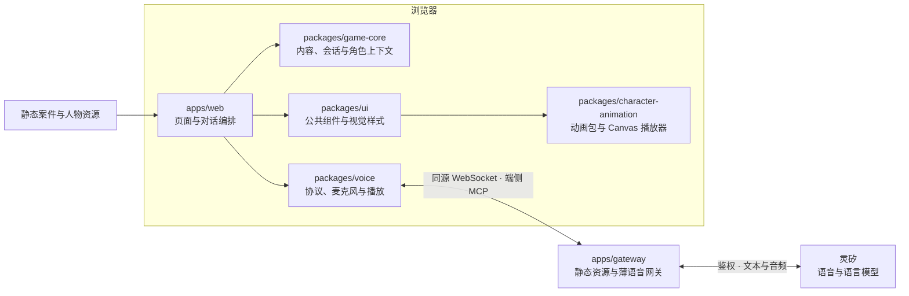

# 

**轻松开口，认真推理。**

[English](README.md) · 简体中文

[](https://github.com/nighca/lie/actions/workflows/ci.yml)
[](docs/coverage/README.md)


LIE 既是 AI 语音推理游戏，也是让你创作自己谜题的游戏平台。与 AI 角色自由语音交流，对照各自的说法，最后选出事件的责任人。画面轻松，人物却未必把话说全——问什么、先问谁、相信哪一句，由你决定。桌面和移动端浏览器均可游玩与创作，无需安装客户端。游戏界面使用中文。

[开始游戏](https://lie.agency/) · [创作案件](https://lie.agency/editor) · [观看演示视频（3:07，含声音）](media/promo-video/lie-demo.mp4)

## 一局怎么玩

| 接案 | 开口问话 | 换个人聊 | 做出指认 |
| --- | --- | --- | --- |
| 读公共背景，认识在场人物 | 开启语音对话，自由追问、直接开口打断 | 对照说法，回看各人的只读转写 | 点击人物，查看结果 |

选对后揭晓完整经过。选错也会结束本局，不揭晓答案；想再试只能重新开始。角色交流只有语音，切人、开始或结束对话、最终指认保留按钮操作。没有文字聊天输入，也不要求填写推理说明。

询问额度由所有人物共享，累计语音启用时间，包含停顿、等待和回答；连接准备不计。时间用完会停止询问并进入指认，不自动判负或揭晓。离开正在调查的页面需要确认，确认后丢弃本局，不保存进度。

| 案件 | 人物 | 询问额度 |
| --- | ---: | ---: |
| **《消失的纪念章》**：摄影社合影前，一枚纪念章不见了 | 3 | 8分钟 |
| **《压轴怎么是鸭叫》**：木偶剧谢幕，钢琴曲突然变成鸭叫 | 4 | 10分钟 |
| **《盐和糖的小乌龙》**：社区烘焙的小饼咸过了头 | 4 | 9分钟 |
| **《这真是今天做的吗》**：Hackathon 路演后，核对谁把旧成果说成了现场新作 | 3 | 8分钟 |

每案人数可以不同，引擎没有写死三名嫌疑人。

## 创作并分享自己的谜题

编辑器分为故事设定、故事人物、真相结局三步，可以自由往返。用纯文本写公共背景与各人物设定，选择预置形象，选定唯一正确目标并设置时长。八套预置形象提供鲜明的立绘、随对话状态变化的动画和已配置音色；形象名称与案件人物姓名相互独立。

未完成的草稿也会自动保存在当前浏览器。试玩使用同一个游戏引擎；分享把完整案件压缩到 URL fragment，朋友打开链接即可玩，不需要故事数据库或账号。当前完整链接预算为16,000字符，跨浏览器边界验收仍待完成。玩家也可在编辑器中改编分享的案件。修改草稿不会改变已经发出的链接。

向官方投稿时，编辑器准备规范的案件 JSON，引导作者在 GitHub 创建 Pull Request，由维护者评审收录。详见[编辑器实施说明](docs/game-editor-implementation.md)与[案件作者规格](content/games/README.md)。

覆盖率徽章是**application lines 的采样快照**，Node脚本另行统计。见[采样SHA、时间、范围与更新命令](docs/coverage/README.md)和[真实计数](docs/coverage/summary.json)。CI上传当次报告artifact，不会自动改写仓库内徽章。

## 本地体验

需要 **Node.js 24.22.1+ 的 24.x 版本**与 **npm 11**。

```sh
npm ci
npm run dev
```

打开[本地开发演示](http://127.0.0.1:5176/?demo=1)，选择案件后点击 **“开启模拟对话”**，假数据问答会循环进行，点击 **“结束对话”** 停止。此模式不采集麦克风、不调用模型、不播放声音，仅在 Vite 开发环境启用；生产构建忽略 `demo=1`。

真实语音需要同源 Worker 和服务端灵矽配置。完成本地配置后：

```sh
npm run build
npm run dev --workspace @lie/gateway
```

通过 `http://127.0.0.1:8787/` 使用 Worker 提供的页面与 `/api/voice`。服务或配置未就绪时会显示错误，不会自动替换成假回答。配置细节及历史实验见 [Web 应用说明](apps/web/README.md)、[网关说明](apps/gateway/README.md)与[开发指南](docs/development.md)。不要把管理 key 或私有配置放进前端变量、URL 或提交记录。

## 工程检查与部署

```sh
npm run typecheck
npm test
npm run build
```

自动化覆盖内容校验、指认规则、角色上下文、异步归属、语音协议、UI 流程和 Worker 边界。替身供应商通过不代表真实麦克风、识别、播放或模型行为通过；真实服务另行验收，证据见[验证记录](docs/validation.md)与[案件真实复核](docs/case-live-followup.md)。

[CI](https://github.com/nighca/lie/actions/workflows/ci.yml) 负责检查、覆盖率、构建和部署 dry run。独立的[CD workflow](https://github.com/nighca/lie/actions/workflows/cd.yml) 仅接收本仓 main 成功 CI，校验同一 SHA 与产物，确认仍为最新 main 后部署预构建产物，不重复构建或测试。手动重验从 CI 发起；[交接与权限](docs/ci-cd.md)说明边界。[发布核验记录](docs/releases/2026-10-25-combined-demo/README.md)保留现有 CI/CD 的实际执行证据。

本地与线上开发预览已支持真实语音。应用访问鉴权按项目负责人决定临时关闭，供应商凭据仍保留在 Worker。正式访问、并发分配和账户级支出控制仍暂缓；浏览器内的询问倒计时不是供应商费用硬上限。持续语音真人试玩与受控模型检查不等于已具备不受限的多人正式服务能力；见[线上语音预览边界](docs/online-voice-preview.md)。

## 架构



故事以公共背景和各角色设定的纯文本为主，只保留程序需要的少量元数据；形象通过独立资源配置复用。同一玩法下，新增故事通过内容包与配置完成。游戏内容和单局逻辑在浏览器运行，完整答案可被开发者工具检查；平台管理凭据留在托管端。无需游戏数据库或传统常驻服务端。统一的案件与人物素材规格连接创作工具和运行引擎，自研轻量 2D 骨骼动画格式与 Canvas 播放器让人物资源持续复用。

| 位置 | 职责 |
| --- | --- |
| [apps/web](apps/web) | Vue 页面、浏览器对话编排与展示 |
| [packages/game-core](packages/game-core) | 独立 TypeScript 内容校验、会话、指认与角色上下文 |
| [packages/ui](packages/ui) | 统一视觉的公共 Vue 组件 |
| [packages/voice](packages/voice) | 灵矽协议、PCM、麦克风与播放 |
| [packages/character-animation](packages/character-animation) | 独立动画包校验、状态播放与 Canvas 渲染 |
| [apps/gateway](apps/gateway) | 静态资源与薄语音网关，不处理案件规则 |

## 继续了解

- **玩法与内容：** [首版玩法](docs/gameplay-proposal.md) · [完整剧情与作者核查，含剧透](docs/case-options.md)
- **产品与美术：** [视觉方向](docs/visual-direction.md) · [界面设计规范](design/ui/spec.md) · [可复用人物预设](design/character-presets/README.md)
- **工程与上线：** [架构设计](docs/architecture.md) · [开发说明](docs/development.md) · [部署方案](docs/deployment-options.md) · [验证记录](docs/validation.md)
- **项目协作：** [计划与决策](docs/project-plan.md) · [AI agent 协作规范](AGENTS.md)
