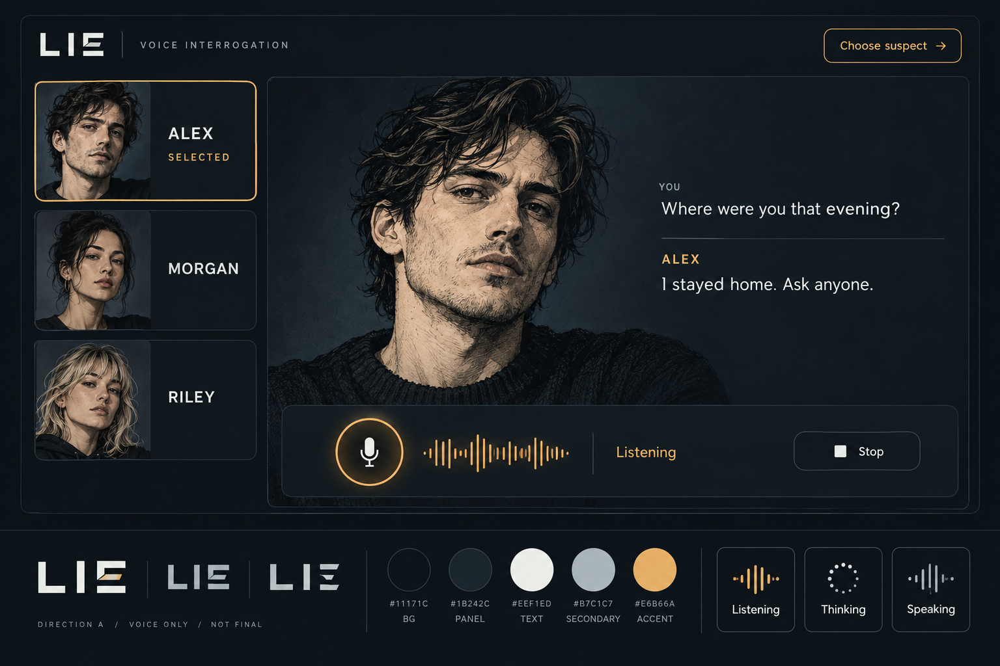
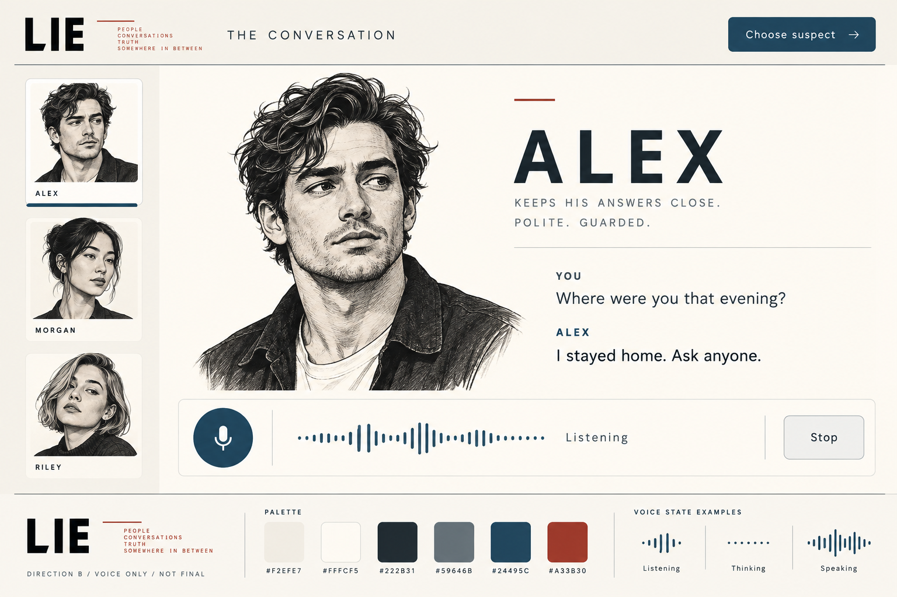

# LIE 语音风格板：当前待选方向

状态：探索预览，未批准，非正式 Logo、角色、界面或可运行页面。2026-10-23。

用户已明确移除证据元素：玩家只与三名嫌疑人语音对话，最终通过按钮选择嫌疑人。以下两张新版图取代旧版；旧图仅保留设计历史，不再待选。

| 最新图片 | 方向 | 评审重点 |
| --- | --- | --- |
| [voice-night.png](voice-night.png) | A 夜间审讯室 | 深色、琥珀、大幅人物、语音主控；对峙感更强 |
| [voice-light.png](voice-light.png) | B 明亮访谈台 | 浅色、深蓝、编辑式人物访谈排版；更轻、留白更多 |





两张均由内置 `image_gen.imagegen` 独立生成，`transparent_background: false`，没有输入图片、CLI fallback 或代码替代图片。人物、名字、表情、对白与英文均为占位，不确认案件、角色身份或产品语言。图中只有少量只读转写，不含文字输入。字标仍为方向探索。用户选定风格后再制作正式 UI 与品牌资产。

## 当前本地路径与 QA

- `/private/tmp/lie-visual-styleboards/design/styleboards/voice-night.png`
- `/private/tmp/lie-visual-styleboards/design/styleboards/voice-light.png`

均复制到项目，保留原始生成文件：

- `/Users/nighca/.codex/generated_images/01a167a4-52a9-7eb2-ba15-8e2e9c90d04b/exec-6f350c4b-f938-491d-b2d1-17e68dcee9ab.png`
- `/Users/nighca/.codex/generated_images/01a167a4-52a9-7eb2-ba15-8e2e9c90d04b/exec-5f3abf97-cb37-472e-bf83-ce63ab4d0d18.png`

已通过 `view_image` 打开两张复制后的 PNG，均为1536×1024，检查到：

- 恰好三个嫌疑人卡，当前人物大幅展示，短转写清楚，语音主控与“Choose suspect”指认入口明显。
- 没有证据卡、文件、照片物证、线索板、搜证或出示按钮；没有罪犯揭晓或可信度分数。
- 两图底部包含字标、色板及收音/等待/说话的独立品牌示例；这些是控件样本，不是同时发生的游戏状态。
- 两图现代且对照明显，未见真实账号、凭证、警徽或霓虹。浅色图增加了短占位人物描述及小标语，不作为产品文案。
- 人物外观在两套图中未完全一致；正式人物在案件与风格确认后统一制作。英文演示不能替代中文排版验证。
- 静态图未验证交互、真实语音、键盘、实际色值对比度或最终响应式布局；当前只用于用户确认美术方向。

## 新版实际完整提示词 A

```text
Use case: ui-mockup
Asset type: exploratory art direction board for LIE desktop browser voice-only mystery game; not a production screen.
Primary request: wide landscape high-fidelity UI style board, dark night interrogation direction. The entire experience is only speaking with three suspects and eventually choosing one suspect. Focus on PEOPLE and VOICE, not documents or investigation props.
Composition: upper 80% is a large flat front-facing desktop web app mockup, bottom narrow strip contains LIE wordmark exploration, five palette swatches and three small voice status specimens.
UI: LIE geometric legible wordmark top left, subtle "VOICE INTERROGATION", top right restrained button "Choose suspect". Three fictional contemporary adult portrait cards in a compact rail across the left or top, labeled ALEX / MORGAN / RILEY, with ALEX clearly selected by border plus text. Large selected suspect portrait is the main visual focus in a generous central interview area; original monochrome editorial illustrated face with natural detailed ink and shading, contemporary clothing, calm guarded expression. Short read-only transcript beneath or beside portrait: "YOU / Where were you that evening?" and "ALEX / I stayed home. Ask anyone." No other narrative paragraphs. Bottom stable voice controls with prominent microphone, understated amber waveform, "Listening", "Stop". Separate small bottom brand specimens show "Listening", "Thinking", "Speaking" with simple icons and small waveform, clearly style specimens not concurrent active states.
Palette: charcoal blue background #11171C, panels #1B242C, white text #EEF1ED, secondary #B7C1C7, amber #E6B66A. Restrained fine rules, subtle rounded rectangles, large clear sans-serif labels, generous breathing room, elegant intentional hierarchy. Flat actual web interface, no physical monitor.
Wordmark exploration: LIE with one subtly broken stroke, legible first. Small footer "DIRECTION A / VOICE ONLY / NOT FINAL".
Strict exclusions: NO evidence cards, NO files or paper, NO casefile panels, NO documents, NO physical clues, NO photos of objects, NO clue board, NO investigation tools, NO presenting evidence buttons, NO guilt meters, NO culprit reveal. Exactly three suspects. No badge, no old-fashioned detective props, no neon sci-fi, no charts, no real people identities or accounts. This is a voice dialogue game, not an evidence dashboard. English short labels only, no tiny dense text.
```

## 新版实际完整提示词 B

```text
Use case: ui-mockup
Asset type: exploratory art direction board for LIE desktop browser voice-only mystery game; not a production screen.
Primary request: wide landscape high-fidelity UI style board, light editorial interview direction. This is a modern voice interrogation game, only speaking with three suspects then choosing one suspect. PEOPLE and VOICE dominate. Contemporary magazine-like character interview composition, bright warm background and clear typography, no dossiers.
Composition: upper 80% is a flat front-facing desktop web app mockup; narrow lower strip shows LIE wordmark exploration, palette, and simple voice-status specimens.
UI: bold clean "LIE" wordmark top left with small rust proofreading-like offset line, a quiet heading "THE CONVERSATION", top right button "Choose suspect". Three compact fictional contemporary adult editorial illustrated portrait cards labeled ALEX / MORGAN / RILEY on a rail at left, ALEX selected by navy underline and label. Main area has large selected character illustration on warm near-white field, original detailed monochrome pen/ink contemporary portrait with natural features and guarded expression, a large name ALEX and generous negative space. Beside or beneath image a short read-only conversation transcript: "YOU / Where were you that evening?" and "ALEX / I stayed home. Ask anyone." Bottom stable voice area has navy microphone button, restrained navy waveform, "Listening", and "Stop". Bottom specimen strip contains "Listening", "Thinking", "Speaking" simple icon/voice-state treatments, distinct from actual active screen.
Palette: warm background #F2EFE7, panels #FFFCF5, strong dark ink #222B31, secondary #59646B, navy #24495C, tiny rust #A33B30 accents. Near-square shapes, thin precise rules, modern spacious sans-serif typography, readable short labels, no tiny dense text. Contemporary digital interview, not vintage archival material.
Footer "DIRECTION B / VOICE ONLY / NOT FINAL".
Strict exclusions: NO evidence, NO files, NO cards containing documents, NO paper sheets, NO casefile panels, NO physical clues or photographs of objects, NO clue board, NO investigation tools, NO presenting evidence buttons, NO guilt meters, NO culprit reveal. Exactly three suspects, not more. No badges, no vintage props, no neon, no charts, no real person identities or accounts. Flat UI, no device mockup.
```

---

## 已被取代的旧版记录

以下为此前含证据玩法的历史记录；其中“待选”“下一步”等措辞均已失效，旧图 night-desk.png 和 open-casefile.png 不能作为当前产品方向交付。

# LIE 风格板：供用户选择方向

状态：探索预览，未批准，非正式 Logo、角色、界面或可运行页面。2026-10-23。

本目录实际包含两张内置 `image_gen` 工具生成的本地 PNG；没有使用 CLI fallback、HTML 截图或 SVG 替代。分别独立调用一次，未使用输入参考图片。对应方向提案见 ../../docs/visual-direction.md。

| 图片 | 方向 | 可评审重点 |
| --- | --- | --- |
| [night-desk.png](night-desk.png) | A 夜间调查台（推荐） | 暗色审讯区域、琥珀语音控件、浅色证据阅读面；语音对峙更突出 |
| [open-casefile.png](open-casefile.png) | B 公开案卷 | 浅色档案排版、深蓝操作、赭红标记；材料阅读与比较更突出 |

人物、名字、门禁记录、公寓与所有其他文案均为虚构占位，用来比较色彩、排版、人物表现和状态感受，不确认首案剧情、规则或语言。正式产品的中文排版仍需单独验证。图中 Logo 是方向草图，不能当作最终品牌资产；后续需检查缩小可读性并产出正式资源。图中“Close case”等按钮不是对玩法用语的批准。

## 本地路径与生成记录

本工作树路径：

- `/private/tmp/lie-visual-styleboards/design/styleboards/night-desk.png`
- `/private/tmp/lie-visual-styleboards/design/styleboards/open-casefile.png`

路径随本地集成迁移到主工作树时，以本目录的相对文件名为准。原始生成结果保留在：

- `/Users/nighca/.codex/generated_images/01a167a4-52a9-7eb2-ba15-8e2e9c90d04b/exec-d622a71a-0be7-4d69-9be4-263a78c0cb46.png`
- `/Users/nighca/.codex/generated_images/01a167a4-52a9-7eb2-ba15-8e2e9c90d04b/exec-d0bb5db7-6529-4001-a8ae-49bbdf141f04.png`

两次调用均为 `image_gen.imagegen({ prompt, transparent_background: false })`，未使用 `referenced_image_paths` 或 `num_last_images_to_include`。

## 目检结果与限制

已用 `view_image` 打开复制后的两张本地文件，尺寸均为 1536×1024。检查到：

- 两图都有三个嫌疑人卡、当前人物区、证词、证据阅读区、出示按钮、麦克风/波形/Listening/Stop、字标探索与色板。
- 暗色与浅色方向区别清楚；主要标签和门禁时间清楚可读，未出现警徽、古代道具或科幻霓虹。
- 未出现真实账号、API key 或供应商状态，未展示“谁是罪犯”的判定。
- 两图人物插画的身份外观不完全相同；此轮比较风格，不承诺跨图角色一致性。正式人物素材将在方向与案件确认后统一制作。
- A 底部的小色板标注较细；B 增加了虚构公寓照片和材料说明。均只作氛围参考，不直接进入应用。
- 图片是静态生成稿，未验证交互、中文排版、键盘操作、像素级色值或实际对比度。不能用其替代实现后的测试。

下一步请用户选 A / B 或明确需要修改的视觉要素，再制作正式主屏、tokens、角色素材和 Logo。主代理另行组织可点原型；本任务不包含其实现。

## 实际完整提示词 A

```text
Use case: ui-mockup
Asset type: exploratory visual direction board for desktop browser game LIE, not final production design.
Primary request: A wide landscape high-fidelity visual style board titled "A / NIGHT DESK". Modern single-player voice interrogation mystery game, three fictional suspects, restrained editorial art direction.
Composition: A large flat front-facing desktop UI occupies the upper 80 percent of the image, with a narrow style specimen strip beneath containing five palette swatches, LIE wordmark exploration, and a microphone control specimen. No laptop or physical desk photograph. In the UI: compact top bar with LIE on left and "CASE 01", "Close case" on right; three small fictional illustrated head-and-shoulder suspect cards ALEX, MORGAN, RILEY across the upper left, selected ALEX indicated by amber border and text; broad conversation zone left, pale evidence reading panel right. A larger selected suspect portrait in the conversation header, a few short neatly typeset dialogue lines below, stable voice control area at bottom with microphone icon, modest waveform, "Listening", "Stop". Evidence panel has title "ACCESS LOG", "SOURCE / BUILDING RECORD", a short timeline "21:10 Entry", "21:24 Exit", and a button "Present evidence".
Style: contemporary, quiet and tactile yet clean digital product, nuanced charcoal-blue panels with thin rules, subtle restrained rounded corners; ample space, highly readable sans-serif typography, bold white titles, body text not tiny. Character art consistent monochrome editorial illustration, distinct contemporary adults, original invented faces, not celebrities.
Palette: background #11171C, panel #1B242C, primary text #EEF1ED, secondary #B7C1C7, amber #E6B66A. Evidence reading surface warm paper #F3EFE5 with dark readable text.
Wordmark: "LIE" very legible geometric sans capitals, one subtle broken stroke as an exploratory concept. Small board footer "VISUAL DIRECTION / NOT FINAL".
Constraints: exactly three suspect cards, all English text short and spelled correctly, evidence remains clearly legible, voice interaction is visually central, no truth/guilt scores, no indication of culprit, no real credentials or accounts, no police badges, no vintage detective props, no cyberpunk, no sci-fi neon, no generic dashboard charts, no photos of physical devices, no watermark.
```

## 实际完整提示词 B

```text
Use case: ui-mockup
Asset type: exploratory visual direction board for desktop browser game LIE, not final production design.
Primary request: A wide landscape high-fidelity visual style board titled "B / OPEN CASEFILE". Modern single-player voice interrogation mystery game, three fictional suspects, a warm light editorial casefile system. Deliberately daylight and paper-oriented, not dark or neon.
Composition: A large flat front-facing desktop UI occupies upper 80 percent, a narrow style specimen strip beneath with five palette swatches, LIE wordmark exploration, and a microphone control specimen. No laptop or physical desk photo. In UI: compact top bar with LIE on left and "CASE 01", "Close case" on right; left conversational dossier column containing three small fictional illustrated head-and-shoulder suspect cards ALEX, MORGAN, RILEY in a row, selected ALEX marked by navy underline and text; selected portrait and few short conversational lines; bottom voice control area with microphone, modest waveform, "Listening", "Stop". Right evidence reading area generously laid out like a contemporary editorial archive, large "ACCESS LOG" title, "SOURCE / BUILDING RECORD", a two-item short timeline "21:10 Entry", "21:24 Exit", and navy "Present evidence" button. Thin precise dividing lines, small evidence index tabs.
Style: clean contemporary typography, generous gutters, near-square card corners, subtle warm paper texture only, ink-dark text. Strong clear hierarchy, large readable text. Three consistent monochrome ink-like editorial illustrated portraits of distinct contemporary adults, original invented faces, not celebrities. This is a digital game UI, not an illustration of old paperwork.
Palette: background #F2EFE7, white paper panels #FFFCF5, text #222B31, secondary #59646B, navy #24495C, very restrained rust #A33B30 for small graphic emphasis. No dominant black surfaces.
Wordmark: "LIE" very legible bold sans capitals with one small proofreading-style line offset, exploratory not finished. Small board footer "VISUAL DIRECTION / NOT FINAL".
Constraints: exactly three suspect cards, English short labels spelled correctly, evidence clearly legible, voice control clearly visible, no truth/guilt scores or culprit indicators, no real credentials/accounts, no badges, no wax seals, no typewriter fonts, no historical detective aesthetic, no physical props, no generic SaaS charts, no watermark.
```
