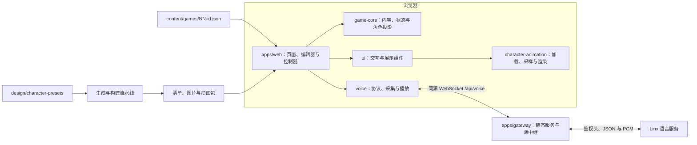

# LIE 架构设计与模块接口

本文介绍 LIE 的模块职责、依赖关系与对外接口，覆盖工作区包的公开 API、应用内部协作接口，以及 Worker 的 HTTP 和 WebSocket 接口。

## 总体结构与数据流

游戏内容、单局状态、历史、计时和指认在浏览器运行。云端仅提供静态资源与语音传输，不保存游戏进度或判定输赢。没有游戏数据库，也没有跨玩家共享的游戏会话对象。



一轮交流的数据流为：控制器建立当前人物的 `ConversationScope` → 适配器检查语音可用性并准备传输/播放器/麦克风 → 服务通过端侧 MCP 读取该人物上下文 → PCM 双向流动，STT/TTS 事件投影为人物历史和视图 → 用户切人、停止或指认时关闭旧作用域。计时和指认由程序执行，模型只生成角色表达。

| 模块 | 责任与依赖 | 对外边界 |
| --- | --- | --- |
| `apps/web` | 页面、路由、编辑器、游戏编排；依赖 core、ui、voice | 应用内部 `GameController`、`VoicePort`，不作为工作区公共包发布 |
| `@lie/game-core` | 内容校验、确定性状态转换、角色上下文；不依赖 Vue、网络或文件系统 | 包根导出 content/session/context；另有 `@lie/game-core/content` 子路径 |
| `@lie/ui` | 无案件规则的展示组件；依赖 Vue、character-animation | 组件与展示类型从包根导出，样式通过 `@lie/ui/style.css` 引入 |
| `@lie/voice` | Linx WebSocket/MCP、PCM 编解码、麦克风与播放 | 包根导出 channel、PCM、player、microphone 与观测类型 |
| `@lie/character-animation` | 非可执行动画包校验、确定性采样、浏览器加载与 Canvas 渲染 | 包根导出解析器、时间线、渲染器、加载器和类型；另有 `@lie/character-animation/contract` 子路径 |
| `apps/gateway` | Worker 静态服务、供应商凭据与双向中继 | HTTP/WS 路由；源码另导出 `relaySockets` 供测试 |

包的准确导出以各自入口为准：[core](../packages/game-core/src/index.ts)、[ui](../packages/ui/src/index.ts)、[voice](../packages/voice/src/index.ts)、[animation](../packages/character-animation/src/index.ts)。

## game-core：内容、状态与角色投影

### 内容输入

`validateGame(data: unknown): GameDefinition` 校验并返回规范化快照。它保留原始文本，不自动 trim；未列入契约的输入字段不进入返回值。失败抛 `ContentValidationError`，携带 `issues: { path, message }[]`，当前在首个错误处停止。

| 类型/字段 | 规格 |
| --- | --- |
| `GameDefinition` | `id`、`title`、`background`、`interrogationLimitSeconds`、`characters`、`ending`；可选 `summary` |
| `CharacterDefinition` | `id`、`name`、`profile`，以及 `appearanceId: string \| null` |
| 文本与引用 | 必填文本非空；人物数组非空，人物 ID 在本案内唯一；`ending.culpritId` 必须引用一个人物 |
| 时长 | 正安全整数秒；人物数由内容决定，没有三人固定限制 |
| 形象 | core 只保留 ID，不查询素材库；缺失或 null 规范化为 null |
| 结局 | `ending: { culpritId, reveal }`；完整真相为纯文本，不交由模型判定输赢 |

```ts
loadGame(gameId: string, read: (gameId: string) => Promise<unknown>): Promise<GameDefinition>
buildCharacterContext(game: GameDefinition, characterId: string,
  history: readonly DialogueEntry[]): CharacterContext
```

`loadGame` 由调用者注入读取逻辑，另校验实际 `game.id` 等于请求 ID。`buildCharacterContext` 输出 `background`、当前人物 ID/姓名/profile、复制后的 history 与 systemPrompt；不加入其他人物 profile 或 ending。调用者必须传入该人物的历史。该投影是模型输入隔离，完整故事仍在浏览器可查，不是反作弊或内容保密边界。

来源：[内容契约](../packages/game-core/src/content.ts)、[上下文装配](../packages/game-core/src/context.ts)。

### 状态接口

不原地修改输入，会话更新由返回值交付；幂等忽略可返回原对象。会话 ID、墙钟时间与耗时由调用者提供，core 不持有定时器。

| 公开函数 | 输入 → 输出与约束 |
| --- | --- |
| `createGameSession(game, { sessionId, now })` | 重新校验内容并创建 `intro`，各人物历史为空 |
| `startSession(session, now)` | `intro → interrogating`，默认选第一位人物 |
| `selectCharacter(session, characterId)` | 仅 interrogating，切换当前人物，保留各人历史 |
| `appendDialogue(session, characterId, entry)` | 仅当前人物且 interrogating；相同 entry ID 幂等忽略 |
| `consumeInterrogationTime(session, elapsedMs)` | 有限非负毫秒，累计并钳制到总额度；到期本身不改变 phase |
| `getInterrogationRemainingMs(session)` | 返回非负剩余毫秒 |
| `accuse(session, characterId, now)` | interrogating → solved/lost；错误结果 `reveal: null` |
| `endSession(session, now)` | interrogating → ended，不自动指认 |
| `restartSession(session, identity)` | 基于同案新建 intro、空历史和新会话身份 |
| `getCharacter(game, characterId)` | 返回人物，未知 ID 抛错 |

`DialogueEntry` 为 `{ id, role: 'user' | 'assistant', text, at, interrupted }`。`GameSession` 包含 game 快照、phase、当前人物 ID、按人物分桶 histories、已用毫秒、result 与生命周期时间。非法阶段、未知人物、非当前人物写入分别抛 `GameStateError` 的 `invalid-phase`、`unknown-character`、`inactive-character`；非法耗时抛 `RangeError`。[实现与完整类型](../packages/game-core/src/session.ts)。

## apps/web：控制器与语音协作接口

### 控制器

`createGameController(options): GameController` 接收 `readGame(gameId)`、`voice: VoicePort`、`newSessionId()`、`now()`；可选 `clock` 提供单调时间与定时器，可选 `resolveVoiceId(appearanceId)` 将形象映射到音色。它是应用内部接口，不是网络 API。

| 方法 | 行为 |
| --- | --- |
| `load(gameId): Promise<void>` | 停旧语音并加载；loadEpoch 拒绝过期加载结果，失败进入 failed 视图 |
| `start()`、`selectCharacter(id)` | 进入询问或切人；正在交流时切人关闭旧连接，并尝试续接新人 |
| `startConversation(): Promise<void>`、`endConversation()` | 准备/开启持续交流，或结束交流并结算计时；结束交流不结束游戏 |
| `openAccusation()`、`closeAccusation()`、`accuse(id)` | 仅 interrogating 可打开，打开前停语音；仅打开指认面板时接受 accuse |
| `end()`、`restart()` | end 令 core 进入 ended；restart 创建新会话并回到 intro |
| `getView()`、`subscribe(listener)` | 返回/推送 `GameView`，订阅即收到当前值；返回取消订阅函数 |
| `getVoiceFeedback()`、`subscribeVoiceFeedback(listener)` | 独立推送音量反馈，订阅即交当前值并返回取消订阅函数，避免重建完整视图 |
| `getRemixSource()` | solved/lost 时返回内容快照，其他状态为 null |
| `dispose()` | 作废加载与连接、关闭语音、清空订阅；页面退出需调用 |

`GameView` 只提供展示所需 title/background、人物公共列表、当前人物 history、计时、语音状态、busy/notice、指认面板与结果。不会公开人物 profile 和完整 game；只有 solved 显示 reveal。内部 session 的完整内容仍在浏览器内存。准备连接时 busy，`open()` 完成后才计时；语音启用期间等待、停顿和回复都计入共享额度。到期关闭语音、打开指认，不自动判负。旧连接的事件须同时满足 session、character、epoch 和 AbortSignal 所有权检查。[控制器源码](../apps/web/src/application/controller.ts)。

### VoicePort 与事件

```ts
interface VoicePort { create(scope: ConversationScope): Conversation }
interface Conversation { open(): Promise<void>; close(): void }
```

`ConversationScope` 包含 `sessionId`、`characterId`、`voiceId: string | null`、`epoch`、`signal: AbortSignal`、`isCurrent()`、`readContext(): CharacterContext` 和 `onEvent(event)`。`open` 在传输、播放和采集均就绪后完成；`close` 负责释放资源，真实适配器实现幂等关闭。注入替身须遵循同一作用域约束。

| `ConversationEvent` | 控制器消费方式 |
| --- | --- |
| `userText { text }` | 写入当前人物用户历史，进入 waiting |
| `assistantText { text }`、`speaking` | 累加临时回答/进入 speaking；不把每段都当独立最终条目 |
| `listening`、`interrupted` | 提交临时回答，后者标 interrupted，回到 recording |
| `audioLevel { inputLevel, outputLevel, inputActive }` | 单独发布线性 RMS 与本地输入活动估计；不是服务端 VAD |
| `closed`、`error { reason?: 'context-too-large' }` | 停连接，保留已显示历史，给出重连或容量提示 |

真实适配器先 GET `/api/voice/status`，随后并行准备 channel、播放器 AudioContext 与麦克风，全部成功才 listen.start 并转发采集帧。端侧工具 `self.lie_character_context` 无参数，返回当前作用域上下文 JSON。TTS stop 与本地播放排空共同决定回到聆听，STT 打断时清空旧播放。`VoiceAvailabilityError` 区分 unavailable 与 check-failed；容量超限不静默截断上下文。没有自动切替身或隐式重连。[接口](../apps/web/src/application/voice.ts)、[真实适配器](../apps/web/src/application/liveVoice.ts)。

### 页面、编辑器与分享

入口 [main.ts](../apps/web/src/main.ts)组装依赖，[Application.vue](../apps/web/src/Application.vue)管理首页 `/?game=<id>`、`/editor`、内存快照试玩 `/editor/preview`、分享 `/play#game=…`。试玩快照刷新后不恢复，返回编辑器；活动调查离开前需确认。`demo=1` 只在 Vite DEV 启用替身，不采麦克风，生产忽略。

| 内部接口 | 输入输出/生命周期 |
| --- | --- |
| `createDraft(appearanceId?)`、`createRemixDraft(game)` | 返回可编辑 `EditorDraft`，含 summary；改编产生新 game ID，人物/结局引用保持匹配 |
| `draftIssues(draft, presets)`、`draftGame(draft, presets)` | 前者返回 step/field/characterId/message 定位，后者先检查可玩性必填与有效形象，再 core 校验；缺简介不阻止试玩 |
| `saveDraft(storage, draft)`、`loadDraft(storage)` | localStorage key `lie-editor-draft`；允许未完成草稿，恢复检查可编辑形状、旧 summary 补空；JSON/存储失败抛错 |
| `encodeGameLink(game, baseUrl): Promise<string>` | core 校验后 UTF-8 JSON → gzip → base64url；生成 `/play#game=…`，完整 URL 上限 16,000 字符 |
| `decodeSharedGame(fragment, presets): Promise<GameDefinition>` | fragment 限长、gzip 有界解压、UTF-8/JSON/core 校验，非 null appearanceId 必须存在；不导入任意素材 URL |
| `prepareSubmission(game, sequence?)` | 要求非空 summary、安全 ID 和正序号；返回 `{ filename, json, url }`，建议 `content/games/NN-id.json` 与 GitHub 新文件页 |

分享原文与生成时压缩结果各受 128 KiB 上限；解码限制解压后的字节，Application 另检查完整 URL 长度。16,000 为产品预算，跨浏览器极限矩阵尚未全验。fragment 不随正常 HTTP 请求发给服务端，但接收者可解码全文，链接不是加密或访问控制。草稿只保存在当前浏览器；不含账号、云同步或上传素材。投稿由作者在 GitHub 确认，再经维护者审核，不获取 token 或自动创建 PR。[草稿](../apps/web/src/editor/draft.ts)、[分享](../apps/web/src/editor/share.ts)、[投稿](../apps/web/src/editor/submission.ts)。

## voice：协议与音频公开接口

```ts
createVoiceChannel(options: VoiceChannelOptions): VoiceChannel
// VoiceChannel
open(options?: { signal?: AbortSignal }): Promise<void>
startInput(): void
input(data: Uint8Array): void
stopInput(): void
interrupt(): void
close(): void
```

`VoiceChannelOptions` 必填 `tools: readonly VoiceTool[]` 和 `onEvent`；可注入 `createSocket`、handshakeTimeoutMs/toolTimeoutMs（均默认 10 秒）、listenMode（默认 realtime）、voiceId 与 onStartup。`VoiceTool` 包含 name/description/inputSchema，以及 `execute(argumentsValue, signal): Promise<string>`。同连接重复 RPC ID 不重复执行，关闭取消未完成工具；工具失败发送 MCP isError 结果及 tool 错误事件，不直接由 channel 关闭连接。出站 JSON 按 UTF-8 计算，上限 65,536 bytes，超限产生 payload-too-large 并关闭，不截断角色资料。

连接只允许 open 一次。完成 hello 音频协商后，空 tools 无需等待注册，非空 tools 还需完成 tools/list 注册响应才 ready；可注入 `VoiceSocket` 做协议替身。默认 socket 使用同源 `/api/voice`，HTTPS 对应 WSS。`startInput` 发 listen.start，manual 等 stopInput，realtime 使用供应商 VAD；stopInput 不等于停止麦克风。interrupt 发送 abort 并发 interrupted，调用者还需停本地播放。

`VoiceEvent` 包括 ready(format)、stt(text)、tts(start/sentence/stop，stop 含 aborted)、audio(Uint8Array)、tool(start/end/name)、interrupted、closed(code/reason)、error(code/message)。error code 为 connection/protocol/timeout/tool/payload-too-large。只在 ready 且当前 TTS 有效期间接收二进制音频，关闭后不继续发事件数据。[完整类型](../packages/voice/src/types.ts)、[协议实现](../packages/voice/src/channel.ts)。

| 公开函数 | 规格与资源所有权 |
| --- | --- |
| `createPcmEncoder(inputSampleRate, onFrame)` | 输入 ≥16 kHz Float32，`push(samples)` 加权单声道重采样，输出 PCM16LE/16 kHz/20 ms，每帧 320 samples、640 bytes；`flush()` 静音补齐末帧 |
| `decodePcm16(data)` | PCM16LE → Float32Array，奇数字节抛错 |
| `openMicrophone(options)` | 必填 onFrame，可选 signal/onLevel 与采集工厂；安全上下文和用户手势下请求音频，AudioWorklet 混为单声道后编码；返回异步幂等 `stop()`，负责 track/worklet/context/blob URL 清理 |
| `createPcmPlayer(context, onIdle?, onLevel?)` | `enqueue(data, format)` 仅 PCM16 mono 16 kHz；按 AudioContext 排队，排队已超 30 秒时清空并报错；`stop()` 清空节点/音量采样，context 由调用者恢复和关闭 |

input 帧长度必须恰好 640 bytes；协商只接受 PCM16 mono 16 kHz。麦克风和播放器音量为线性 RMS，约 50 ms 采样；不是唇形数据。[PCM](../packages/voice/src/pcm.ts)、[麦克风](../packages/voice/src/microphone.ts)、[播放器](../packages/voice/src/player.ts)。

## character-animation：动画数据与播放接口

动画 JSON 为非可执行数据，包含 `schemaVersion`、canvas、assets、nodes、clips、states、transitions。nodes 按父先子后排列，绑定位图部件；Transform 含 x/y、pivotX/Y、rotation（度）、scaleX/Y；轨道对变换或 visible 做关键帧采样。assets 只引用包内 `parts/<slug>.png|webp`。[类型](../packages/character-animation/src/types.ts)。

- v1 只接受 default/listening/waiting/speaking 四基础态；v2 在四态必需的基础上允许 accusedCorrectly/accusedWrongly 各自可选。当前八套正式形象都具有六态，但这不是所有包必须六态的要求。
- transitions 的 from/to 仅基础态，转场 clip 和结果 clip 均非循环；缺专用转场时，时间线采用 240 ms 姿态混合。
- 解析器检查未知字段、版本、引用、顺序、关键帧与预算：最多 32 assets，canvas 加 assets 总像素 ≤32×1024×1024，单维 ≤8192。错误抛 Error，先拒绝再播放。

| 包根公开接口 | 输入输出与约束 |
| --- | --- |
| `readAnimationPackage(value: unknown): AnimationPackage` | 解析并校验上述契约 |
| `new AnimationTimeline(data, state = 'default')` | `setState(state)` 拒绝缺态，同态不重播；`advance(seconds): AnimationPose` 只接受有限非负增量；finished 表示非循环主 clip 已到末帧 |
| `sampleClip(data, clip, seconds)`、`blendPoses(from, to, progress)` | 独立确定性姿态采样/混合；循环取模，非循环钳制末帧；调用者提供有效数据 |
| `loadAnimationPackage(url: URL, signal: AbortSignal)` | 返回 `Promise<{ data, images }>`；最多并行三部件，校验 PNG/WebP 尺寸并解码为 HTMLImageElement，撤销 object URL；失败/取消中止并清理 |
| `createCanvasRenderer(canvas, data, images)` | 返回 render(pose)/dispose()；依层级变换、绘制顺序、裁切/遮罩渲染，无 Canvas 2D 或缺图时抛错 |

加载器是浏览器能力，解析器与时间线可独立使用。宿主应取消过期加载、管理 RAF/可见性并 dispose renderer；`AnimatedPortrait` 已封装这些职责。[解析](../packages/character-animation/src/package.ts)、[加载](../packages/character-animation/src/load.ts)、[播放](../packages/character-animation/src/playback.ts)、[渲染](../packages/character-animation/src/canvas.ts)。

## ui：组件输入、事件与插槽

这些组件不保存游戏真相或调用供应商。业务状态由应用传入，组件将用户动作通知应用。类型完整定义在各组件源码。

| 组件 | 主要 props | 事件 / slots |
| --- | --- | --- |
| [ProductHeader](../packages/ui/src/components/ProductHeader.vue) | title?: string/null | navigateHome；title/actions/notice |
| [UiButton](../packages/ui/src/components/UiButton.vue) | variant: primary/secondary/quiet，disabled，busy | 原生 button click 透传，非自定义 emit；default slot；busy 时禁用 |
| [CharacterChoice](../packages/ui/src/components/CharacterChoice.vue) | name，description，selected，disabled | 原生 button click 透传；avatar slot，默认姓名首字 |
| [Transcript](../packages/ui/src/components/Transcript.vue) | messages: readonly TranscriptMessage[]，animate=false，emptyText | 只读，无提交事件；无业务输入 slot |
| [VoiceControl](../packages/ui/src/components/VoiceControl.vue) | status、label 必需；active/preparing、actionLabel/cancelLabel/interruptLabel、disabled、inputLevel/inputActive 可选 | start/cancel/interrupt；details/answer |
| [UiDialog](../packages/ui/src/components/UiDialog.vue) | open，title | close（包括 Escape）；default/actions；父层更新 open |
| [UiNotice](../packages/ui/src/components/UiNotice.vue) | tone: info/error，默认 info | default slot |
| [AnimatedPortrait](../packages/ui/src/components/AnimatedPortrait.vue) | src: string/null，state: AnimationState；label 默认“人物形象”，fit 默认 crop，可选 contain | default 静态回退、loading 插槽；无自定义事件 |

`TranscriptMessage` 为 id/speaker/text，可选 mine/avatar/interrupted/pending；`VoiceStatus` 为 idle/recording/waiting/speaking/error。VoiceControl 的 start 是动作事件，是否开始或结束由应用当前 active 状态决定；组件不直接操作麦克风。

AnimatedPortrait 限同源动画 URL，src 变化、卸载或 reduced-motion 会取消加载/RAF；后台暂停，恢复不补算后台时间。基础态变化复用时间线。结果动作一次展示后停帧，reduced-motion、缺态或失败使用静态回退；调用方通过结果阶段组件卸载/新挂载界定下一次展示，不能依赖重复赋同态重播。

## gateway：网络路由、缓存与中继

Worker 的实际接口为 `fetch(request, env): Promise<Response>`，依赖 ASSETS binding 与三项私密 Linx binding（token、device、agent）；不将其下发浏览器。当前应用访问鉴权按用户决定临时关闭，Origin 检查不是用户身份认证。代码不依赖完整 Node.js 服务器运行时。[入口](../apps/gateway/src/index.ts)、[宿主配置](../apps/gateway/cloudflare.config.ts)。

| 路由 | 行为与错误 |
| --- | --- |
| GET `/api/health` | `{ status: 'ok', storage: 'none' }`，no-store；不代表供应商可用 |
| GET `/api/voice/status` | `{ status: 'ready' \| 'unavailable' }`，仅检查三项 binding 是否存在，no-store；有 Origin 则须同源，拒 Sec-Fetch-Site: cross-site 和任何 query（403） |
| GET `/api/voice` | 要求 Upgrade: websocket（否则 426）；Origin 必须精确同源且无 query（403）；binding 缺失 503，上游握手失败 502，成功 101 |
| 其他 `/api/*` | JSON 404，不回落到 SPA |
| `/static/*`、`/assets/*` | ASSETS 响应须为 200/206/304、合法内容地址且不是 HTML；否则 404/no-store。成功设一年 public immutable；304 缺 Content-Type 时用 HEAD 检查元数据 |
| `/games/*` | 兼容静态路径 guard；非 304 且非 application/json 返回 404。当前官方案件已打入前端，不从这里加载 |
| 其他路径 | 交给 ASSETS；配置启用 SPA fallback，为 /editor、/play 等入口服务 |

内容地址要求 `/static/<64位小写hex>/…`，或 `/assets/<name>-<hash>.js|css`。HTML 及其他普通资源不由这一 guard 强设 immutable；不可让缺失资源的 SPA HTML 获得长缓存。

中继上游固定为 Linx WS 地址，服务端附鉴权与设备/agent/protocol/client headers，握手超时 10 秒。`relaySockets(browser, upstream)` 一连接一对 socket，双向透传文本和二进制；任意帧 UTF-8/二进制大小 >65,536 bytes 关闭 1009，最多持续 180 秒（1000），发送/错误关闭 1011。一端关闭结束另一端，1005/1006 分别转 1000/1011。它不解析案件规则，不提供复用连接池、自动重连、并发调度或账户级费用硬限额。浏览器共享询问额度可跨多个连接累计，不能与单连接 180 秒混为一谈。

## 内容与资源流水线

### 官方内容和形象

`content/games/NN-<id>.json` 是官方案件唯一内容源，至少两位正安全整数编号，按数值排序；重复编号（含 01/001）、重复 ID、文件 ID 不匹配或无非空 summary 明确失败。`readOfficialCases(sources)` 返回 `OfficialCase[]`，每项 `{ sequence, game }`；`bundledCases` eager glob 同时供目录投影和 `readBundledCase(id)` 使用，未知 ID 抛错。新增同玩法案件只加 JSON，无单独 registry、公有内容副本或 engine 改动。当前四案人数/秒数分别为 3/480、4/600、4/540、3/480。[作者规格](../content/games/README.md)、[官方读取器](../apps/web/src/application/officialCases.ts)、[打包入口](../apps/web/src/application/bundledCases.ts)、[目录投影](../apps/web/src/application/catalog.ts)。

`design/character-presets/manifest.json` 与相对 PNG/animation 包是人物制作源。生成器 `syncCharacterPresets({ sourceDirectory?, outputDirectory?, check? })` 校验 ID、固定路径、普通文件/目录隔离、PNG 画布、声音配置、动画引用与预算，输出 `apps/web/public/appearances` 的运行时清单和资源。--check 比较已有输出，不作为来源反写。生产 URL 由构建另派生。[生成器](../scripts/character-presets.mjs)。

`readCharacterPresets(data)` 输出 `CharacterPreset[]`：id/name/avatar/portrait/accent、voiceId/animation 可 null，portraits 含基础状态与可选结果图；故事以 appearanceId 引用，不复制美术或声音。它校验 animation 为当前形象的本地或 immutable package 路径。应用的 [createCharacterPresetLoader](../apps/web/src/presentation/characterPresetLoader.ts)返回 `{ state, load, cancel }`，state 含 presets/status；`load(): Promise<readonly CharacterPreset[] | null>` 共享在途请求，默认 8 秒超时覆盖响应体解析，失败置 failed 并返回 null，可重试；cancel 中止在途请求。[运行时类型](../apps/web/src/presentation/characterPresets.ts)与制作源字段含义不同，接入者勿直接把源相对路径当运行 URL。

### 生产派生与检查

1. Web prebuild 生成固定 PNG/清单，保留原始制作源。Vite 资源插件调用 `fingerprintAssets(publicDirectory, { optimizeImage? })` 收集人物与品牌资源，图片按源 bytes 去重、最多两个编码 worker，返回 `{ urls, outputs, manifestUrl, imageStats }`，分别提供源 URL 映射、输出字节映射、派生清单地址与图片处理统计。
2. 固定工具的 WebP q90 编码采用 `-q 90 -m 6 -alpha_q 100 -metadata icc`；检查尺寸与完整 alpha，缓存键绑定源/工具/策略身份。超预算、不支持元数据或无体积收益等场景保留 PNG 并报告；损坏源不伪装成功。
3. 根据实际输出扩展名改写动画包相对 parts；以最终路径/长度/bytes 对完整包目录取 hash，其余静态资源按最终 bytes 取 hash；清单引用最终 URL 后再 hash。虚拟模块 `virtual:lie-preset-manifest` 输出运行时清单 URL，开发指向固定清单。Vite 随后生成带 hash 的 JS/CSS。
4. Web postbuild 检查固定输出与制作源一致；构建过程/测试守卫验证官方 JSON、资源引用和派生契约。CI 运行类型、覆盖率、真实 Web/Gateway 构建、部署 dry-run 与发布产物打包。CD 校验上游 SHA/产物/最新 main 后部署同一已验证产物，不重新构建。

实现入口：[静态资源插件](../apps/web/build/static-assets.mjs)、[图片优化](../apps/web/build/image-optimize.mjs)、[图片格式校验](../apps/web/build/image-codec.mjs)、[工具固定](../apps/web/build/image-tools.mjs)、[CI](../.github/workflows/ci.yml)、[CD](../.github/workflows/cd.yml)、[产物交接](../scripts/ci-release.mjs)。这些是构建期 Node.js 接口，不可放入浏览器或假定 Worker 兼容同样的文件系统/子进程能力。

## 接入与验证边界

修改包接口时同时检查其直接消费者：core → controller/editor/official reader，voice → liveVoice，animation → generator/AnimatedPortrait/build，ui → App/Editor。接口规格可由 [core tests](../packages/game-core/test)、[voice tests](../packages/voice/test)、[动画 tests](../packages/character-animation/test)及 [Web tests](../apps/web/test)核对；测试替身证明协议和状态处理，不证明真实模型推理、听感或多用户容量。

分享跨浏览器极限、四案完整真实模型/盲测、多用户隔离与账户费用控制仍须独立验证，不因接口完备而视为完成。
