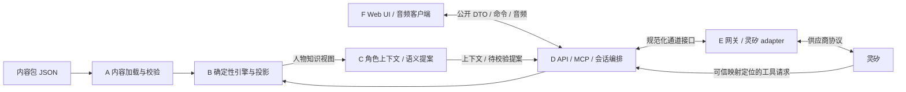

# LIE — 内容驱动的多游戏架构

更新：2026-10-23。本文为可评审的架构设计，尚未实现。

## 目标与承诺

用户已确认：首版交付一个游戏，但从开始就具备多游戏抽象；后续新增游戏应只需要设计故事、人物等游戏内容。首发为桌面浏览器 Web，首案有三名嫌疑人，使用灵矽提供模型和语音，近期交付窗口为 2–3 天。

本次将“游戏”定义为使用同一套自由审讯、证据核查与出示、提交推理、结算流程的一个独立故事。**增加这种游戏，只新增内容包和部署配置，不修改通用引擎、界面或供应商适配代码。** 角色数量、证据数量、证明组合和剧情推进条件均由内容定义；三人是首案配置，不是引擎常量。首版可以没有游戏目录页面，但创建会话必须显式选择游戏及版本。

增加全新核心玩法（例如场景漫游、多人实时协作、即时动作或新的规则操作）可能需要扩展引擎。该边界不影响同玩法下新故事的无代码增量要求。先用静态 JSON 内容包、固定规则操作和简单加载器，不建设编辑器、任意脚本系统或插件 SDK。

最终案件、具体玩法、模块边界与部署方式仍待确认。前端已确定 Vue + TypeScript；如需服务端或 Worker，采用 TypeScript 并优先 Node.js 技术生态。本文以现有玩法提案为接口设计参考，不将其中的按钮交互、证明表单或提示规则视为已批准决定。

技术基线：F 模块的组件和浏览器交互使用 Vue + TypeScript；内容契约、规则引擎与角色上下文使用独立 TypeScript 模块，不依赖 Vue、DOM 或 Node.js 专属 API。编排与供应商适配通过接口连接这些模块，运行时特有的网络、配置与存储实现留在边界。这样前端、Node.js 和候选托管环境可以复用规则及其自动化测试。

Node.js 是服务端优先运行环境；若选择 Cloudflare Workers，须验证实际使用的 Node.js API 和 npm 依赖，不把兼容层等同于完整 Node.js 运行时。构建工具、组件库、具体运行版本与部署供应商不因本次技术基线而自动定案。

**部署形态补充（待评审）：** 用户希望最终提供在线体验，并优先避免传统服务端运维。以下“服务端”描述可信执行与信息边界，不要求常驻进程、虚拟机或独立部署服务；托管 Worker/function 是候选承载方式。纯前端引擎在计算上可行，但灵矽浏览器鉴权、凭证交付和角色状态通道尚需核实；对浏览器隐藏答案也是当前设计提案的取舍，不能把它误记为用户已经提出的防作弊需求。部署选项见 [部署预研](deployment-options.md)，当前未选定平台。

| 待确认的运行方式 | 模块落点 | 主要取舍 |
| --- | --- | --- |
| 浏览器游戏 + 薄托管网关 | A/B/C 和本局编排在浏览器；E 的凭证与握手部分在托管 Worker；端侧 MCP 经语音连接交给浏览器 | 可减少共享存储和云端 MCP，偏向测试部署简单；内容包答案可被开发者工具查看。端侧 MCP、设备分配、语音和记忆仍需验证 |
| 托管游戏 + 浏览器公开界面 | A/B/C/D 在可信托管环境，E 处理灵矽通道，F 仅接收公开视图 | 能将答案和状态留在托管端，但跨请求与云端 MCP 要有一致的会话状态实现 |

下表的 D/API 和秘密投影细节以第二种方式为参考设计，不代表该部署方式已获确认。采用第一种方式时，D 的本局编排是浏览器内的应用接口，端侧 MCP 读取该局角色视图，不额外建设云端游戏 API/数据库。A/B/C 保持纯逻辑，避免运行位置变化要求重写规则；所有模式都不向浏览器交付平台管理 API key。

**实现前确认关口：先由用户确认本文的模块边界、主要接口、并行顺序和复用范围，再开展具体开发。** 在此之前可继续收集需求、评审内容与技术资料、修改方案；不把评审草稿当作编码授权。具体框架若会显著改变部署或接入方式，也需确认。

## 模块拆分与独立验证

以下是逻辑模块和文件所有权边界，不要求拆成多个服务或独立部署。首版可以在一个仓库、一个服务端进程内组织。自动化优先覆盖规则、隔离、竞态和关键用户流程；不为文档或微小配置添加低价值测试。

| 模块 / 可并行工作包 | 职责与输入 → 输出 | 依赖 | 独立测试与替身 |
| --- | --- | --- | --- |
| A 内容与校验 | JSON 内容包 → 校验后的内部 `GameDefinition`、定位到字段的诊断；管理版本注册表 | 共享内容契约；路径验证使用 B 的纯转换能力 | 自动化校验合法双内容包、坏引用、未知操作、明显循环依赖与版本锁定；运行作者提供的解题路径夹具，检查必要线索与有效结案可达；不需模型，不等于全路径证明 |
| B 确定性引擎 | 定义 + 旧 `GameSession` + 已授权命令 → 新状态、领域事件、`PublicGameView` 与按人物过滤的知识视图 | 共享内容与规则契约，不导入 A 的加载器 | 自动化验证证据/披露状态、不同问序对应动作、有效与无效结案、跨包隔离；对公开及人物投影做秘密字段和未知事实排除检查；用固定输入，无网络 |
| C 角色上下文与语义提案 | 人物知识视图 + 本人历史 + 当前轮输入 → `CharacterContext`/提示词、受限 `SemanticProposal`；不直接写状态 | B 的只读视图；共享提案契约 | 自动化验证人物知识、谎言/改口权限和历史选择；fake 提案解析器覆盖越权、虚构证据、未知 ID、格式错误。真实角色一致性另行评估 |
| D 会话编排与 API/MCP | 浏览器命令、人物通道事件、可信 MCP 请求 → 调用引擎、持久化状态、公开响应及人物工具响应；拥有认证授权、映射、动作幂等与事件顺序 | A、B、C；E 的接口 | 用内存会话仓库和 fake provider 自动化测试重复命令、过期版本、切人/重开竞态、旧局/旧人物/旧通道事件拒绝、MCP 伪造参数与故障恢复 |
| E 语音网关与灵矽适配 | 人物通道配置、角色上下文、音频/文本、停止指令 → 规范化 STT/TTS/音频/错误事件；管理供应商连接及部署绑定 | 共享 provider 契约；真实服务仅在集成时依赖 | 用协议夹具/仿真 WebSocket 自动化测试握手与事件转换、音频格式、乱序、重复、断流、打断清队列、重连；真实录制须脱敏且取得后再加入回放 |
| F Web 界面与音频客户端 | 仅 `PublicGameView`、公共事件与用户输入 → UI、游戏命令、音频上传/播放；不接触内部定义和人物私密上下文 | D 的公开协议 | 用 fake API、虚拟麦克风和音频播放替身自动化覆盖两人/三人渲染、获取/出示/结案/重开流程、权限失败、打断、切人后丢弃旧音频；真实设备声音体验另验 |

状态写入的最终规则只在 B；持久化、授权和顺序只在 D；C 和 E 不反向决定游戏事实。A 的发布验证可以调用 B 的纯规则转换能力运行解题路径夹具，但不得依赖运行中的 API 或供应商。共享契约在物理上保持轻量，前端构建只能导入其中的公开 DTO，不能通过一个大包间接打包内部内容。



图中 D→B 表示请求转换；B→C 表示过滤后的数据流，不是引擎调用模型。模型产生的语义提案经 D 转为候选命令，再由 B 校验；供应商只能从专门的 MCP 接口获取被许可的信息。

## 接口先行与并行集成顺序

用户确认架构后，先由主代理协调一份最小契约再分发实现任务，避免各代理独立猜测边界：

- 内容契约：`GameDefinition`、规则操作表、内容版本与错误诊断。
- 内部运行契约：`GameSession`、`GameCommand`、`DomainEvent`、人物知识视图、`CharacterContext` 和受限 `SemanticProposal`。引擎转换保持可重复：时间和外部标识显式输入，不在规则中隐式取系统时间或调用模型。
- 浏览器公开契约：建局/查询/命令的请求与 `PublicGameView`、成功与错误结果。内容包分别定义可公开的 `hypotheses`/关系候选（含正确与错误候选及显示条件），以及仅服务端读取的 `acceptedProofs` 答案组合；投影按条件输出候选描述，不能输出“哪组正确”、答案引用或从真实证明组合直接生成选项。动作携带 `commandId`、`expectedRevision`，人物事件携带局、人物与通道代次。服务端自行验证会话归属，不以客户端标签代替授权。
- Provider 契约：开始/输入/停止/关闭通道；统一事件包含 `sessionId`、`characterId`、`connectionEpoch`、轮次与事件序号，以及识别文本、回答文本、音频参数/帧、结束或错误。服务端内部关联平台 ID，浏览器不接触平台凭证。

接口先以文档和少量合法/非法样例评审；实现阶段再落成类型或 schema。契约负责人由主代理指定，变更先通知所有消费者，禁止各模块各写一份不一致的 DTO。

| 顺序 | 工作与并行安排 | 集成完成条件 |
| --- | --- | --- |
| 0 | 用户确认架构与相关玩法；确定最小契约、文件所有权和检查命令 | 关键边界无歧义，未决事项有明确阻塞范围 |
| 1 | A+B 为一个基础工作包；E 基于协议替身独立开发；F 基于公开 DTO/fake API 开发。主代理维护接口和集成队列 | A+B 可运行两个测试包；E、F 分别通过边界测试。并行度按可用代理数量安排 |
| 2 | C 在人物知识视图稳定后推进；D 以 A+B 和 fake C/E 串起端到端状态流程。F 接上 D，E 的真实链路验证可独立继续 | 不依赖真实模型即可完成建局、证据、结案、重开和隔离回归 |
| 3 | 接入 C/E 的真实灵矽链路，逐步验证单人物→证据同步→多人物→跨局；最后以正式内容盲测 | 真实接入记录、自动化回归和内容试玩分别通过；不可用能力明确处理 |

每个工作包在独立 worktree 中完成，由发起者本地 review 后，按 [AGENTS.md](../AGENTS.md) 的串行集成流程合入本地 `main`；关键版本或里程碑才集中 push。上游模块可以先交付固定契约与夹具，下游不必等待全部上游代码；接口变化或用户新想法涉及多个模块时，由主代理先评估影响并重排任务。

真实 provider 未就绪不阻塞 A/B、公开投影、API、UI 和音频状态机的确定性测试。fake provider 必须支持可控延迟、工具失败、乱序事件、旧通道回包与重连，不能只返回一段正常回答。其通过只证明我们自己的边界行为。另列两项必须实际执行的验收：固定场景的真实 AI 扮演评估（自由改写、逼问、虚构材料、知识越界、允许改口），以及真实浏览器/设备上的语音集成（识别、首音、打断、回声、平台记忆、MCP 时序和重开）。不承诺 fake 或协议回放等同于真实服务验证。

## 内容定义与运行状态

服务端加载完整内容包，通用引擎产生浏览器可见的 `PublicGameView` 和当前人物可见的 `CharacterContext`。两种输出都通过明确字段构造；不能先发送完整内容再依赖前端隐藏或删字段。通用引擎、界面、提示词模板和 adapter 不包含首案角色名、证据 ID 或剧情专属分支；内容包不含凭证、平台 ID 或运行进度。

`GameDefinition` 是发布后不可变的内容版本，至少包含：

- 元信息：`schemaVersion`、`gameId`、`version`、语言、标题、介绍、调查目标和素材引用。
- 固定真相：事实、时间线、事件参与者、事实间关系与结案揭晓文案。
- 任意长度的人物集合：身份、公开介绍、表现风格、私有知识引用、允许的谎言与隐瞒、初始立场、允许改口的内容及前置条件。
- 证据：来源、正文、初始可见性、核查请求、获取条件、证明与反证关系；公开描述和私密说明分字段保存。
- 声明式规则：可用动作、条件与效果，包括线索开放、人物认知和立场变化、已更正证词、提示级别等。
- 结案候选与秘密答案分离：`hypotheses` 定义可显示的待判断结论/关系及显示条件，不标正确性；`acceptedProofs` 仅服务端保存可接受责任人、必须成立的结论及对应证据关系、主要替代解释的排除要求，允许多组有效组合。
- 提示与结算：提示条件、分级内容、结案反馈、缺失依据说明、放弃与成功后的揭晓内容。

`GameSession` 是单局可变状态：

- `sessionId`、锁定的 `gameId + version`、状态版本 `revision`、阶段与当前人物。
- 已获得证据、已执行核查、逐人物的已出示证据、可知信息、已允许改口及已确认的状态变化。
- 逐人物对话记录、原证词与更正记录、工具观察版本；不将各人物历史合成同一份模型上下文。
- 提示使用、结案提交与结果、开始与结束时间、已处理动作 ID。

固定事实永不由对话修改。状态保存“角色说了什么”“系统允许其承认什么”和“玩家已经获得什么”，而不是把每句台词当事实。角色表达出乎预期的承认，也不能跳过证明组合直接判胜。

标识规则：内容内部引用使用包内稳定 ID；所有跨包访问至少携带 `gameId + version`。运行操作以服务端已授权的 `sessionId` 为根，人物数据以 `(sessionId, characterId)` 定位。平台连接另有 `connectionEpoch` 区分重连与切换前后的事件。日志同时记录游戏版本、游戏 session、人物、状态版本及平台 session，避免同名证据、同名人物或旧事件串入另一局。新局生成新 `sessionId`，不复用旧运行状态。

## 规则与不可信输入

规则采用有限操作组成的数据表达式。例如条件支持 `all`、`any`、`not`、`hasEvidence`、`evidencePresented`、`flagIs`、`phaseIs`；效果支持 `grantEvidence`、`setFlag`、`allowDisclosure`、`recordCorrection` 和 `finishSession`。具体操作表随获批玩法收敛，未知操作在加载时直接报错，不能悄悄跳过。不得使用 `eval`、动态导入或内容携带的任意 JavaScript。

浏览器提交动作意图，例如“向当前人物出示 E1”；服务端验证会话归属、人物存在、证据已获得和当前阶段，再原子应用效果、递增 `revision` 并返回新公开视图。动作 ID 用于重试去重；提交包含预期版本，过期操作刷新后重试。结案必须读取服务端状态及内容包的证明规则。

玩家发言和模型工具参数均不可信。玩家说“我有监控”或“另一个人已经认罪”只形成对话输入，不会授予证据、修改真相或让其他角色获得真实秘密。若自由语言识别用于推进，只输出包内允许的候选意图或声明 ID，再由引擎校验前置条件；模型不能调用任意状态写接口。自然对话可以容纳质疑和说谎，但正式证据、改口状态及结案由受约束动作确认。

语义提案优先复用灵矽当前对话中的工具调用来提交，不另行假设存在独立的灵矽文本推理 API。C 模块构造上下文、解析受限提案并交给 B 校验；是否支持可靠的调用时序仍须实测。

## 内容包示例

以下仅展示结构，不是首案剧情，也不是已冻结的完整 schema。UI 从公开候选生成选项；服务端用独立的秘密答案判定，不能把正确组合一起投影。

```json
{
  "schemaVersion": 1,
  "gameId": "sample-missing-key",
  "version": "1.0.0",
  "presentation": {"title": "测试：钥匙去哪了", "objective": "确定谁保管钥匙"},
  "truth": {
    "facts": [{"id": "f-held", "text": "甲在交接后保管钥匙"}],
    "timeline": [{"id": "t-handoff", "at": "18:00", "factIds": ["f-held"]}]
  },
  "characters": [
    {
      "id": "a", "public": {"name": "甲", "role": "值班人"},
      "knowledgeFactIds": ["f-held"],
      "claims": [{"id": "c-denial", "text": "我没拿钥匙", "kind": "lie"}],
      "disclosures": [{"id": "d-admit", "factIds": ["f-held"], "corrects": ["c-denial"]}]
    },
    {"id": "b", "public": {"name": "乙", "role": "交接人"}, "knowledgeFactIds": ["f-held"]}
  ],
  "evidence": [{"id": "e-receipt", "initiallyAvailable": true, "public": {"title": "交接单", "text": "甲签收钥匙"}}],
  "rules": [{
    "id": "r-admit", "on": "presentEvidence",
    "when": {"evidencePresented": {"characterId": "a", "evidenceId": "e-receipt"}},
    "effects": [{"allowDisclosure": {"characterId": "a", "disclosureId": "d-admit"}}]
  }],
  "hypotheses": [
    {"id": "h-a", "label": "签收材料支持甲保管钥匙", "visibleWhen": {"hasEvidence": "e-receipt"}},
    {"id": "h-b", "label": "签收材料支持乙仍保管钥匙", "visibleWhen": {"hasEvidence": "e-receipt"}}
  ],
  "resolution": {
    "acceptedProofs": [{"characterId": "a", "hypothesisIds": ["h-a"], "requiredEvidenceIds": ["e-receipt"]}],
    "feedback": {"success": "交接单支持这一结论", "insufficient": "还缺少签收依据"},
    "reveal": "甲在交接后保管钥匙"
  },
  "hints": [{"id": "h-receipt", "level": 1, "text": "查看交接材料"}]
}
```

这里允许改口不代表模型必然在该轮说出改口；实际说出与否需结合对话事件确认、记录并测试。规则只开放该角色本来知道且在当前条件下允许透露的内容，不将整个 `truth` 注入角色。

## 秘密隔离与灵矽适配

浏览器只收到当前允许公开的字段：人物公开介绍、已获得证据、可执行动作、提示、对话与阶段允许的反馈。秘密事实、未来证据、证明答案、私有角色上下文、未到揭晓阶段的结算文案只留在服务端。内容包不得放进前端静态资源或构建产物。前端路由和网络接口也不提供“读取完整包”的入口。

`CharacterContext` 由服务端按人物知识、已正式出示的材料、当前披露权限和本人历史构造。通用提示词模板负责扮演约束，内容包提供人物资料；模板不能带首案名称和剧情。有限知识与提示词属于模型行为约束，仍需真实对抗问话验证，不能宣称仅靠过滤已解决模型幻觉。

Provider adapter 对上提供开始人物通道、发送音频或文字、停止、关闭、取得规范化事件等能力；服务端维护 `(sessionId, characterId, connectionEpoch) → (providerDeviceId, providerAgentId, providerSessionId)` 映射。云端 MCP 依据可信服务端映射识别局与人物，不能相信模型自报 `sessionId`。切换或结束后拒绝旧通道事件。

部署绑定独立于内容包，可按环境和人物映射灵矽 agent、音色、设备和接入参数；凭证来自服务端环境或私密配置。新故事的上架流程可以自动生成或绑定平台角色配置，但不能要求修改 adapter 源码；内容包不固定平台 agent ID。供应商配额、虚拟设备授权及配置操作仍是部署条件，不是故事逻辑。

[技术预研](technical-discovery.md) 推荐浏览器经 LIE 网关连接灵矽，分别处理人物通道和 MCP 状态读取。该推荐基于文档，**尚未实测**；浏览器音频、虚拟设备、长期记忆、新证据及时进入模型上下文和新局清理都需验证。三角色独立逻辑通道是首案接入建议，不允许将 adapter 实现固定成三条；连接策略要支持内容包的角色集合。平台会话不是游戏会话，单纯新建 WebSocket 不视为隔离已完成。

## 加载、版本与基础验证

服务启动或发布时从内容注册表按 `gameId + version` 加载 JSON，完成校验后才允许开局。首版注册表可为静态文件，无需后台。会话锁定内容版本；更新内容必须发布新版本，新局使用新版本，存量局保留旧版本，不在调查途中热换真相。

基础验证至少检查：

- schema 和操作版本、必填字段、唯一 ID、人物和集合最小有效长度、所有事实/人物/证据/声明/规则/证明/素材引用存在且类型匹配。
- 初始状态、条件和效果合法，证据出示只关联已存在人物，披露仅引用该角色允许访问的事实，证明组合与结案人物有效。
- MVP 由内容作者提供预期解题路径夹具，使用通用引擎实际执行，验证必要证据、披露和有效结案在这些路径上可达；结合静态引用检查诊断明显的无入口循环依赖。夹具失败必须修复内容或规则，不能绕过引擎；夹具通过仅证明所覆盖路径，不证明全部路径可达或所有死路均被排除。完整状态空间探索或符号验证后置。
- 公开投影不包含秘密字段，引用的公开素材不夹带真相，内容包不携带代码或凭证。

机械检查不能证明案件推理唯一或剧情合理；每个正式内容包仍需人工审讯、替代解释复核和盲测。这些属于设计故事本身的工作。

## 无代码新增游戏的验收

在第一案外添加一个仅供自动/人工验证的最小测试内容包，不作为第二个产品案件交付。它使用不同的 `gameId`、两名人物、不同数量证据和证明组合；可故意复用包内人物/证据 ID，测试命名空间。

1. 只增加该内容包及环境绑定，通过同一加载器和建局接口运行；通用引擎、Web UI、提示词模板和 adapter 均无剧情代码改动。
2. 同一套界面正确渲染首案三人和测试包两人；切人、核查、出示、提示、提交、反馈、重开都依据各自数据运行。
3. 按两条不同调查顺序完成测试包；缺依据、错责任人、有效证明组合分别得到包内定义的结果；不得依靠首案 ID 或名称。
4. 同时开启不同游戏，以及同游戏的两局；各自的证据、人物历史、披露、结案与提示计数不互通。旧音频、旧工具结果和重连事件不能更新新局。
5. 检查浏览器产物、初始 HTML、网络响应和工具返回：开局无完整真相、私密人物资料、未解锁证据、答案组合或平台凭证；结案仅开放阶段允许的揭晓。对人物追问其他人的秘密，验证角色上下文未越界。
6. 构造未知操作、坏引用和明显死循环依赖等坏包，加载时拒绝并给出内容位置；使解题路径夹具无法取得关键证据或结案，发布检查必须失败；旧内容版本的在途局不受新版本影响。未覆盖路径不计为已证明可达。

本地模拟可先覆盖数据驱动与隔离逻辑；真实语音角色表现、平台历史与 MCP 时序须单独通过灵矽实测。任何未通过项在交付记录中明确保留，不用本地模拟替代供应商能力验证。
