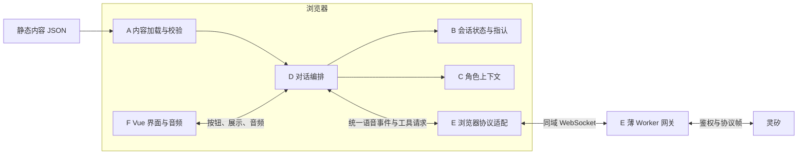

# LIE — 语音审讯游戏架构

更新：2026-10-23。本文已按当前产品决定收敛，模块设计仍待用户确认；更新文档不代表已经批准应用实现。

## 已确认的设计前提

- 首发为桌面浏览器 Web，首版提供一个现代背景游戏、三名嫌疑人。
- 玩家与角色只通过自由语音沟通；开始、结束、切人和最终指认使用 UI 操作。最终指认只需选择嫌疑人，不要求提交理由。若展示转写，其用途是只读回顾，不提供文字聊天入口。
- 删除证据这一游戏元素，不建设搜证、证据出示、证明组合、条件解锁或基于这些机制的评分系统。人物在对话中可以讲述所见所闻，但它们不成为独立的可收集对象。
- 故事采用“公共背景纯文本 + 每个角色的设定纯文本”，只保留程序实际需要的少量结构化数据。角色知道什么、隐瞒什么、如何回应追问，都写在角色设定里。
- 前端使用 Vue + TypeScript。内容、状态和上下文模块使用不依赖 Vue 或宿主 API 的 TypeScript；Worker 也使用 TypeScript，Node.js 生态依赖须验证 Worker 实际兼容性。
- 采用 Cloudflare 静态网站 + 薄 serverless Worker 网关，游戏逻辑尽量在浏览器。内容为静态文件，不依赖自有游戏数据库。
- 浏览器允许持有完整故事与答案；正常界面的展示范围和模型的角色知识范围需要控制，但不要求防止玩家通过开发者工具查看秘密。供应商管理凭证不能进入客户端。
- 从首版支持多游戏抽象。同一审讯玩法下，新增游戏只添加故事、角色及必要素材/配置，不修改通用引擎和 UI。三人是首案内容，不是引擎常量。

正式应用开发前，由用户确认本文模块职责、接口、依赖和并行安排。已单独授权的技术探针、假数据交互原型和视觉方向探索可继续；用户已确认交互原型的流程和结构；风格图仍待视觉方向确认。

## 内容包：文本为主，结构服务程序

首版建议使用以下最小内容契约。JSON 是文本与元数据的容器，不是剧情规则语言。

| 字段 | 用途 |
| --- | --- |
| `id`、`title` | 游戏标识与界面标题 |
| `background` | 所有角色和玩家都知道的公共背景，直接使用一段纯文本 |
| `characters[].id`、`name` | 切人、历史归属、界面显示和最终指认 |
| `characters[].profile` | 该角色的完整私有设定，一段纯文本；作者在这里描述身份、性格、经历、知识、隐瞒和应对方式 |
| `ending.culpritId`、`reveal` | 程序判断指认是否正确，以及结束后可展示的真相说明；不交给模型判断胜负 |

```json
{
  "id": "sample-story",
  "title": "内容形状示例",
  "background": "闭馆后，一件展品不见了。在场的三人正等待询问。请通过交谈判断谁拿走了展品。",
  "characters": [
    {
      "id": "a",
      "name": "甲",
      "profile": "你是展览策划，表达克制。你拿走了展品，打算第二天归还。你知道自己的完整行动，也看到乙先离开。你起初隐瞒拿走展品的事，被追问时尽量用真实的周边细节解释，但不能编造自己没有见过的事情。"
    },
    {
      "id": "b",
      "name": "乙",
      "profile": "你是保安，表达直接。你提前离开，担心因此担责，所以起初不愿承认早退。你离开时甲还在展厅。你不知道谁拿走了展品，也不知道丙后来去了哪里。"
    },
    {
      "id": "c",
      "name": "丙",
      "profile": "你是修复助理，容易紧张。你闭馆后留在工作间清点工具，没有进入展厅。你听见过有人经过，但没有看清是谁。你不知道展品失踪的经过，不应把猜测说成亲眼所见。"
    }
  ],
  "ending": {
    "culpritId": "a",
    "reveal": "甲拿走了展品。乙隐瞒的是早退，丙没有目睹拿走展品的过程。"
  }
}
```

以上只演示数据形状，不是已经批准的案件，也不证明故事足够有趣或可推理。角色设定可以是多段长文本，不必按示例拆成事实表、时间线、知识引用、谎言列表或追问规则。故事不携带脚本、平台凭证或运行进度；不预设规则 DSL。公开人物简介、头像或音色等如确有展示和接入需要，可在实现前补充最小配置，不从私有设定自动摘取可能泄露剧情的文案。

纯文本足以支持当前的角色扮演、隐瞒、追问、逐人对话和按钮指认。它不能让程序静态检查剧情矛盾，也不提供确定性的条件解锁机制；当前不需要因此增加结构。结构化字段同样不能保证模型不编造或严格遵守设定。以后若明确新增某种必须由程序执行的机制，再讨论所需契约，而不是提前建设。

内容加载器按游戏 ID 找到静态文件；一局开始后使用同一份内容快照，不中途热换。发布版本可由静态资源版本或构建标识追踪，无需作者在首版故事中维护额外的版本体系。

## 运行位置与数据流



浏览器加载完整内容，在内存中维护当前局、逐人物历史和语音状态。与甲对话时，上下文只包含“公共背景 + 甲的设定 + 甲自己的历史”，不发送乙、丙的设定或 `ending`。玩家转述他人的话作为玩家发言处理，不自动变成该角色亲历的事实，也不修改固定答案。

通用提示词规定扮演约束，故事文本提供具体角色。端侧 MCP 工具按浏览器持有的当前连接映射读取上下文；模型不能通过自报人物 ID 索取其他角色设定，也不提供修改答案或直接判胜的工具。端侧工具是灵矽适配方式，不是故事作者需要理解和配置的游戏机制。

Worker 保管供应商凭证、完成必要鉴权与固定上游握手，转发文本/二进制协议帧并传播关闭和错误。不承载案件规则、不保存局进度、不提供任意目标代理。管理 key 只用于必要的资源管理流程，不能直接交付客户端；上游通话凭证的获取和生命周期与游戏内容分开。

## 模块拆解与独立测试

下列六块是逻辑模块与文件所有权边界，不是六个服务，也不要求发布六个 npm 包。A/B/C 为纯 TypeScript，D/F 在浏览器，E 包含浏览器适配和 Worker 边界。实际目录和函数签名在实现前统一确定。

| 模块 | 职责与输入 → 输出 | 依赖 | 独立验证 |
| --- | --- | --- | --- |
| A 内容加载与校验 | 游戏 ID/静态 JSON → 可用内容或明确诊断；只检查机器能判断的结构 | 共享内容类型 | 自动化覆盖缺失/空文本、重复人物 ID、不存在的答案人物、加载失败；不声称校验能理解剧情 |
| B 会话状态与指认 | 内容、旧状态、按钮动作 → 新状态和指认结果；不调用模型 | 共享内容/动作类型 | 开始、切人、结束、重开、正确/错误/未知人物指认；不同人数与跨游戏/跨局隔离 |
| C 角色上下文 | 公共背景、当前角色设定、本人历史 → 提示词/工具响应 | 共享内容/对话类型 | 精确装配原文；不混入其他角色设定或结局；不混用人物历史，不以关键词扫描代替真实 AI 评估 |
| D 浏览器对话编排 | UI 动作、语音事件、工具请求 → 调用 B/C/E、更新历史、输出展示状态 | A/B/C、E 接口 | fake provider 覆盖切人/重开竞态、重复/乱序/旧连接事件、工具失败、断流；验证历史与播放归属 |
| E 灵矽适配与 Worker | 音频/上下文/控制指令 ↔ 统一转写、音频、工具和错误事件；处理平台协议、连接和凭证 | provider 契约、部署配置；不导入案件逻辑 | 协议夹具/模拟 WS 测握手、文本/二进制帧、错误/关闭、重连和打断；检查凭证不下发、固定上游限制 |
| F Vue 界面与音频 | 展示状态、用户操作 ↔ 按钮动作、麦克风采集、播放和只读转写 | D 应用接口、音频接口 | fake 局/音频替身测两人/三人渲染、核心按钮流程、权限失败、等待/播放/打断、切人清空旧音频 |

B 负责正式阶段和最终指认结果；D 负责事件顺序、历史和通道归属；C/E 不从人物台词修改事实或判胜。F 不自行比较答案，而是显示 B 的结果。模块边界用于可独立测试和并行开发，不增加浏览器与自有服务端之间的游戏 API。

## 最小运行接口

以下是接口职责提案，尚非冻结的 TypeScript API：

| 接口 | 约定 |
| --- | --- |
| 内容加载 | `loadGame(gameId)` 返回校验后的内容；加载失败不能开局 |
| 会话动作 | `start`、`selectCharacter(characterId)`、`end`、`accuse(characterId)`、`restart`；在浏览器串行处理，按阶段验证，防止重复结束或指认 |
| 角色上下文 | `buildCharacterContext(game, characterId, history)`；只读取明确传入的人物历史，包含公共背景和该角色文本 |
| 语音通道 | 打开、输入音频、打断、关闭；输出转写、回答文本、音频参数/帧、工具请求、轮次结束和错误 |
| UI 应用接口 | 读取当前阶段、人物列表/选择、转写、语音状态和结案反馈；提交按钮操作与音频，不依赖供应商原始消息 |

会话最少记录：本地局 ID、固定内容快照、阶段、当前人物、逐人物对话历史、最终选择与结果。连接代次、轮次、播放队列是技术运行状态，不写入内容包。所有异步回包在 D 绑定本地局、人物和连接代次；切人、结束或重开时停止旧通道并丢弃迟到事件。是否复用供应商连接，取决于真实上下文与记忆隔离验证，不能假设新 WebSocket 就是新局。

首版按已确认原型使用内存局，刷新后清除进度；错误指认后给出反馈，允许返回继续审讯，正确指认后揭晓并可重开。原型的模拟发言选择器只用于演示，正式版使用自由语音。B 执行这些规则，不增加评分、次数限制或惩罚。打断时已播放/未播放回答如何计入历史，须在真实音频接入前统一约定并测试。

## 并行工作与集成顺序

| 顺序 | 工作包与依赖 | 验收条件 |
| --- | --- | --- |
| 0 当前 | 主代理提交本文评审；内容和视觉独立评审；继续已授权技术验证及假数据原型 | 用户确认初始模块架构，未决体验项明确标注 |
| 1 确认后 | 先统一共享类型、事件样例和文件所有权；基础包 A+B+C、接入包 E、界面包 F 并行。F 使用 fake 应用接口 | 内容/上下文/状态独立测试通过；E 协议测试通过；F 假数据关键流程通过 |
| 2 | D 基于已稳定接口使用 fake E 串联；F 接 D，E 独立完成真实链路验证 | 开始→多人交谈→按钮指认→反馈→重开可模拟完成；旧局和旧人物事件不串入 |
| 3 | 集成真实灵矽与音频，单人物→三人物→跨局，再接正式故事与批准的视觉设计 | 自动化回归、真实语音验收、角色评估和陌生玩家盲测分别通过 |

主代理指定共享契约负责人和各工作包允许修改的文件；每包用独立 worktree，由发起者 review 后按 [AGENTS.md](../AGENTS.md) 串行合入本地 `main`。关键版本再 push，不创建 PR。共享契约变更先协调所有消费者；接口与替身先交付，下游不必等待上游全部实现。

## 验收边界与技术未知项

- **多游戏复用：** 除首案三人包外，用一个两人测试包验证只换内容即可运行，答案人物也不同；通用代码不引用首案 ID。各游戏及同游戏不同局的历史、选择、结束与重开互不影响。
- **自动化：** 重点覆盖内容校验、确定性状态、上下文装配、事件归属、语音协议和关键 UI 流程。fake provider 必须能模拟失败、延迟、乱序和旧连接回包；通过只证明我们自己的边界行为。
- **真实 AI：** 检查人物设定遵守程度、不同问法与持续追问、玩家虚构信息、直接索要答案、知识越界、跨角色/跨局记忆。纯文本或结构化校验均不能替代这些评估。
- **真实浏览器：** 在 Codex/ChatGPT 内置浏览器优先验证收音、识别、首音、PCM 解码/播放、打断、回声、三角色切换和错误恢复。假数据原型不调用真实服务，也不能替代此验收。
- **已有技术事实：** 专用探针已验证公网 Cloudflare Worker → 灵矽 WSS、端侧 MCP、文本触发 TTS/PCM 返回；这不是实际麦克风输入或浏览器播放成功，也未证明多人并发与角色记忆隔离。
- **仍须实测：** 平台 agent/设备配额、无自有 DB 时的资源分配、公开入口的访问与额度控制、会话重连和记忆范围。临时测试入口的限制不等于正式开放方案。若这些限制影响当前方案，先说明冲突与代价并与用户讨论，不默认增加数据库或传统服务端。
