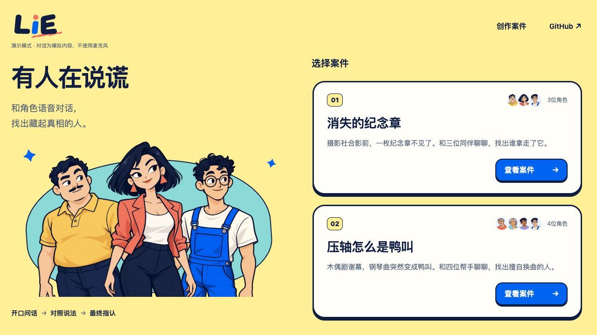
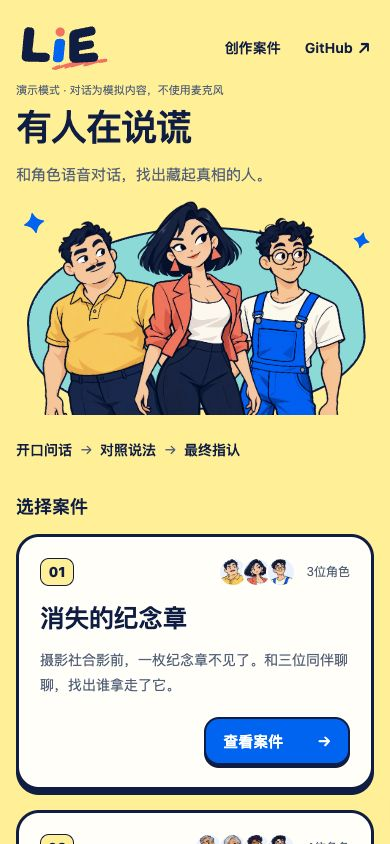
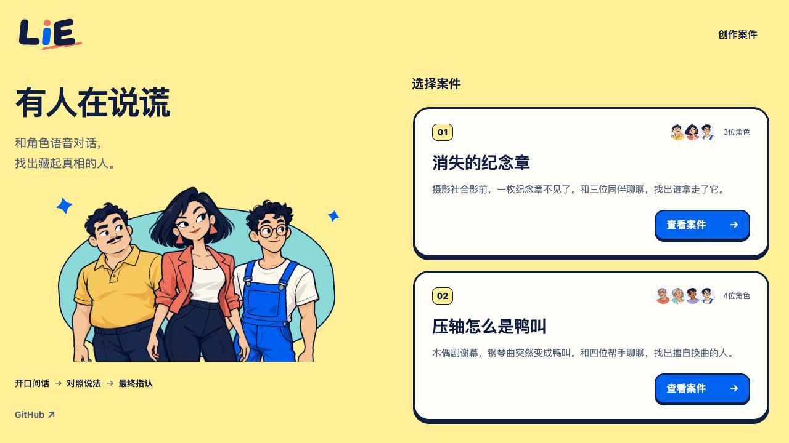

# GitHub 仓库入口设计提案

2026-11-01；**用户已批准原轻入口样式，并明确要求顺序为“创作案件 GitHub ↗”、直接实现上线。** 正式源码与验收已交总协调 review，是否已合入/发布以总协调回执为准。

批准证据：用户先说“这个版本我没问题；不过我在想把 GitHub 链接放到靠边一点会不会更好？”，随后明确“不用再给我看了，就按这个设计+我说的顺序实现然后上线吧”。总协调据此要求保留正常页边距，将仓库链接置于首页操作区最右侧，不再追加设计审批。

## 推荐：只在首页右上角增加轻入口

在“创作案件”右侧加入 `GitHub ↗`，作为首页操作区最右一项，保留正常页面外边距。使用深蓝文字、透明背景，不复制“查看案件”的蓝色主按钮造型。现有 Logo 红点继续承担版本弹窗入口；编辑器与调查页暂不增加仓库导航，保留业务操作空间。

链接目标由 origin 核实为 `https://github.com/nighca/lie`。建议新标签打开，并带 `noopener noreferrer`；可访问名称为“在新标签页打开 LIE GitHub 仓库”。手机保留文字和外链箭头，44px 点击高度，键盘 focus 有蓝色描边。这里没有 Star 数字、登录或其他 GitHub 操作。

原推荐（GitHub 在“创作案件”左侧）的静态截图仍保留为 [桌面](recommended-desktop.png) / [手机](recommended-mobile.png)，对应冻结设计提交 `125b4143ea15a92bffee94fb1605d6e87b3a9912`；`recommended.html` 已按用户要求改为最右顺序。下面备选仅保存探索历史，不是正式实现范围。

## 备选：介绍区下方

可把同一文字链接放在首页左侧介绍区的流程说明下方。更安静，但更难发现；在当前固定高桌面首页中还会占用人物图空间，因此推荐顶部方案。

## 预览来源与边界

- 基线：`f504e1acc1044f58c5b455daeb62b96fa5b9047c`，与 v1.2.0 一致；独立分支 `codex/github-entry-design`。
- 上下文来自本地最新 main 首页的实际 DOM/CSS 静态快照，复用仓库内现有角色图与品牌下划线；不是正式 App 的功能改动。`recommended.html`、`alternative.html` 和 `snapshot.css` 保存冻结预览，只有 GitHub 链接是可导航的新交互，其余产品按钮是静态上下文。
- 方案遵守 nighca-fe 的简单实现与范围约束。正式改动只在 Application 首页 header actions 中增加一个语义化链接及 scoped 样式；没有修改其他 ProductHeader 使用者。
- 1280×720、390×844 实际看图；320×720 量测 documentWidth=320、headerHeight=64、GitHub 点击区 73.23×44px，无横向溢出。390 时 documentWidth=390，角色图片均完整加载。
- 已读链接 href、target、rel 和可访问名称，未点击仓库链接或执行任何 GitHub 写操作；未进入案件或启动 provider/mic/WS。
- 设计文件并非应用 E2E、业务按钮或真机触屏验收；正式实现的实际验证记录如下。

## 临时服务已结束

owner `/root/github_entry_design`，parent Chat `01a18baa-4fac-71f2-a81f-c39be0640fe8`；worktree `/Users/nighca/.codex/worktrees/lie-github-entry-design/lie`；启动源 f504e1a + 本设计未提交文件；端口 127.0.0.1:5176，PID25311，原 PTY/session60536。consumer 仅为本设计截图，停止条件为截图完成。

root 已授本次 5176 turn；启动前该端口无 listener。截图后原 PTY Ctrl-C，Python 正常退出，随后精确 PID 与 5176 listener 均无结果。自建 IAB tab 已关闭，viewport override 已 reset；未改用户 tab、8787/8788、5177 或 5198。没有保留运行中的 Demo；若需要恢复，可在协调端口后从仓库根目录提供静态服务并打开本目录 HTML。

## 正式实现与检查

- 产品源码仅 `apps/web/src/Application.vue`：首页操作顺序为“创作案件 / GitHub ↗”，语义 anchor、正确新标签目标和 rel，焦点描边与44px热区。编辑器、调查与版本红点行为保持既有代码。
- 源基线仍为 f504e1a。总协调本轮main推进到98a956d仅修改App.vue指认文案，与本项Application.vue不重叠；集成时从届时main顺序cherry设计与本提交，不回放旧base。
- Node24.22.1：现有 homepage presentation + hidden page version 共7项测试通过；Web类型检查、Web完整构建与资源后置校验通过。未为静态链接新增重复测试。
- IAB在本轮不可用，仅Chrome可用；使用新建专用tab `1910332508` 打开 `http://127.0.0.1:5176/?demo=1`，不使用或改变用户tab。1280×720、390×844实际截图，所有角色图加载完整。320×720的documentWidth=320/headerHeight=64；GitHub点击区73.23×44px，x=230.77（右侧保留16px）。390时x=300.77；桌面点击区88.22×44px，x=1167.78（右侧保留24px）。
- DOM核对 href/target/rel 与顺序；从“创作案件”按Tab进入GitHub链接，focus-visible蓝色3px描边。只在首页验收，未进入案件、无mic/provider/WS或GitHub写操作；这是渲染与导航合同检查，不是真机触屏测试。
- 修订静态服务：PID53283、PTY56021，原PTY Ctrl-C正常退出。随后正式Vite：PID57132、PTY61890，consumer本次截图，完成后原PTY Ctrl-C退出。两PID与5176 listener精确复核均无结果；Chrome专用tab已关闭，viewport已reset。无运行服务保留，不触用户8787/8788、5177、5198。
