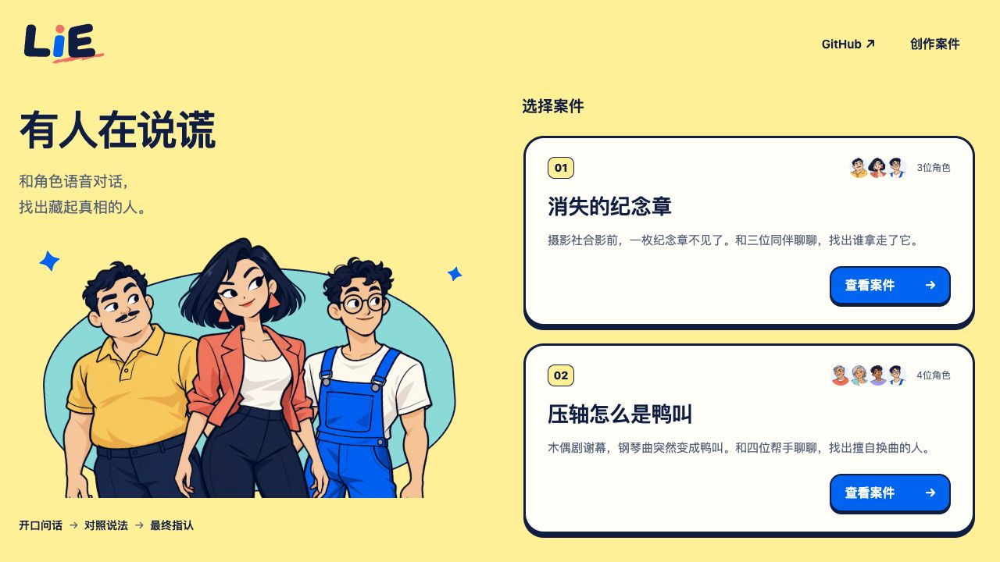

# GitHub 仓库入口设计提案

2026-11-01；**待用户确认，尚未实现到正式产品。**

## 推荐：只在首页右上角增加轻入口

在“创作案件”左侧加入 `GitHub ↗`。使用深蓝文字、透明背景，不复制“查看案件”的蓝色主按钮造型。现有 Logo 红点继续承担版本弹窗入口；编辑器与调查页暂不增加仓库导航，保留业务操作空间。

链接目标由 origin 核实为 `https://github.com/nighca/lie`。建议新标签打开，并带 `noopener noreferrer`；可访问名称为“在新标签页打开 LIE GitHub 仓库”。手机保留文字和外链箭头，44px 点击高度，键盘 focus 有蓝色描边。这里没有 Star 数字、登录或其他 GitHub 操作。

## 备选：介绍区下方

可把同一文字链接放在首页左侧介绍区的流程说明下方。更安静，但更难发现；在当前固定高桌面首页中还会占用人物图空间，因此推荐顶部方案。

## 预览来源与边界

- 基线：`f504e1acc1044f58c5b455daeb62b96fa5b9047c`，与 v1.2.0 一致；独立分支 `codex/github-entry-design`。
- 上下文来自本地最新 main 首页的实际 DOM/CSS 静态快照，复用仓库内现有角色图与品牌下划线；不是正式 App 的功能改动。`recommended.html`、`alternative.html` 和 `snapshot.css` 保存冻结预览，只有 GitHub 链接是可导航的新交互，其余产品按钮是静态上下文。
- 方案遵守 nighca-fe 的简单实现与范围约束。后续若用户接受，可只在 Application 首页 header actions 中增加一个语义化链接及必要样式；不必修改所有 ProductHeader 使用者。
- 1280×720、390×844 实际看图；320×720 量测 documentWidth=320、headerHeight=64、GitHub 点击区 73.23×44px，无横向溢出。390 时 documentWidth=390，角色图片均完整加载。
- 已读链接 href、target、rel 和可访问名称，未点击仓库链接或执行任何 GitHub 写操作；未进入案件或启动 provider/mic/WS。
- 设计文件并非应用 E2E、业务按钮或真机触屏验收；正式实现须等用户批准后单独验证。

## 临时服务已结束

owner `/root/github_entry_design`，parent Chat `01a18baa-4fac-71f2-a81f-c39be0640fe8`；worktree `/Users/nighca/.codex/worktrees/lie-github-entry-design/lie`；启动源 f504e1a + 本设计未提交文件；端口 127.0.0.1:5176，PID25311，原 PTY/session60536。consumer 仅为本设计截图，停止条件为截图完成。

root 已授本次 5176 turn；启动前该端口无 listener。截图后原 PTY Ctrl-C，Python 正常退出，随后精确 PID 与 5176 listener 均无结果。自建 IAB tab 已关闭，viewport override 已 reset；未改用户 tab、8787/8788、5177 或 5198。没有保留运行中的 Demo；若需要恢复，可在协调端口后从仓库根目录提供静态服务并打开本目录 HTML。
