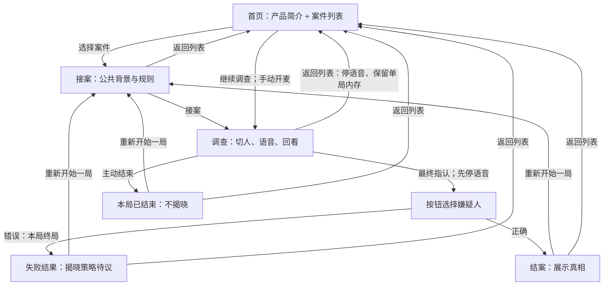

# 首页与选案完整动线提案

2026-10-24。**提案，尚未批准，也未实施。** 本文基于 `9d7e046f93224ab2f9e96ee8c8320e7be7845644` 的 App、controller、核心会话与页面生命周期代码；供主代理 review 后，与用户确认整条流程。本轮对话页视觉候选另行讨论，不以本提案预定其布局。

## 已确认边界与当前行为

用户要求新增一个前置首页，简要介绍产品并列出可玩案件；目前只有《空盒里的纪念章》，架构继续支持多个静态内容包。新增页面实施前，须先确认完整用户动线。

保留语音询问、只读转写、按钮切人和指认。**用户最新已确认：指认错误也必须使本 session 终局失败，不能继续询问或再次指认；再试只能全新重开。** 正确指认展示真相；失败是否揭晓尚未明确，本文推荐暂沿用只在正确时揭晓的做法，作为待议项，不当成已批准规则。语音一次开启可多轮，切人、指认、主动结束或页面隐藏会停止语音，恢复时须手动开启。首案8分钟跨人物累计，连接准备不计时，停止语音后暂停；耗尽后仍可回看和指认，不能继续询问，不自动判负或揭晓。重开回到接案页，清空历史和额度使用量。刷新不恢复旧局。

本次读到的代码尚保留“猜错可继续”的旧实现，须另行按最新决策修改；本提案只更新目标动线，不声称规则已落地。目前 `/` 直接加载默认案件的接案页，`/?game=<id>` 可指定案件；首页列表、应用内返回首页与跨案选择均未实现。当前 Logo 的 `/` 链接会触发页面导航，不能把它当成已经存在的内存保留能力。

## 推荐：一个首页，一个案件界面，最多保留一局

首页把产品简介与案件列表放在同一页。简介只需让玩家理解“与不同人物语音交谈，比较说法，选择责任人”，并说明麦克风与声音播放的使用时机。案件卡展示标题、无剧透简介及询问额度；首案可展示8分钟，不硬编码到通用界面。点击卡片进入已有接案页，在这里读公共背景、看人物和规则，再点击“接案，开始调查”。不另设营销落地页或案件详情层。

调查页、正确结案页和主动结束页沿用现有结构；错误指认改为终局失败结果页，与正确结果页同样提供“重新开始一局”和“返回案件列表”，不再提供返回调查或重试指认。给案件界面补充明确的“返回案件列表”。首页始终能通过 Logo 返回。浏览首页、选案与接案都不会申请麦克风或建立语音连接；只有玩家点击“开始对话”才进入现有预检和语音准备过程。

**推荐返回首页时只暂停语音，在当前页面内存中保留一个进行中的会话。** 首页对应案件卡改为“继续调查”，点击返回原人物、历史和剩余额度；不自动恢复收音或播放。这只是当前标签页的一份内存，不是存档承诺。选择另一案件时，先明确提示“开始另一案件会放弃当前调查”，确认后才替换；取消则仍在列表，旧局可继续。当前只有一案，也不提供多局切换或会话管理页面。

“继续调查”可回到额度已用完的调查页，此时仍只允许回看与指认，不返还时间。主页卡片不展示历史、错误指认对象、人物隐瞒或真相。

## 退出、重开与返回的具体结果

| 玩家动作 | 去向与会话结果 | 麦克风、播放与额度 |
| --- | --- | --- |
| 结束对话 | 留在当前调查；人物和历史保留，可再次开启 | 停止收音/播放/连接，结算已启用时间，之后暂停 |
| 切换人物 | 留在同一案件，显示新人物历史 | 先关闭旧语音；不开新麦克风，额度不重置 |
| 打开最终指认 | 留在案件界面，显示现有指认弹层 | 先停语音；取消弹层不自动继续收音 |
| 指认错误 | 本局终局失败；提供“重新开始一局”和“返回案件列表”，不可继续或再次指认 | 停止并关闭语音；重开才新 session；是否展示真相待确认 |
| 指认正确 | 结案页，展示已有真相；提供“重新开始一局”和“返回案件列表” | 停语音；不把正确结果当作自动开启另一局 |
| 主动结束本局 | 现有结束页，不揭晓答案；提供重开与返回列表 | 停语音，本局不能继续；不新增结束后回看页面 |
| 调查中返回列表 / 点击 Logo | 停在首页，保留一份进行中内存；该卡显示“继续调查” | 停语音、结算后暂停；继续也须手动开始对话 |
| 在首页选择另一案件 | 先确认放弃旧调查；确认才进入新案接案页，取消则保留旧局 | 旧语音已经停止；新案尚未收音，额度独立 |
| 接案页返回列表 | 回首页；无需保留尚未开始的会话 | 没有语音或额度消耗 |
| 成功/失败/主动结束后返回列表 | 回首页，三类终局会话均不作为“继续调查”保留；再次选该案进入新接案页 | 不恢复已关闭连接，不自动开始 |
| 重新开始一局 | 回到同一案件接案页；新 session、空历史、额度归满，仍须再次接案 | 先关闭旧语音；接案不自动开麦 |

两种首页返回方式都尚未批准，区别如下：

| 方案 | 玩家影响 | 实现与维护成本 |
| --- | --- | --- |
| 保留当前内存单局（推荐） | 可浏览列表后继续，避免误退损失；须说明刷新不保留、另一案件会替换旧局 | 需要唯一会话的归属与继续入口，处理同页导航和跨案放弃确认；不需持久化 |
| 返回首页前确认结束本局 | “返回”就意味着终止，确认后只能重开；误点可取消，但不能暂时看列表再回来 | 不需首页恢复会话，但每种离开路径含浏览器后退都须可靠处理确认和取消；也不等同只改链接 |

不额外要求玩家确认每次返回列表，因为推荐方案不会丢弃进行中的那一局。放弃单局的确认只用于切到另一案件；“主动结束本局”继续保持现有明确结束动作，不在本提案新增第二套结束规则。

## URL、刷新与浏览器导航

推荐保留现有分享形状：`/` 为首页，`/?game=<id>` 为案件入口。URL 只表达选中了哪一案，不编码调查进度、人物、指认结果或历史。接案、调查、指认弹层与结案是同一案件内的状态，不为每轮问答或每个阶段不断增加浏览器历史记录。

- **直接打开案件链接：** 验证 ID、加载内容后展示接案页，不跳过接案或自动收音。未找到/格式错误/加载失败时，明确反馈并提供重试和返回列表，不静默替换为默认案。首页正常展示可用案件，不因一个案件加载失败而整体失效。
- **当前页面内的后退/前进：** 首页与案件之间同步 URL 和显示。离开调查即停语音；若回到内存中唯一保留的同一案件，恢复调查界面与剩余额度，语音保持关闭。去另一案沿用放弃确认，不因历史导航绕过。浏览器取消导航时，应恢复一致的 URL 和页面，不能出现地址指向新案、内容仍是旧案的状态。
- **刷新案件地址、关闭后重开、新标签页：** 从接案页创建新局；原历史、额度和正在调查的人物不恢复。刷新首页只显示列表，不再有“继续调查”。沿用现有不持久化约定，不加入 localStorage、账号或云存档。
- **标签页隐藏：** 按已确认规则停语音，保持同页内存和当前界面；回到前台不自动开麦。用户仍可手动继续。
- **真正离开文档（如跳到其他网站）或 pagehide：** 关闭收音/播放/连接并释放页面资源，不能依靠浏览器后台页面保留语音。前进/后退缓存恢复也不能自动复活旧连接；推荐按一次重新进入处理，案件地址回接案页，不承诺恢复被卸载的会话。

因此，推荐的“返回首页保留一局”要求应用内导航；不能简单保留现有硬跳转链接后声称会话仍在。页面可见性和文档离开时的停止边界继续覆盖准备中的权限/连接、迟到回包与旧 timer，不能只把麦克风按钮视觉切为停止。

## 静态内容与最小实现边界

首页需要一个可枚举静态案件入口及明确公开的卡片信息，内容目前只有一条，后续添加同玩法游戏时可通过静态配置扩充。标题和额度优先复用已有定义；卡片简介由作者明确提供公开文案，不自动摘要 profile 或 ending。本文不预定复杂 catalog schema、分页/搜索/分类、锁定/解锁或难度算法。

完整故事文件仍可按既定架构被浏览器检查，但正常首页、卡片与接案页不渲染私有设定或真相；也不把答案塞进 URL、卡片无障碍标签或预览描述。案件规则、剩余时间、正确/错误指认仍归核心与 controller；首页导航不另算胜负或维护第二份计时。

本提案不增加账号、DB、服务端存档、跨标签同步、成绩榜或自动接续对话。语音可用性预检与当前接入方式独立：首页/接案可正常浏览，语音失败时明确留在调查，不假装对话成功、不消耗尚未启用的询问时间。

## 待用户确认及后续验收

核心待确认是：**是否采用“返回列表保留当前页面内唯一进行中会话，切到另一案件才确认放弃”的推荐方案？** 它允许无损浏览列表，但需要首页区分“选择案件”与“继续调查”。若用户更倾向返回列表即结束丢弃，应改为离开调查前明确确认，并移除继续入口；不能在未确认前选择其中一种实施。

另一个必要待议项是：**失败结果是否揭晓真相？** 当前推荐失败只显示失败结果，正确才揭晓；这尚非用户决定。无论采用哪种揭晓策略，错误终局、禁止继续/再次指认已经明确，不再列为待确认选项。

其余动线作为完整方案一并确认：列表进入既有接案页，成功/失败/主动结束均可重开或返回列表，直接链接和刷新回接案页。已确认的语音、额度及错误终局机制不重复请求批准。主代理可将本提案与视觉候选分开呈现，未批准前不安排页面或路由实现。

方案批准后，自动化验收至少覆盖：首页不展示角色秘密、不启动语音；选案与直接链接正确；错误指认必定终局、正确结果揭晓、终局禁止语音与再次指认、重开生成新局；同页返回/继续保留人物、历史与额度但关闭语音；切案确认取消不丢旧局、确认后跨案隔离；浏览器前进后退和刷新按上述边界处理；结束、隐藏、换案和迟到异步回调都不能让旧收音或计时继续。另用内置浏览器走完整用户流程与可访问性检查，替身对话验收不替代真人语音体验。
