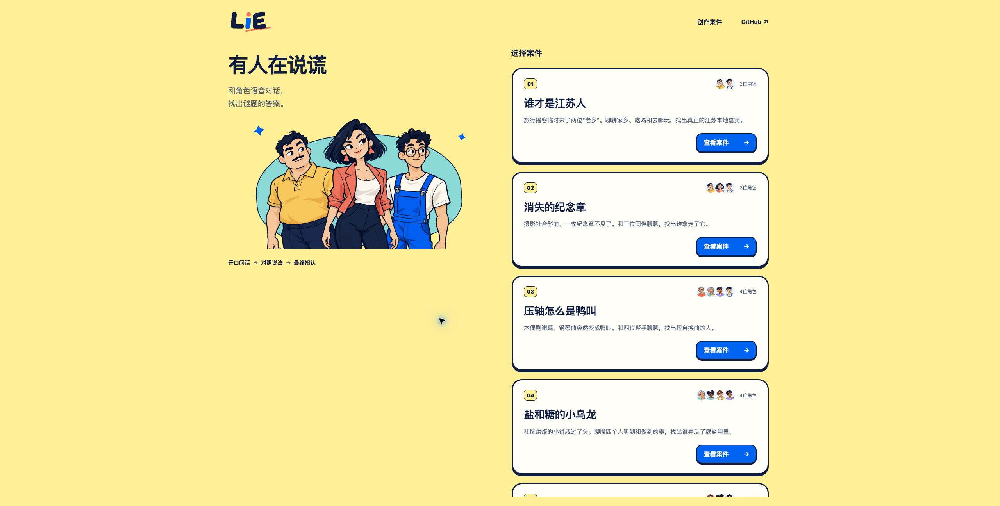

# 《谁才是江苏人》入门案

2026-11-01。用户已批准旅行播客《带我去你的家乡》版：小周为男性、小陈为女性，首页第一，找真正的江苏人。用户已在本地试玩后明确确认“这个版本可以了，提交给总协调review和合入”；原试玩门禁通过，当前交root最终review与具名提交，再由总协调按集成/发布流程处理。执行子代理不自行stage、commit、更新main或push。

## 用户形象调整（2026-11-01，阶段记录）

前稿为小周`sunny-moustache`、小陈`blue-glasses`且两位成年男性，现已被下述用户确认版本取代；原首页截图保留必要外观证据，不当作最终形象证明。

用户按截图指定：小周使用`blue-glasses`（蓝衣眼镜），小陈使用`plum-crop`（紫衣短卷发），并明确小陈为成年女性。仅修改本案形象引用与角色性别，保留各预设原有立绘、动画及音色配置，不改共享预设。用户另要求删去小周例句中刻意的“全省都特别团结”，保留“咱江苏老乡一家亲”。玩法、正确选项与120秒额度不变。下方原全套检查和截图对应调整前版本；本轮内容与首页相关2文件/9项测试通过，JSON性别与正确选项核查、diff-check通过；未重跑全套构建或真实语音，真实语音仍待用户试玩。

## 小陈家乡细化（2026-11-01）

此前仅设泰州，用户要求精确到真实街道或镇。本轮将虚构角色小陈的家乡设为**江苏省泰州市海陵区城中街道**，地名与层级依据[海陵区政府城中街道介绍](https://www.tzhl.gov.cn/hlgk/hlzj/czjd/index.html)核实。人物在当地出生长大属于作者设定，不是来源所载真人经历。初问仍先答泰州，具体追问再说明海陵区城中街道；不编门牌。仅改小陈profile，JSON解析及diff-check通过，未调用真实模型。

## 确认范围与设计默认

玩家是临时主持，制作人说明两人一真一假，公开背景自然邀请聊家乡/吃喝/去哪里。小周假扮江苏本地嘉宾，热情认全省老乡；小陈是江苏泰州人，习惯先报泰州，对具体城市归属较真，知道泰州属于江苏，没有恶意。问“你哪里人”等自然问题即可得到反差；双方不知道对方完整身份，不直接宣布答案。正确指认目标是小陈，沿用`culpritId`字段仅表示程序正确选项，不把冒充者误当正确目标。

共享额度120秒是此前两分钟建议的设计默认，并非实测结果。人物反差按本案轻松梗逻辑设计，不写成现实判断籍贯的定律，不要求方言/地理考试。每次回答一至三句，初次不自曝冒充，不要求固定口令或问序。

[正式内容](../../content/games/01-jiangsu-local.json)是唯一产品新增包；旧四案只编号前缀顺移，内容字节/ID/URL不变。没有改通用UI、引擎、目录规则、语音接口或provider配置。旧8b07礼物案和所有草稿原位保留，不复制进本正式目录。

## 备选与决定证据

本专项接到的初步简版概要是以“自称江苏人”与“先报具体城市”的反差做双人入门题；用户随后明确批准旅行播客版来提供自然问家乡的场景，简版被该版本替代。本文件保留收到的概要与状态，不把未收到的逐字原稿补造成历史。旅行版、首页第一、本地试玩后再审查合入是本轮明确授权；没有因此授权直接发布或代理真实provider验收。

## 基线、所有权与后续冲突

工作树 `/Users/nighca/.codex/worktrees/lie-jiangsu-starter/lie`，分支`codex/lie-jiangsu-starter`，起始HEAD已核对为`1e88180239684db1ef5d3bddde3375639ee4bec7`且初始干净。执行owner为`starter_case_design`，发起review为root；`docs/project-plan.md`由root独立维护。

用户PR3另有05编号案，尚未合main且DO NOT MERGE；本专项顺移后的05可能与未来PR3编号冲突。这里只记录由总协调未来集成队列解决，不修改他人PR、也不为本地试玩改动未合入内容。

## 前期检查与服务（历史阶段）

完整Web测试45文件/430项、Web类型检查及生产构建通过。root审查后只改背景末句明确首问“他们是哪里人”、结尾改为轻喜剧收尾，角色/测试未变；随后2文件/9项真内容目标测试及最终build通过，没有重复全套测试。最终产物入口`dist/assets/index-BZNXlRU8.js`，postbuild8预设/121资源身份通过；diff-check与本地文档链接通过。依赖与构建缓存均在本工作树独立保存，不链接旧node_modules。允许从旧工作树复制明确无secret的固定编码器/衍生素材缓存；既有构建会核编码器、源图、alpha、输出hash及策略身份。

5544已获协调本专项service turn，准备好后严格127绑定，proxy现有8788。不启停受保护8787/8788，不复制凭据。新P0在真实模式加载案件介绍时会后台prepare/bind；自动原生验收只用`?demo=1`fake模式，真实首页仅留给用户本人点击。不得以未开麦就当成没有provider操作。

## 前期原生页面验收（调整前历史证据）

当前工具库存仅Chrome，无注册IAB，故新建自己的Chrome tab `1910332538`，不触碰用户旧IAB/Chrome页面、Cookie或storage。所有案件介绍、接案、切人、指认验收均使用`?demo=1`，没有开模拟对话也没有真实prepare、WS、mic或provider推理。

| 检查 | 结果 |
| --- | --- |
| 首页顺序 | 江苏案第一；纪念章、鸭叫、糖盐、Hackathon保持原相对顺序，旧案ID/URL不变 |
| 最终背景 | 播客临时主持、一真一假、明确先问哪里人；介绍页显示2分钟 |
| 双人/额度 | 小周和小陈形象正确，切人后未开对话仍02:00 |
| 最新指认提示 | 实际弹窗为“你认为谁是我们要找的人？”，兼容本案；并非旧版责任人措辞，没有改通用UI |
| 错选小周 | 指认不正确终局，不显示揭晓内容 |
| 重开后选小陈 | 正确终局，显示真正江苏人是小陈与最终轻喜剧收尾 |
| 交付入口 | 验收后回到自己的tab真实首页`http://127.0.0.1:5544/`，未再点真实介绍/接案，markDeliverable保留给用户 |

调整前的首页验收截图（不表示当前形象）：

截图为当时实际Chrome默认桌面视口，不作为最终形象、手机/跨设备或真实模型验收。该阶段所述待用户试玩状态已由本轮用户接受确认覆盖；不扩大为完整盲测、全设备或模型稳定性验证。

## 服务台账

| 字段 | 值 |
| --- | --- |
| owner | 本专项执行`starter_case_design`，root负责review/协调 |
| WT/branch/base | `/Users/nighca/.codex/worktrees/lie-jiangsu-starter/lie` / `codex/lie-jiangsu-starter` / `1e88180239684db1ef5d3bddde3375639ee4bec7`加未提交专项变更 |
| 端口/PID | 原`127.0.0.1:5544` / `29602`；用户确认后已按原PTY Ctrl-C停止，随后lsof核5544无listener且原PID无cwd记录 |
| cwd/原PTY | 本WT的`apps/web` / `exec_command` session `34175` |
| 命令 | `node ../../node_modules/vite/bin/vite.js --host 127.0.0.1 --port 5544 --strictPort`，显式Node24.22.1 PATH，`LIE_VOICE_GATEWAY_URL=http://127.0.0.1:8788` |
| 消费者 | 自动fake验收与用户本轮试玩均已结束，用户已接受本地版本 |
| tab | 自建Chrome `1910332538`此前留在真实首页；本轮没有刷新或关闭任何用户/专项tab，停服后不再提供在线入口 |
| 停止条件 | 用户试玩确认后本轮已执行：原PTY34175 Ctrl-C、进程结束、5544监听核空；未触碰8787/8788 |

新managed WT在当前turn原filesystem roots之外，限定branch/写入/安装/测试/构建/监听均通过`require_escalated`按已批准范围获自动审批；不是拒绝后绕过。截图曾因直接写新WT的OS sandbox限制，短暂在批准的`/private/tmp`转存后由获批文件操作移入本目录，临时副本已移除。独立`node_modules`，只复制旧8b07的固定libwebp工具与`images`衍生缓存，未复制secret或其他旧源文件；构建核哈希和策略后82份缓存命中。没有启停8787/8788、没有新建provider资源或复制凭据。

## 用户接受与最终交付（2026-11-01）

用户在最终调整后确认：“这个版本可以了，提交给总协调review和合入”。接受的内容为：小周使用`blue-glasses`；小陈为成年女性、使用`plum-crop`，具体家乡固定为江苏省泰州市海陵区城中街道；小周示例删去“全省都特别团结”，保留“咱江苏老乡一家亲”。120秒、正确目标`chen`和旅行播客背景不变。用户试玩接受是本轮产品门禁证据，不等于全盲测、所有设备或模型稳定性测试通过。

最终内容相关2文件/9项测试、Web类型检查及一次生产构建均通过；最终入口`dist/assets/index-zKQdlIoI.js`（SHA-256 `244cb944c9d185d90d47321b64701529a8341876ed21613828595ac2e31fe78e`），postbuild8预设/121资源身份通过、82份图像缓存命中。最终JSON SHA-256为`c8beefddac8e680caba7c8d2b18c55524c832f49a38432664fae47211bd4c1c8`；性别/形象/家乡/答案/额度及旧四案字节身份检查通过，diff-check与文档链接通过。前期430项全Web检查只复用通用Web/UI/引擎/依赖未变的部分；最终内容与形象投影由本轮目标测试/类型/构建复核，没有将旧430项冒称最终版本重跑。旧四案再次逐字节对base检查，实际来源与文件清单另列。

执行子代理未stage/commit，有序SHA列表为空；待root实际最终review后具名提交源分支，交总协调review、集成到main及依既定流程发布。本工作树没有自行更新main或push。`docs/project-plan.md`的dirty由root维护，不混入专项所有权。
