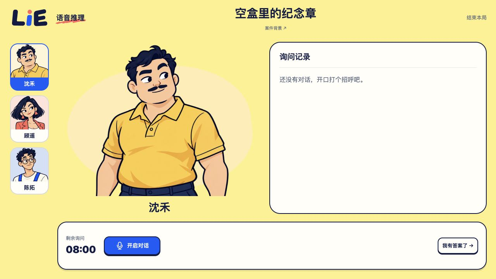
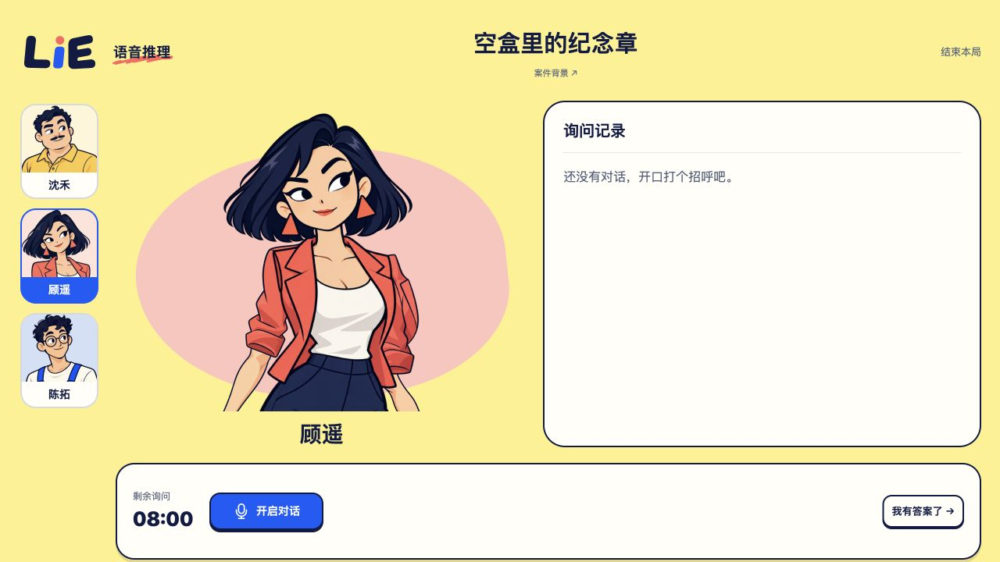

# Immutable asset implementation and acceptance

Base: reviewed main `e6cc3aa9b0f69a7c92ea422dde8085a1329e46fd`. Audit dependency `cba8cf0` (same patch as frozen audit `eb03bb5`). Implementation `d6700a757111f1eb57c6037211925ca1ad276ac6`; later evidence-only/test follow-up commits are ordered in handoff. No push, deployment, PR or main mutation.

## Result

The build derives 92 immutable resources: original 89 preset assets, two brand SVGs and one rewritten manifest. Canonical source, fixed generated `/appearances/` tree, package JSON bytes, PNG pixels/alpha/profile metadata and source contracts are unchanged. All fixed files retain revalidation defaults. New immutable URLs are `/static/<SHA256>/...`; animation digest covers sorted paths, lengths and bytes of the entire package and its parts, preserving relative `parts/*.png` without changing the animation contract. The new loader obtains its manifest URL from a virtual module, keeping development/test fixed-URL behavior.

A Vite pre-transform rewrites original public references before Vue/CSS bundling and hashing. Final HTML favicon is transformed before normal HTML output. There is no post-hash JS/CSS rewrite. Vite emits a warning that the derived underline URL is resolved at runtime; all actual emitted URL targets and browser rendering were independently verified. Fixed generated assets remain outside the new namespace, and the original strict generator still checks their original bytes.

Gateway changes are limited to Worker-first `/static/*` and `/assets/*`, MIME-aware missing-resource rejection and long caching for successful hash resources. 304 is preserved; a headerless 304 gets an unconditional HEAD metadata check to reject SPA HTML. Body, ETag, encoding, Vary and range metadata pass through. HTML/mutable manifest/API/voice/WS policies remain outside the new long-cache branch. There is no new `_headers` file or rule-count growth. [Cross-deployment continuity and operating cost](deployment-consistency.md) remain explicit release considerations.

## Verification

Node **24.22.1**, locked existing dependencies installed offline, no package/lock changes.

- Web suite **228/228** (25 files); Gateway existing suite **13/13**, plus new direct static-transport **3/3**. Web and Gateway typechecks passed.
- Actual Web build and `cf build` passed. Original generator strict dist check: **8 presets/89 assets**, unchanged bytes. Final output tree contains 190 files, including the 92 derived immutable resources.
- `cf deploy --prebuilt --mode production --worker lie-game --provision=false --dry-run` passed with no upload. Build warning about workspace lock-file detection is from cf; repository root lockfile remains unchanged.
- Real Vite fixture builds establish stable hash/entry URL for unchanged bytes; changed PNG updates its URL, manifest and entry; changed animation part updates the whole animation directory, manifest and entry; changed brand SVG updates CSS hash and HTML favicon reference. Old generation files are absent after a clean rebuild, demonstrating the retention limitation.
- [Build contract](build-contract.json) was generated by [verify-build.mjs](verify-build.mjs) against actual `cf build` config, bundled Worker and copied asset tree. All derived outputs match planned bytes, preset references exist, package bytes remain original, and all **46** relative parts resolve.
- Contract covers cold200, conditional304, HEAD empty body, validators, missing hash cors/navigate404/no-store, HTML fallback304 protection, and HTML/fixed manifest/API/voice routes without immutable. The local assets simulator returns full200 for Range requests; it does not produce206 here. Separate fake-binding tests verify actual206 body/Content-Range/ETag/Content-Encoding/Vary preservation. Fake206 is not live-platform evidence.

## Browser evidence

A single IAB3/tab1 was reused from the read-only online audit for local acceptance at `http://127.0.0.1:5544/`. No fallback Chrome or global viewport changes. Actual built Worker/asset bundle, not Vite dev mode; provider credentials absent.

[Cold/warm network](browser-network.json): all 13 immutable resource responses on warm reload transferred **0 encoded network bytes**; HTML alone transferred208 bytes and retained `public, max-age=0, must-revalidate`. Browser memory-cache responses may expose `fromDiskCache:false` with old timing, so the transfer counts—not a disk-cache flag—support the conclusion. Cold images were byte-identical to the online assets; no claim is made that cold PNG transfer decreased.

[Animation requests](animation-network.json): official first case intro→start, sunny 1254×1254 canvas, then switch to coral 1254×1254 canvas. Package and all observed relative part requests were200/immutable. No warning/error logs; no microphone/provider interaction. Only the first official case and these two animations were exercised in this bounded browser window; full eight-preset path existence was checked by the build contract, not called visual acceptance of all eight.

## Lifecycle

Owner `root/production_performance`; worktree `/Users/nighca/.codex/worktrees/production-performance/lie`; served source `d6700a757111f1eb57c6037211925ca1ad276ac6` (actual application bytes match the built candidate). One temporary preview, fixed5544, PID43122, originating PTY53366, consumer IAB3/tab1, stop condition acceptance completion. Original PTY Ctrl-C returned exit130; subsequent `lsof -nP -iTCP:5544 -sTCP:LISTEN` empty and `ps -p43122` had no process. Tab closed; cache-disabled override reset false; trace ended; no viewport/throttle override. No editor interaction or draft writes. No retained service; 8787/8788/5355 untouched.

Two early owned build-contract probes were stopped through their original PTYs after an assertion preceded consumption of a full Range response and runtime disposal waited on the unread stream. The verifier now consumes every response before assertions; final run exit0/disposed. These are not development-server starts or passing range206 results.
