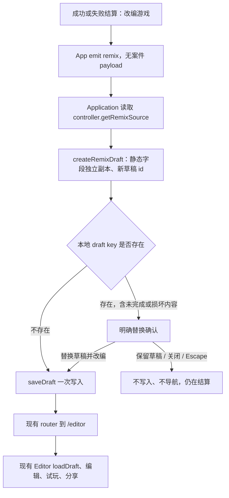

# 结算后改编游戏：最小实现方案

2026-10-25，Asia/Shanghai。只读代码基线：`7249a6f94106ce9fa7aaefdf640222f77ff70188`。本提交仅保存方案，**尚未修改或实现任何生产行为**；没有安装依赖、运行测试、使用浏览器、启动服务、收音或调用供应商。

用户已登记需求：成功/失败结算都能主动把本局完整案件带入既有编辑器，独立改编，不修改原案。以下接口与本地草稿处理是待主协调技术审查的最小建议；不把方案当作已实现，也不重开已批准的模块架构或整体视觉方向。

## 建议结果

在当前 `solved` 和 `lost` 共用的结算操作区增加“改编游戏”。点击后，从本局 controller 的静态案件快照取得完整内容，生成新的草稿标识，沿现有 `lie-editor-draft` 单草稿槽进入 `/editor`。编辑器的字段、自动保存、试玩和分享全部复用，**不需要新路由、Editor 初始数据 prop、导入协议或第二份持久化**。

失败结算仍不展示正确人物、人物私有设定或真相。主动进入改编则包含这些作者资料，符合用户已明确的需求。按钮旁建议用一句简短说明“改编会打开完整案件，包括答案与结局”，帮助玩家选择；说明不包含实际答案。

“失败”对应当前错误指认的 `lost`。手动结束的 `ended` 在现代码中是另一页面，本最小范围不顺带增加该入口；若后续用户把手动结束也纳入，再明确扩充，不假称本轮已覆盖。

## 实际代码边界

| 基线位置 | 已核事实 | 对方案的影响 |
| --- | --- | --- |
| `apps/web/src/App.vue:153–177` | `solved/lost` 共用结果页，只有成功分支渲染 `resultParagraphs`，共用 `.result-actions` | 同一处加 CTA；不能为改编把完整案件塞进 `GameView` |
| `apps/web/src/application/controller.ts:39–81,175–187` | controller 私有 `session`；load 后经 `createGameSession` 保存实际游玩内容；`getView()` 只投影公开人物，失败时 reveal 为 null | 新增显式只读静态内容快照 getter，不从公开 view 反推案件 |
| `packages/game-core/src/session.ts:55–66` | `session.game` 是经过 `validateGame` 深拷贝的静态内容，与 histories、已用时间、phase 分开 | 同一入口覆盖官方、分享、试玩，排除运行数据 |
| `packages/game-core/src/content.ts:64–104` | `validateGame` 重建人物列表/ending，逐字保留合法文本，只返回静态合同字段 | 可复用其明确拷贝边界；不改引擎/schema |
| `apps/web/src/main.ts:19–27` | 官方由 `readBundledCase` 读取；分享/试玩的 `createController(game)` 闭包直接返回传入内容 | 不按目录 ID 重新取内容，否则会错失实际自定义快照 |
| `apps/web/src/Application.vue:31–77,98–115` | 路由转换会 discard/dispose controller；分享先解码再 attach，试玩使用 `previewGame`；`/editor` 分支加载预设 | 必须先取快照、准备/写入草稿，再跳路由；不能先 dispose 再取源 |
| `apps/web/src/editor/Editor.vue:16,29–45` | Editor 挂载时 loadDraft 一次，之后 deep watch 自动保存；预设加载状态已有机制 | 成功写当前草稿后挂载即可预填，不额外双向同步或 watch 新 prop |
| `apps/web/src/editor/draft.ts:14–19,60–75` | 一个 key；`loadDraft` 允许未完成正文，但损坏 JSON 可抛错；`saveDraft` 是一次 setItem | 冲突按 raw key 是否存在判断，不能把“无法解析”当作无草稿 |
| `apps/web/src/style.css:83–105` | 结果区桌面 nowrap、移动纵向满宽 | 先复用现按钮；实现验收检查三按钮是否拥挤，不预先扩大为全页重排 |

## 数据流与最小接口

1. **App 事件**：增加 `remix: []`。结果页按钮只发意图，不携带真相，不更改 `GameView` 或当前失败结果投影。默认不在 intro/loading/failed/interrogating/ended 添加入口。
2. **controller 只读方法**：建议 `getRemixSource(): GameDefinition | null`。只在已加载且 phase 为 solved/lost 时返回 `validateGame(session.game)` 的独立副本，其余返回 null。方法不发布事件、不重启/结束游戏、不结算时间、不接触 voice。Application 拿不到源时不写草稿；路由已变更导致的旧意图不继续执行。
3. **draft helper**：建议 `createRemixDraft(source: GameDefinition): EditorDraft`。显式复制 title/background/原配置 interrogationLimitSeconds、全部人物 id/name/profile/appearanceId，以及 ending.culpritId/reveal；只把案件 id 换成现有 `crypto.randomUUID()` 生成的新草稿 id。不增加 sourceId、版本、谱系或云记录，不自动改标题或追加“改编”。人物 ID 保持本案内引用，避免无谓重映射答案；新案件 id 也避免后续手动投稿仍指向原官方案的同名文件。既有 helper 接收可靠静态合同，不再做第二轮兼容解析。
4. **Application handler**：监听 `@remix`，先取得独立源并构建 draft；执行下面的存储门禁；写入成功后复用 `editor()` / `router.push({ path: '/editor', query: demoQuery() })`。保留已有 demo 标记；不把全部内容拼到 query/history.state，也不为编辑交接再压缩一遍链接。
5. **Editor API 不变**：无需修改 Editor.vue。已有 characterPresets/presetStatus、自动保存、清除、校验、preview/leave 事件保持。刚写入的改编稿按正常本地草稿恢复；无需为状态文案另造持久来源标志。

副本边界：`GameDefinition` 是静态字段白名单，不复制 sessionId、phase、histories、转写、currentCharacterId、result、interrogationUsedMs、当前剩余时间、voice 连接/反馈、时间戳。时限来自案件原配置，不从 GameView 的剩余量换算。

## 单草稿冲突：明确替换，不增备份系统

推荐沿用当前清除草稿的“确认后替换/取消保留”语义，复用 `UiDialog`，但不挪用现有离开游戏 confirmation 的 Promise 状态。新增的 pending draft 与提示状态只活在 Application 内存里，取消、离开该结果或卸载即释放。

| 情况 | 最小行为 |
| --- | --- |
| `localStorage.getItem(DRAFT_KEY) === null` | 写完整改编稿，成功后导航。点击改编已经是用户创建该稿的明确意图 |
| raw key 存在，哪怕空字符串、未完成或坏 JSON | 写入前弹“此浏览器已有草稿，继续将替换它；此操作无法撤销”。操作：“保留草稿”（取消）/“替换草稿并改编”。关闭、Escape 与取消等价 |
| 选择保留 | key 原字节不变、无导航，当前结果与原局不变；不默默改成本次空白稿或另开临时编辑器 |
| 确认替换 | 一次 `saveDraft(localStorage, pendingDraft)`，成功才导航。被替换稿不会自动另存第二槽，这一点须在文案与验收中说清 |
| 读取存储抛错 | 不猜“无草稿”，不写入或导航；给可取消/重试的可见错误，继续保留结果页 |
| setItem 抛错 | 留在结果页显示失败；不先 removeItem，不提前 dispose controller，不导航到空白编辑器。原存储的行为沿浏览器原子 setItem 合同，不构造自定义事务/回滚 |
| 确认期间另一标签更新了 raw 值 | 确认提交前重读；若与本次提示所见值不同，更新记录并重新提示，不能把新变化默认为已确认。仍不声称 localStorage 有跨标签 CAS/事务锁，也不改变既有多标签写入策略 |
| 试玩来源与当前草稿恰好相同 | 同样遵守已有 key 的确认，不加结构比较/特殊绕过，避免旧试玩覆盖后来的编辑 |

这里的“保全”是**取消即完整保留原稿，未经明确确认绝不替换**，不是自动同时保存两份。用户没有要求作品库或历史版本，故不偷偷新增备份 key/列表。若主协调理解需求为“确认改编也必须自动保留旧稿副本”，那是本方案未满足的额外要求，应先确认具体恢复入口与范围；不能暗用 sessionStorage 或无 UI 的备份伪称已保全。

不推荐借现有分享功能强迫先备份：未完成草稿可能不满足 `draftGame` 的有效形象/必填校验，无法生成正常分享链接；当前也没有任意 draft JSON 的导入恢复 UI。新增导出/导入或多槽持久化反而扩大范围。本最小方案不把它们当作现成能力。

只有 pending draft 在内存；换页/discard 时清除它，避免旧弹窗确认把前一局内容写入新场景。正常 solved/lost 离开不触发现有 interrogation 离开确认。刷新已进入的 `/editor`，由当前同一存储 key 恢复新稿；没有新增刷新协议。确认前取消/刷新结果时，不写任何新稿。

## 来源与不变性

- **官方案件**：取当前已 load 的 session.game，不重查目录/静态文件，不写 bundled case，也不更改官方目录。
- **分享案件**：取本次已解码并开始的快照；原 fragment 链接与其他持有者的副本不变。不能用本案 id 去匹配同名官方案。
- **试玩案件**：取本局 controller 的快照，而非 previewGame 指针或后来被另一页写入的当前 draft；确认覆盖规则照常。
- **失效/空预设**：源 appearanceId 原样保留，不能默认替成第一人或丢弃人物。现编辑器要求有效预设才能试玩/分享，因此这些稿件通过现有定位校验补齐；载入字段不因预设资源迟到而清空。
- **原案隔离**：helper/导出 getter 都返回独立对象；在编辑器改名、改人物、删人物/答案，不得改回原游戏 session、官方常量、原分享内容或 preview source。换新草稿 id 的推荐是技术隔离，不引入作品版本管理。

## 独立测试与验收要点（尚未执行）

1. controller：对 solved/lost 两态取源，包含正确答案/私有设定/真相/原时限；原有 lost getView().reveal 仍为 null、序列化 view 不含私有资料。源方法不改变 view、不发布 voice 操作；loading/intro/interrogating/ended 不提供源。
2. 快照隔离：修改返回源/新稿的人物或 ending，不影响 session.game 和原 reader 输入。读取源不再次调用 readGame；运行转写和已消耗时间不出现在 draft。
3. helper：全部静态文字（含 Unicode、显式换行）逐字相同、人数/顺序/形象 ID/答案引用相同；只有案件 id 新建，人物 ID 保留。
4. App：正确/错误结果各有一个“改编游戏”事件入口；点击前错误结果 DOM 不含真相；事件不携带 full-game payload，不改变原有重开/返回按钮。
5. Application/路由：官方、真实 gzip 分享、自定义试玩分别结算后进入真实 Editor，字段完整；分享 ID 与官方冲突也取实际快照；试玩期间原草稿另有更新也不反取本地内容。
6. 存储冲突：无 key 直接进入；有未完成/坏 JSON key 必须确认；取消/关闭/Escape 保留原字节与当前路由；确认才写；读取失败、写入失败和确认前 raw 值改变走相应保留/重试路径。不要用“不可玩旧稿”为理由绕过冲突。
7. 旧功能回归：新稿刷新恢复，现有 preview/share 仍用新稿；原官方/分享/试玩源不变；迟到结果/路由离开取消 pending 意图，不污染另一个场景。fake voice 只证明状态隔离，不称真供应商验收。
8. 实现轮浏览器：仅独立自有 origin（优先复用编辑器5402），虚构已有草稿，桌面与391 CSS视口检查三按钮/确认窗/预填与取消。无必要启动真实语音、登录或服务；不碰用户8787草稿。尚未进行该轮浏览器验收，也不以本方案声称通过。

现有可扩展测试位置：`controller-result.test.ts`、`editor-draft.test.ts`、`App.test.ts`、`editor-navigation.test.ts`。复用目前的真实 controller + fake voice/真实 gzip/内存路由，不增一套模拟产品实现，不写只镜像新函数内部的低价值测试。

## 后续 implementation scope 与启动条件

建议后续生产变更限于：

- `apps/web/src/App.vue`：结果 CTA、只发 remix 意图、必要完整内容说明。
- `apps/web/src/Application.vue`：事件接线、单草稿确认/错误与提交顺序、pending 清理；不新增路由或服务。
- `apps/web/src/application/controller.ts`：一个只读静态内容 getter，避开 voice 连接/切人/预算代码。
- `apps/web/src/editor/draft.ts`：一个明确字段副本 helper；存储 schema/key 不变。
- 上述四个现有测试文件及本专属方案/后续实现验收文档。

当前预计 **不需要**改 Editor.vue、share.ts、main.ts、game-core、UI 组件、预设/动画、账号/云/Worker。不预先领取全局 style；若第三按钮实测在已有 nowrap 布局下拥挤，先向 root 申请精确的 result-actions 小规则所有权，不顺手全站调整。

App/style/controller 正由调查专项处理连接提醒与 active 切人续接，本轮完全不写。待该项主协调 review/集成、接口稳定并明确释放相应文件后，才从新的 reviewed main 开实现分支；不要直接在旧基线7249上重放覆盖最新语音代码。本提交未取得 implementation turn，不能据此宣称功能已完成。

只剩主协调对最小草稿替换语义/新草稿 id 的技术审查和文件排期；没有新增外部权限、供应商或产品架构决定。若审查要求超出单草稿的自动保留/恢复，需要把新增范围明确交用户，而不是自行扩为版本库。
