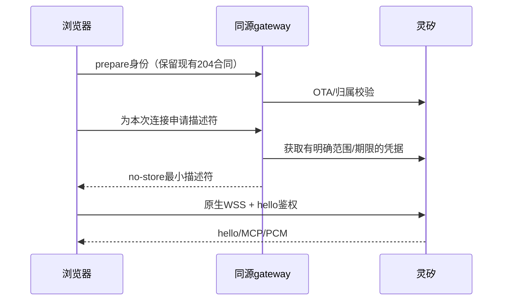

# 浏览器直连灵矽：可行性验证与候选设计

2026-11-03。用户明确授权阅读文档、真实验证、可行时实现与PR预览，并由总协调代为决定待定事项。本专项为内部no-PR规则的明确例外；main/线上发布仍由总协调掌握。

当前结论：**浏览器协议可连，但本轮完全不带token也完成相同的PCM/16k hello与MCP tools/list状态，不能据此建立“prepare下发token保护直连”的产品安全前提。** 已停止产品接入；安全产品化仍缺正式身份/权限、有效期与撤销合同。`device-scoped`是待证明要求，不是现有OTA token已证实属性。

## 一手协议证据

- [WebSocket标准](https://websockets.spec.whatwg.org/#the-websocket-interface)只有URL和protocols构造参数，不能设置gateway目前使用的任意请求头。
- [灵矽WS文档](https://linx.qiniu.com/docs/xrobot/platform/websocket)公开的`/v1/ws/`合同使用Authorization、Device-Id、Client-Id、Protocol-Version请求头；未找到该入口的浏览器query/subprotocol/hello替代鉴权合同。
- [OTA文档](https://linx.qiniu.com/docs/xrobot/platform/OTA)说明绑定后返回websocket URL/token，但没有可核的设备权限范围、过期时间与撤销语义。管理端用户token有效期不能套用到OTA token。
- 官方控制台公开[静态资源roleConfig-DFwpAsLp.js](https://xrobo.qiniu.com/assets/roleConfig-DFwpAsLp.js)，读取日期2026-11-03，SHA256 `45255aaadf4cfce1f5fb015fef3a110bb85eb09ad881bc856146b6b63b3523a4`：原生WebSocket连`wss://xrobo-io.qiniuapi.com/v1/ws2`，query为`device-id`与`client-id`；hello含device_id/device_mac/token/features/audio_params。其网页体验将agentId作为设备值、使用公开静态示例token，不能拿来作为产品安全凭据。该客户端加载Opus，未明确声明PCM，故本次PCM能力来自下面的实测而非静态推定。

## 首轮真实正向结果

[白名单结果](positive-browser-result.json)。环境：本机macOS、独立headless Google Chrome、Playwright驱动原生WebSocket、页面Origin为`https://lie.agency`。独占临时Agent/Device，先关闭开场问候并readback确认；未开mic、录音、上传PCM、发送listen或文本推理。不是Node自定义header探针，也不是大陆或iOS真机测试。

1. 官方Device OTA流程取token；以真实Device/client标识作为ws2 query身份，以该OTA token放入hello，未使用公开demo的agentId/示例token。
2. 连接open，收到PCM/16000 hello与MCP tools/list并提交应答，1787ms结束。脚本支持initialize应答，但没有单独记录/断言其成功，因此不称已独立验证initialize。首轮只断言format与sample_rate；没有独立录下channels/bit-depth，也未渲染或接收TTS音频。1787ms仅本机单次协议时长，不是首音时延或改善比例。
3. token可解析为JWT形式，payload只有data字段，没有可读exp；没有验证签名/解密data。这既不能证明永不过期，也不能证明已知短期或Device隔离。
4. finally关闭浏览器、精确解绑owned Device与删除owned Agent，返回均成功。私密0600 ledger保留owned ID供追溯，token在收尾清空。没有用户tab、应用服务或共享资源操作。

执行偏差：首轮脚本在正向结束即finally清理，未将负向组包含在同一资源生命周期。该轮真实成功与清理结果原样保留，不补造阴性证据。总协调随后批准**额外一次**独占1Agent/1Device、至多3连接的新5分钟窗口，按合法→缺token→错误token顺序，整组结束/异常后finally清理；两轮总连接数上限仍不超过5。补测结果另列，不能用设计预期代替实测。

## 第二轮：token鉴权对照

[脱敏实测结果](auth-comparison-result.json)。同一环境、同一新建独占Device/client、同一hello除token字段外保持一致；每条确认close后再拨下一条。

| 组 | 原生WS结果 | 关闭 | 结论边界 |
| --- | --- | --- | --- |
| 合法OTA token | PCM16 mono/16000 hello＋MCP tools/list及本地应答，5311ms | confirmed | 协议协商成立；未发listen或计费业务请求。 |
| 完全省略hello.token | 同样PCM16 mono/16000 hello＋MCP tools/list及本地应答，1664ms | confirmed | **这一握手状态不以该token存在为必要条件。** 不能证明后续业务授权相同，也不能推断服务端完全没有其他身份校验。 |
| 确切错误token | 未执行 | 不适用 | 按总协调预定门禁，前一阴性组达到同样握手状态即停止，不扩大探测。 |

两次hello均检查format、sample_rate、channels与bits_per_sample/bit_depth（未声明bit-depth时沿用现有协议16默认），没有收/发音频或验证真实解码。时间包含各次网络/服务端准备差异，不能比较为缺token更快，更不能称大陆或iOS效果提升。

该轮browserClosed、deviceUnbound、agentDeleted均true。两轮总计3条WS、2个专用临时Agent与2个Device，均各自清理成功；没有复活前轮身份、调用共享Agent、读取用户日志、使用mic/录音/推理、发出listen或操作用户tab。前轮只一次正向、补轮正向+缺token，未执行任何额外隐藏重试。

实测只覆盖来自本机Chrome/正式首页Origin的握手，不包含真实TTS、Origin白名单范围、跨Device/跨Agent、token到期/撤销或业务计费权限。JWT无可读exp不等于没有服务端期限。当前不能安全地把设备身份字段当作已证实的会话授权机制，也不会使用公开demo的agentId/静态token绕过这个缺口。

两组按批准顺序在同一浏览器上下文、同一Device/client上先合法后缺token；没有清provider Cookie或检查服务端身份缓存。缺token组可能受到前组的浏览器/服务端认证状态影响，本轮不能分辨，也没有验证一个全新未认证上下文的缺token行为。因此该结果不是“灵矽无鉴权”的证据；它只说明本轮序列中的握手没有因省略hello.token而被拒绝，仍不足以确立安全分发合同。按预设停止条件不再扩大实验。

## 验证脚本与复验条件

[feasibility-probe.mjs](feasibility-probe.mjs)是独立服务端执行工具，默认拒绝执行。只有明确传入`--execute-owned-probe`、`--key-file`（本机服务端既有私密文件）、`--private-state-dir`（预先建立0700的ignored目录）、`--playwright-module`（本机既有Playwright的绝对模块路径）才进入实验。私密ledger用0600和wx创建，拒绝覆盖先前实验；脚本内不包含凭据。需要Node24、Playwright及当前配置指定的macOS Google Chrome，不是PR浏览器里运行的功能。

脚本会创建1个临时Agent/Device、验证禁开场、只发hello/MCP，最多3次原生浏览器连接且每条确认关闭后再下一条；正向失败、未知事件、未知拒绝或负向也达到同样握手状态即停止。资源API有12秒deadline，采样窗口5分钟，cleanup单独最多1分钟；finally尝试关闭owned浏览器、解绑owned Device、删除owned Agent，并输出明确清理状态。API响应未知或cleanup失败需保留私密ledger交原owner处理，不盲建新身份或清理其他资源。实际无声学/推理验证，不能因脚本支持再跑而在未经协调窗口反复调用。

输出只含阶段状态、固定协议枚举、有限数值、token结构摘要和清理布尔；不输出URL参数、身份、token、原始错误或正文。负向的generic close/error不是明确鉴权原因，只用于与正向区分，不升格为完整业务授权或权限边界证明。

## 安全产品候选设计（有条件，未接入产品）

准备HTTP仍经过Cloudflare；只有持续WS从路径中移除gateway。不会承诺终端到provider永不跨境、初始化一定更快或已解决镇江电信断续。provider会直接看到终端网络连接。

前提是供应商确认ws2生产支持、PCM合同、凭据Device/Agent范围与期限/撤销，以及正式/PR Origin政策，并有对应实测。缺token/错误token被拒绝也只说明本轮差异，不证明跨Device权限与有效期；open/hello/MCP不是计费业务权限的完整证明。

如前提成立，采用总协调选择的最小方案：relay保持默认，直连仅由受控PR服务端配置启用，浏览器URL参数不能解锁凭据。连接描述符只含允许的WSS地址、本次连接token、必要Device/client标识和限制；不返回整个OTA响应、activation、Cookie签名或管理信息。绝不下发LINX_API_KEY、LINX_WS_TOKEN或Cookie secret，不以共享key回退。接口继续精确同源Origin/空body/无query/签名Cookie/environment/ownership检查、no-store；客户端仅内存持有，不进storage、日志、分享或诊断。

介绍页prepare缓存只用于身份准备；未知TTL的连接凭据不能无限复用，需每次显式开连接时取得，并保留取消/代次隔离。新连接接口避免把旧prepare的204直接改成200令已开旧页面失败。上游scheme/host/port/path在服务端严格允许后才附凭据，拒绝userinfo/fragment/未知重定向；token优先置hello而非URL。

客户端复用现有channel.createSocket接入点与hello/MCP，不复制第二套游戏/voice；保留16k、player/microphone及iPhone/iPad Safari现有TTS→drain+300ms门控。补齐原relay的65536-byte入站上限与连接期限，但明确客户端600秒timer不能提供原服务端同等级的费用/滥用硬上限；provider须提供可执行的连接/计费限制。游戏询问额度与连接期限保持分别计算。

直连失败不隐式启动第二连接或自动relay重试；清理后由用户明确重试/选择relay。产品CSP若实际存在只放行确切provider WSS域；独立Safari合成音页connect-src none不改。PR环境从自己同源gateway取得凭据，沿用非生产Agent与pr-N身份，不能指向生产prepare；新配置必须同步预览artifact/deploy严格binding校验。

## 交付门槛与后续问题

总协调已决定：没有可核凭据安全合同时交研究/probe PR，不开放任意预览用户领取OTA凭据，不伪装产品直连已经可测。本次无token组已触发该停止条件。PR即使产生平台预览，也只运行既有游戏与relay，不提供新的直连入口；它用于审阅可复验研究和条件设计。用户所要求的可行后产品实现，取决于安全可行性条件，当前条件未满足。

供应商待确认：ws2是否承诺生产使用及PCM16 mono16k；hello token是否强制校验，如何绑定Device/client/Agent；有效期、刷新、撤销/解绑即时性；可否签发短期连接凭据并限制600秒/额度；Origin允许规则；是否存在正式浏览器SDK/鉴权文档。由用户或获授权者转交，本专项不自动代发消息或读取控制台账号。

工作区17d4/lie复用原隔离目录，从已审local main `c8f85d5a47b884268e8cb90e7eb89ef2de28a86f` 建 `codex/linx-direct-websocket`，保留旧a65分支与原件。本批只写本调查目录；共享应用与配置未改。服务端秘密只由探针内部读现有私密来源，不打印/复制；原API响应、token、Device/Agent标识、浏览器握手URL均不进入仓库/PR。
