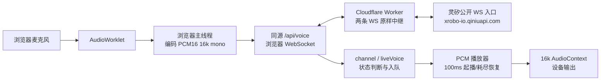

# 中国大陆用户语音断续：首轮调查

2026-11-02（Asia/Shanghai）。状态：**调查完成一轮，根因未定；没有产品修复、生产采集或基础设施变更。** 本文是新专项的调查与备选方案，不覆盖 Safari 自回声专项的 ownership 或批准门禁。

同日后续已由用户要求统一为一个诊断工作项：Safari负责人维护唯一测试说明，总协调统一通知用户；不再分别追问或安排对照。最新输入为iPad自打断暂未复现、用户拟稍后用iPhone Safari，按一台选定设备的一次正常短会话观察；这不代表句中断续也已消失。见[本专项联合分析交接](joint-analysis-handoff.md)；下文首次调查的候选对照保留为历史研究，不是当前测试排程。

## 用户样本与范围

用户在本专项 Chat `01a19b77-cc1d-7e73-90d6-853e08b972ce` 补充：江苏镇江电信、Wi-Fi、iPad / iOS Safari；角色说话中断断续续，停后继续；页面正常出现转写，没有连接错误；初始化连接也较慢。这是一名用户的一种环境，不能代表所有大陆/电信/时段。转写属于哪一侧、是否与停顿同步、是否为同一原句继续，尚未逐项确认。

缺少精确 iPad 型号、系统/浏览器版本、发生时段、前后台/输出模式、该次页面版本和帧时序。Safari 专项已有设备记录，但未经确认不能把另一轮样本的版本套用到本轮。没有向用户索取录音、完整私密对话、HAR、凭据或设备身份。

用户提出“Cloudflare 可能在境外、灵矽在大陆、语音绕行”的假设。它合理但未证实；当前源码可以证明中转架构，不能证明这次 WS 实际入口/执行机房、上游生成节点和两段网络质量。没有连接错误、停后继续，与持续供给/播放停顿相容，尚不足以排除显式打断或设备输出问题。初始化慢与句中卡顿分别测量；旧约三分钟断连、CPU 配额和本轮现象不合并归因。

## 隔离、基线与线上只读核验

- 实际工作区 `/Users/nighca/.codex/worktrees/17d4/lie`，初始 detached 且 clean；与 owning local main、origin/main 均为 `e961e47c1954af65564108654d7f3de12b19172c`。已建立唯一 `codex/mainland-voice-stutter` 分支。app `list_artifacts` 返回空列表，Git worktree 实际登记存在；没有据此重复创建目录或把工作落主 checkout。
- `git ls-remote origin refs/heads/main` 只读复核仍为 e961e47；origin 是 `git@github.com:nighca/lie.git`。未 fetch 改共享 refs，未操作 main、push、deploy 或 PR。
- GitHub API 实查 [CI 41369888679](https://github.com/nighca/lie/actions/runs/41369888679) 与 [CD 41370035646](https://github.com/nighca/lie/actions/runs/41370035646)：完整 head SHA 都为 e961e47，completed/success。
- 2026-11-02 17:01 左右北京时间，已安装的 `cf 1.0.0-beta.18` 只读查询 `workers deployments list --worker lie-game --per-page 1`：最新 deployment `343f9f80-a8d3-400a-b0cb-21bfbe525a01`，version `04edfb89-2767-475d-809a-6b752b8b855c` 100%，message 为上述 verified CI build，创建于 `2026-11-02T00:59:33.526309Z`。
- 该**显式版本** `workers versions get … --worker-id lie-game`：number 59，CPU `30000`、standard、兼容日期 `2026-10-23`、`enable_request_signal`，plain text `VOICE_MAX_SESSION_SECONDS=600`、`VOICE_DEVICE_ENVIRONMENT=production`，R2 `lie-shared-games`。`workers get lie-game` 确认关联 `lie.agency`；logs enabled / sampling 1 / query redaction，traces sampling .01。未查询原始用户请求日志。
- 版本响应没有 placement 字段，仓库配置也未设 placement；这不是“中国网络订阅不存在”或实际执行地域的证明。未查账单/套餐/China Network 接入能力，实际账户是否启用仍未知。未重新下载生产 bundle；以上证明当前 serving 版本标记及配置，不能代替该用户旧 tab 的完整构建身份。
- 全局 `cf 0.15.0` 不支持本次技能所述 search 命令，故只读使用既有 main 安装的 beta.18 CLI 与持久 Node 24.22.1，未安装/升级/软链依赖。无本地 node_modules 的专项 cwd 无法加载 `cf/config`，账户只读命令改在无项目配置的临时 cwd 执行并显式指定 Worker；没有临时配置或凭据复制。CLI 只使用自身已有认证，未查看认证文件或 secret 值。提交材料省略账户标识、secret 名称清单、原始 API 响应和请求头。

## 实际链路

图为代码逻辑路径，不标未经测量的地理位置。网络、Worker、provider 和浏览器都有独立边界。

| 边界 | 实际实现（行号相对 e961e47） | 对本问题的意义 |
| --- | --- | --- |
| 准备 | `liveVoice.ts:24–65,223–231`：status→prepare；介绍页可能预热，已准备可复用。`browser-device.ts:75–162`：OTA/绑定/token。 | 冷热准备不同；不能把初始化所有等待算为 TTS 或只算网络 RTT。 |
| 建连 | `liveVoice.ts:232–265`：播放 resume、mic/worklet、channel 并行。`channel.ts:74–79,229–260`：ready 等 hello＋MCP tools/list。`gateway/index.ts:92–138`：先连上游，必要时初次401同Device取token重试，9秒连接超时，成功后才返回浏览器101。 | 浏览器 socketOpen 包含前面的上游建立；channel 默认10秒握手超时不是连续播放buffer。 |
| 上行 | `microphone.ts:5–19,81–103`：worklet采集→主线程PCM编码。`channel.ts:271–275`：每20ms 640 bytes。 | PCM净载荷约32kB/s（256kb/s）；不含协议开销。低带宽、上行拥塞或主线程延迟会影响识别/响应。 |
| 中继 | `gateway/index.ts:11,108–138,148–175`：固定公开上游；两条accepted WS每个message直接send；单帧上限65536，600秒timer。 | 所有上下行音频与控制消息均经过Worker；无TTS转码、缓存、主动分批定时或PCM重采样。send返回不是对端已收到。 |
| 回答上下文 | `channel.ts:118–171` 与 `liveVoice.ts:151–158`：provider可经MCP取浏览器角色上下文。 | 真实首次回答可能包括额外往返/生成；不等同“连接ready→已听到首音”。 |
| 下行/状态 | `channel.ts:178–223` → `liveVoice.ts:160–185`。只在ready/speaking/非interrupted且当前回答有效时收PCM。 | 实际下行分片可变长；按bytes/32000计算时长，不能把所有消息都假设为20ms。 |
| 播放 | `player.ts:95–178`：首次/真正耗尽后累计1600 samples或首pending的100ms timer；normal TTS stop可flush短尾。健康队列沿nextTime连续追加。 | 不是持续维持100ms最低储备，也不是固定等100ms；稳定时延与间隔抖动不同。16k graph首次/恢复提交余量256/16000=16ms，不是硬件保证。 |
| 停止/生命周期 | `liveVoice.ts:139–180,198–210`；`navigationLifecycle.ts:9–15`。STT、aborted、新回答覆盖残余、close清队列；隐藏页面会结束活跃会话。 | 突然停声可能是明确stop。普通tts.stop只flush/drain；后台事件也可能结束会话，不全是timer节流。 |

连续PCM输出同样约32kB/s；双方同时流动约64kB/s/512kb/s净载荷，是格式算术，不是实测吞吐或认为此带宽足够就一定流畅。两段传输的抖动、重传和生成速率仍然关键。

## 跨境假设：已知与未知

官方当前资料于2026-11-02读取：

- [Workers placement](https://developers.cloudflare.com/workers/configuration/placement/)：默认处理靠近接入位置，placement可改变handler位置；[地理路由说明](https://developers.cloudflare.com/support/troubleshooting/general-troubleshooting/geographic-traffic-routing/)明确Anycast/ISP路由等不保证地理最近。不根据本机某个IP/ping判断该用户执行机房。
- [China Network概览](https://developers.cloudflare.com/china-network/)说明其是Enterprise的独立订阅，域名接入需要ICP；[当前支持表](https://developers.cloudflare.com/china-network/reference/available-products/)列有Workers及WebSockets。因此“Cloudflare在大陆完全没有节点/不能跑Workers”不成立；普通global Workers/Paid也不能推出已接入China Network。本任务没有采购/迁移建议的成本收益实证。
- [CF-Ray说明](https://developers.cloudflare.com/fundamentals/reference/http-headers/)与[request.cf](https://developers.cloudflare.com/workers/runtime-apis/request/)提供请求关联机房信息；首页/health/trace不是同一次语音upgrade。单个colo不能证明完整路径、上游物理机房或持续音频质量；有placement时须区分请求接入和执行。
- [灵矽WS协议](https://linx.qiniu.com/docs/xrobot/platform/websocket)确认固定入口，但没有给本会话的物理机房/生成节点。用户提供“灵矽在大陆”作为待核背景；域名或公司所在地不代替会话地域证据。
- 经典WebSocket建立在TCP之上（[RFC 6455](https://www.rfc-editor.org/rfc/rfc6455)）；TCP可靠有序并重传（[RFC 9293](https://www.rfc-editor.org/rfc/rfc9293#section-2.2)）。由此推论：网络问题可表现为等待后批量到达，而非应用丢帧；本轮没有抓到重传证据。开启网站HTTP/3不能直接证明这两条WS音频已改用避免该等待的传输。

## 现有观测够做什么

`PlaybackObserver`（`player.ts:6–18`）已有schedule、buffer、stop原因、context-state；liveVoice追加answer start/stop/aborted。能重建**同回答内**计划排程空隙、queueAhead、待排samples、是否被显式清空。当前 `arrivalIntervalMs` 是enqueue时主线程 `performance.now()`，随后随pending包到schedule才输出；不是网卡收包时间。[WebSockets标准](https://websockets.spec.whatwg.org/)也规定message经任务队列派发。

需要避免三个误判：

1. `queueExhausted` 是计划时间轴判断，不是声卡实际underrun计数；普通drain不清nextTime，新回答之前的自然静默也会产生gap，必须按回答边界排除。
2. 主线程卡住时音频线程可能继续消费已排buffer；恢复后的集中enqueue与网络集中到包可以产生相同观察。context暂停时audioTime又不是连续墙钟。
3. 计划连续不保证扬声器连续；PCM自带静默、真实render deadline、设备重采样/路由均未被测量。低频RMS也不是网络到包/丢包证据。

生产 `liveVoice.ts:23` 默认**不注入**onPlayback。DEV collector默认关闭，enable后保留最近2000条内存，disable清空；没有截断标记，也没有按本轮导出生产诊断的现成功能。不能给用户一个生产开关并声称已有。`onStartup`也是可选注入：覆盖准备、socket/hello/MCP、mic/worklet/resume、listenStart及首个**上行**PCM；不覆盖每轮说完→首个下行/首个计划播放，更不能定位持续卡顿。

Worker目前只有连接失败/拒绝日志与平台观测配置，没有应用级每帧接收/转发时序。没有复现时间/同会话关联时，拉全量原始用户日志既不能完成归因也会扩大数据范围，本轮未执行。

## 无服务离线对照

[脚本](offline-replay.mjs)直接strip并执行当前player/PCM源码，无独立重写播放器，无浏览器、音频输出、mic、WS或provider。固定同一段2秒合成PCM，100个640-byte分片，16k fake audio clock，只改变回调时序。包括9场景、样本数守恒/无重叠/回收断言；[结果](offline-results.json)保存源码hash和完整数值。

在仓库根目录使用符合项目要求的Node24运行 `node docs/reviews/mainland-voice-stutter-2026-11-02/offline-replay.mjs`，仅向stdout输出JSON；不需要node_modules。同到期任务按fixture登记序号执行，回调自身耗时为零；不模拟真实浏览器任务源竞争。调度断言不验证真实波形、声卡deadline或浏览器任务优先级，70/220/420ms不是Safari实际停顿预测值。

| 合成条件 | 首次计划播放（ms） | 同一回答总计划gap（ms） |
| --- | ---: | ---: |
| 均匀20ms一包 | 96 | 0 |
| 所有包固定额外迟500ms | 596 | 0 |
| 每100ms集中5包，平均速率相同 | 16 | 0 |
| 600–750ms扣住包后补齐 | 96 | 70 |
| 600–900ms扣住包后补齐 | 96 | 220 |
| 600–1100ms扣住包后补齐 | 96 | 420 |
| 源在600ms处暂停300ms，之后不补赶 | 96 | 300 |
| 网络均匀、主线程600–900ms不可处理 | 96 | 220 |
| 每25ms只供给20ms音频 | 116 | 455（4次gap） |

固定额外时延只推迟首声，不必然使连续播放卡顿；实际跨境链路可能同时增加抖动，两者不能混为一谈。网络扣包300ms与主线程阻塞300ms均得到最大enqueue间隔320ms、总gap220ms，证明**仅现有入队间隔无法辨别两者**。低速持续供给最终反复耗尽，任意有限缓冲只能延后这一结果。

这些是对既有调度的受控说明，不是镇江电信实测、Safari复现、真实声卡结果或网络因果证据；没有测试不同缓冲参数，也不据此指定新阈值。当前player/PCM hashes与此前[16k候选](../../voice-playback-16k-candidate.md)及seam档案一致，旧有限本地试听不扩大为全设备/全网络保证。

## 最小实测设计（待协调/确认，未实施）

先复用[Safari专项](../safari-self-interruption-2026-11-01/README.md)的真实窗口方法：用户手动正常游戏，Mac→iPad Inspector仅记该socket的事件类型、方向、相对时间、二进制长度和aborted布尔；不复制正文、headers、binary、身份或HAR。详细提案位于Safari source `da1abe27b5daba9c680f4630d23816611e4536ee` 的 `docs/reviews/safari-self-interruption-2026-11-01/next-live-window.md`，本专项不cherry-pick其待归档文档，也不把它作为运行依赖。Safari owner此前获准的真实窗口不自动授权本专项新增采集项，必须由用户明确同意本轮范围，并协调同一窗口而非重复测试。

第一次先回答“发生了什么”：同一回答无stop且queue耗尽、明确STT/aborted清空、context不running，还是计划连续却听见停顿。生产现有Inspector只能看到其支持的网络/事件信息，不能假装已能读取内部player。若缺关键边界，再提一个与Safari共用的opt-in浏览器记录器；不各造一套，也不把独立合成音诊断页接上Linx。

| 分层/最少字段 | 判读与不能越过的边界 |
| --- | --- |
| 浏览器共享提案：相对单调时钟、回答序号、现有observer字段、TTS/STT/close枚举、bytes/累计audio时长、context状态、visibility；支持时用事件循环/long-task指标。 | 足以分显式stop/排程断流/状态变化。不能从enqueue间隔直接判网络。默认off、有限内存、显式结束/复制、不上传，无正文/PCM/身份；采集设计及ownership须用户与协调者确认。 |
| 必要时Worker补充：同一短窗口、每方向binary序号/长度/累计bytes、相对I/O接收时刻、转发调用结果、该upgrade的colo/placement（如可得）。 | Worker到包平稳、浏览器变长间隔：问题在下游传输或客户端派发；仍须区分这两者。只观察send调用不等于测得线路送达。新增云记录的范围/保留/关联方式单独审查，不能自动利用已有全量日志保存。 |
| 若Worker的provider消息回调本身已有长间隔：需要provider发出时序、Worker运行证据，或经批准的固定PCM受控源。 | 只能说缺口在Worker观察点已可见；候选仍含provider生成、provider→Worker传输和Worker自身派发。双向上行/MCP还可能影响provider何时继续生成，不能据此彻底排除客户端间接影响。受控WS实验是新的服务/调用范围，不能擅自起服务或公网端点。 |

两端按同方向message序号和累计bytes核对，可不改PCM wire格式；channel丢弃帧须另计，不能把player收包序号硬配上游。对齐同会话所需短期随机标记仍属方案；不复用device/session ID。不要直接相减不同主机时钟计算单向时延：比较各端同序列的间隔变化仍含时钟漂移与主线程派发因素。[Worker时钟](https://developers.cloudflare.com/workers/runtime-apis/performance/)只随I/O推进，紧挨的receive/send为0ms不能证明CPU开销为0。

**可证伪的应是具体子假设：**若同次停顿前已向播放器交付足以覆盖停顿时段的PCM，仍因明确本地stop/context或排程/输出而停顿，则“此次停顿由跨境传输造成PCM供应中断”受到反证；这不排除已交付PCM自带静默等上游内容问题。固定PCM在本地稳定输入下出现同类故障，只证明这种症状不必依赖跨境，不能排除用户原来那一次另有网络问题。Worker回调已有长间隔只证明缺口在该观察点可见，不能直接在provider生成、上游网络、Worker派发之间定因；浏览器回调晚同样不是跨境证据。

地域/接入对照需固定同一设备、浏览器版本、页面与gateway版本、前台、输出路径、PCM内容/格式/分片/长度、时段与重复次序，记录城市/运营商/Wi-Fi或蜂窝及样本数。Wi-Fi↔蜂窝若可用按A–B–B–A，只能证明接入组合相关，不能单独定位跨境。相同真人提问不保证生成相同音频，应标为自然会话样本；真正固定音频仅在另获授权的合成控制路径做，不记录/回放私密语音。

本机网络没有被当作镇江电信出口，当前无法完成大陆持续WS样本、该iPad真实播放、provider发送时序或同音频地理对照。ping、IP归属、一次curl、已有本地8787顺畅都不能填补这些空缺。初始化单独分冷/热prepare、socket、hello/MCP、mic许可/worklet/resume；记录用户点击/ready/首声的区别，不把连接优化推作句中修复。

## 最小改进选项与决策门禁

| 顺序 | 选项 | 适用证据/代价/当前状态 |
| --- | --- | --- |
| 1 | 共用现有observer的明确opt-in时序记录；先Inspector，不足再共享产品hook。 | 信息收益最大，玩法与provider参数不变；产品记录器尚未批准/实现。涉及`liveVoice.ts`、应用trace入口、必要时channel计数与gateway，先交协调者分配ownership；player尽量只复用observer。 |
| 2 | 核对灵矽`play_buffer_duration`，先确认省略时实际值，再考虑单变量发送节奏试验。 | [官方WS文档](https://linx.qiniu.com/docs/xrobot/platform/websocket)写默认1000ms、越大服务端发送越积极。当前hello省略该字段；不能把本地100ms阈值当该值。显式1000只固定协议意图，若服务端本就按默认执行应无收益；合法范围/钳制/节奏未知，更大值不先拍定。不修改provider请求。 |
| 3 | 有明确短时供给抖动后，评估较大或自适应起播/恢复储备。 | 增加首声/恢复等待，无法补持续供给不足；当前100ms保持。先量化同音频gap与首声代价，再确认具体方案，不直接用buffer掩盖来源。 |
| 4 | 有主线程迟滞且影响排程的证据后，评估减少主线程工作/播放Worklet等。 | 模块/生命周期成本高；当前没有证据需要换播放器架构，保持待选。 |
| 5 | 两段证据指向网络、受控路由对照有收益后，再讨论区域relay/host/China Network/placement。 | 涉及部署、凭据、来源限制与运维/费用；当前不选迁移目标，不改DNS、套餐、provider或资源。 |

另有协议一致性线索：[OTA协议](https://linx.qiniu.com/docs/xrobot/platform/OTA)提供`websocket.url`，WS文档建议优先动态地址。现有`browser-device.ts:120–123`只取token，网关仍固定入口。所查官方资料没有“就近/按地域调度”保证；不能称改用OTA URL必然解决绕行。若以后处理，先核脱敏scheme/host/path与允许目标及鉴权转发约束，不让凭据随任意返回URL发送。本轮未请求OTA。

## 检查、所有权与交接

- 只拥有本目录调查文档、离线脚本/结果；共享voice/player/liveVoice/UI/gateway/config均未改，中央project-plan/development由总协调在正常批次更新。
- 两个只读subagent分别审查播放器/观测边界与官方网络/协议资料；本专项root完整读取指定源码并复核关键结论和线上白名单配置。离线结果由root执行，另做独立脚本/结论审查。
- Node24.22.1运行9场景断言通过；没有安装依赖或运行应用全套测试，文档调查不需要重跑。无本地服务、端口占用、浏览器tab、录音、mic、provider、WS、Linx绑定/资源或音频上传；未动8787/8788/5177/5198及其他worktree。
- 此轮交接需包含原base、依赖、ordered SHA、实际diff、文档/离线检查、上述未验证边界及clean/service回执。总协调Chat `01a18baa-4fac-71f2-a81f-c39be0640fe8`拥有审查、唯一main集成和普通push；本专项不自行集成发布，不为报告重复触发发布。
- 建议中央队列新增本样本和root/source分工；下一步等待具体用户样本窗口与共有metadata方案确认，未获批准的trace、buffer/协议调参、路由迁移继续保留门禁。
