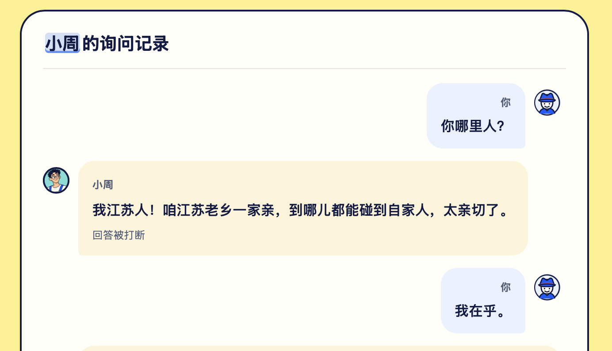

# Safari 角色语音自打断调查

2026-11-01，专项 Chat `01a19770-ee7d-7c31-96fe-b80657c3ee5d`。状态：**首轮事件路径和后续 WebKit 输出路径调查完成，独立无provider诊断工具已实现并离线检查；线上入口待用户范围确认，真实 Safari 未复现、根因未定、无产品修复**。

## 范围与来源

用户报告 Safari 经常将角色播放音识别为玩家输入，导致角色回答中断。截图中的玩家气泡“我在乎。”明确不是用户说的。首轮尚缺设备/输出信息；同日用户在本 Chat 补充了以下对照，替代首轮“设备/输出未知”的状态：

| 用户报告的环境 | 输出与结果 | 未知信息 |
| --- | --- | --- |
| iPhone / Safari | 内置扬声器，遇到自打断；未用耳机 | 机型、iOS/Safari 版本 |
| iPad / Safari，iPadOS **26.7.1** | 内置扬声器，遇到自打断；未用耳机 | 机型、Safari 完整版本 |
| 同一 iPad / Chrome | 用户报告没有此问题 | Chrome 版本、是否同一次/同案件/同 build/相近音量的严格对照 |
| MacBook / Safari | 用户报告没有此问题 | 机型、macOS/Safari 版本、该组的具体输出路由 |

这是用户现场观察，不是本专项在真机上执行的验收。iPadOS 26.7.1 按用户提供原样记录，未独立读回；不将它自动等同 Safari 完整版本。页面 build hash 与耳机对照仍未知。

原始 intake：协调者 Chat `01a18baa-4fac-71f2-a81f-c39be0640fe8`，工作树 `/Users/nighca/.codex/worktrees/lie-disconnect-evidence-integration/lie/docs/backlog/2026-11-01-safari-audio-tablet-cards/README.md`。本目录只复制语音相关原图，逐字节保留，无裁剪/重编码：109605 bytes，SHA256 `b3c0401c4246d319cb96ebd1952902e58c123c57f58a53c53c863cbd3d37a308`。不复制另一个 owner 的卡片布局附件。

预期保持：角色讲话时玩家能自然插话，连续采集与 provider realtime 模式保留。此问题独立于 Worker 约三分钟断开及电流声音爆；不把之前 CPU/16k 试听通过当成本问题的验证。

## 隔离与所有权

- WT `/Users/nighca/.codex/worktrees/9423/lie`，初始 detached HEAD、tracked/untracked 均干净；HEAD 与当时 local main 均为 `8449b1a15db654e31fa18d40aea4932dbd1f6cff`。核对 worktree list、branch、remotes 后，在本 WT 创建唯一 `codex/safari-self-interruption` 分支，复用正确附带的隔离环境。
- 本专项拥有语音相关调查/测试和本目录；不改首页、卡片、首次帮助、共享接口或中央项目计划。中央 dashboard 由协调者在 review/handoff 时批量更新。
- 协调者负责实际 review、串行集成与发布。本专项不改 main、不 push、不部署；不创建 provider 资源。

## 已确认的代码机制

以下均指上述基线，不代表已捕获用户出错当时的实际事件。

| 环节 | 当前代码与证据 | 可推断的边界 |
| --- | --- | --- |
| 麦克风请求 | [`microphone.ts`](../../../packages/voice/src/microphone.ts) 请求 `audio: { channelCount: 1, echoCancellation: true, noiseSuppression: true }`，`video: false`。不指定 `autoGainControl` 或输入设备。 | 已请求 AEC，不等于实际生效或能消除所有外放声。代码没有读取 `getSupportedConstraints()` / `track.getSettings()`；当前没有用户设备的实际设置。 |
| 采集路径 | `getUserMedia → MediaStreamAudioSourceNode → AudioWorklet → PCM encoder → channel.input`；mic graph 的 gain 为 0。编码使用 capture AudioContext 的实际 sampleRate，重采样到 PCM16 mono 16k/20ms。 | 没有显式把角色播放节点接到采集 graph；没有本地 mic 监听外放。实际设备/OS 声学或虚拟路由仍未知。 |
| 播放路径 | [`liveVoice.ts`](../../../apps/web/src/application/liveVoice.ts) 单独创建 `AudioContext({ sampleRate: 16000 })`；[`player.ts`](../../../packages/voice/src/player.ts) 使用 buffer source 接 playback destination。麦克风另开默认采样率 context。 | 两个 context 是当前事实；没有证据证明这就是 Safari 故障原因。未经对照不合并 context、不撤销已接受的 16k 播放。 |
| 本地活动检测 | liveVoice 的输入 RMS / 0.012、0.008 阈值及 120/350ms 滞回仅发 `audioLevel`。 | 改这些阈值不会改变供应商 VAD 或阻止当前打断路径；未发现本地能量触发 abort。 |
| 上游采集/VAD | 持续发送 input PCM，`listen.start` 使用 `realtime`。应用没有本地语音识别器；供应商内部 VAD/ASR 的判定过程不可见。 | 即使本地晚一点处理 `stt`，也不能保证供应商没有先中止旧回答。 |
| 事件归属 | [`channel.ts`](../../../packages/voice/src/channel.ts) 仅把 `type: stt` 的字符串 text 映射为 STT；`tts.sentence_start` 映射为角色文本，二进制只作角色音频。 | 未发现 TTS 文本在此被误映射为 STT。协议缺少可核对的每轮/说话人 provenance，收到 STT 后无法单凭文本判断真人或回声。 |
| UI 打断 | liveVoice 收 `stt` 时先 `interruptAnswer('stt')`，再发 `userText`；[`controller.ts`](../../../apps/web/src/application/controller.ts) 将 pending 角色文本保存为 interrupted，再追加 user 条目。`tts.stop(is_aborted)` 也是独立打断入口。 | “回答被打断＋玩家气泡”与上游 STT 到达的机制一致，但截图不能证明当时确切事件顺序；需要现场记录区分先 aborted 还是先 STT。 |
| Worker | [`relaySockets`](../../../apps/gateway/src/index.ts) 在大小/生命周期限制内原样双向转发 frames，不解析或重写角色。 | 代码中没有 gateway 将 TTS 改成 STT 的分支；不据此排除供应商误归属、ASR 幻觉或回声。 |

## 离线机制实验

[`voice-self-interruption.test.ts`](../../../apps/web/test/voice-self-interruption.test.ts) 将**真实 channel JSON 解码器与真实 liveVoice bridge**接在一起；socket、mic、player/context 为 fake，PCM 为全零合成帧。不是用真实用户声学音频复现，也没有调用麦克风或供应商。

有序输入：hello/tools 握手 → TTS start/sentence（“我在乎。”）/PCM → 本地高 input level 达到 inputActive → 一帧 input PCM → STT。两组 STT 分别为同一句“我在乎。”和正常不同内容的插话。

观察：TTS 仅产 assistantText；本地 inputActive 不停止 player，也不产玩家文本；供应商 STT（不论是否重复台词）均产生 `interrupted → userText` 并 `player.stop('stt')`；此后 mic PCM 继续发送，关会话才 stop mic。这个实验定位了“哪些事件足以产生截图所示行为”，没有证明 Safari 实际回灌。

### 本轮检查

独立 WT 内安装依赖，使用既有 Node `24.22.1`/npm `11.19.1` runtime（系统 PATH 原先为 Node24.17.0/npm11.13.0，未用于本轮检查）；未共享或软链其他 WT 的 node_modules，未读取/复制 `.dev.vars`。

- `npm ci --ignore-scripts --no-audit --no-fund` 通过，217 packages。
- Web 目标测试 5 files / **50 tests** 全通过：新增事件路径 2 tests、liveVoice、liveVoice-prebuffer、voice-capture-readiness、voice-switch-controller。
- `npm run test --workspace @lie/voice`：4 files / **54 tests** 全通过，涵盖 mic constraints/真实采样率重采样/零增益/释放、channel STT/TTS/关闭隔离、播放调度。
- `npm run typecheck --workspace @lie/web` 通过。
- `git diff --check` 与图片 identity / 本地相对链接检查见交付；应用源码零变动，不运行无关全仓 build/云部署。

## Safari 与 AEC 的证据限度

参考 [W3C Media Capture and Streams](https://www.w3.org/TR/mediacapture-streams/#dom-mediatrackconstraintset-echocancellation)：`echoCancellation: true` 是由浏览器选择取消哪些声音的请求，不是本应用 WebAudio 回放一定被完整抵消的保证。应区分 supported constraint、请求 constraint、actual settings，以及实际声学效果；`getSettings().echoCancellation === true` 本身仍不是效果量测。

[Apple Safari 26.0 release notes](https://developer.apple.com/documentation/safari-release-notes/safari-26-release-notes) 记录了 microphone audio unit 的 AEC 模式变化对应 `configurationchange` 通知修复。这只说明设置可能随 capture 状态变化，不能据此断言用户命中该版本/bug。设备版本未补全前，不采用 UA sniff、强制 exact constraint、新的 AEC mode 或 WebRTC loopback workaround。

同日补充后的调查优先级：**移动端 Safari 外放下的 capture/playback 音频会话、实际 AEC 状态/路由，以及其与两个 AudioContext 的交互**。这是待验证假设：同一 iPad Chrome 未出现、MacBook Safari 未出现，使“所有 Safari 均失败”“同设备必然回灌”不符合现有观察；不能因此跳到“Chrome 一定使用不同内核”或“供应商必然无关”。浏览器宿主、权限/音频会话、加载版本/缓存、不同会话的识别表现尚未做受控对照。

针对补充条件查询了 WebKit 的 AEC/WebAudio/移动端相关报告，未找到足以确认本案根因的对应修复。[WebKit #218012](https://bugs.webkit.org/show_bug.cgi?id=218012) 讨论开启 mic 后音量/路由变化，只作为检查音频会话的背景，不是自打断的复现证据；不将音量/爆音 bug 与本案混为一个问题。

后续继续调查已找到具体 upstream 输出路径差异：WebAudio 直接output使用RemoteIO，AEC capture使用VPIO；MediaStream renderer在特定默认输出/最近采集connection等条件下可经capture unit渲染。已据此实现[独立A/B/C工具与源码证据](../../../spikes/safari-audio/README.md)，比较16k直接播放、默认率直接播放、16k媒体流播放；不改变现有玩法，不使用Linx或录音。13项fake/types/独立构建及产物边界检查通过；新增隐藏HTTPS入口待用户明确范围确认，由协调者review后发布，当前未改产品路由。IAB file协议预览被策略拒绝且未绕过，实际CSP/浏览器音频效果未验。

## 下一轮所需证据与判别

设备类别、iPadOS 版本和两台移动设备的外放已由用户补充，不重复请求。后续如取得手动窗口，优先在**同一 iPad 的 Safari 与 Chrome、相同 build hash 和输出/音量条件**比较实际设置与事件顺序，再按需要补齐机型、Safari/Chrome 完整版本、是否有其他正在采集的 tab/app；MacBook 作为附加对照。耳机是可选的第二维度，无需为调查购买设备。目前没有要求用户开始新付费会话。

如用户之后自愿手动复测，保持同页面版本、角色/问题及音量范围，先比较原输出与耳机（设备允许时），每组观察“角色讲话时本人保持沉默”和“主动插话”两种情况，记录次数和是否产生玩家气泡。耳机降低发生率只加强回声/路由假设，不单独证明 AEC 故障；同设备其他浏览器结果是附加证据，不假设所有浏览器使用不同内核。

要继续定位代码，需在用户批准的 Safari 调试窗口取**已有会话**的以下元数据，不为读取设置另开 getUserMedia：

1. 在 `openMicrophone` 已得到 stream 后、创建 graph 前，用 debugger 检查首个 audio track；仅摘录 `getSettings()` 中 `echoCancellation` / `noiseSuppression` / `autoGainControl` / `sampleRate` / `channelCount` / `latency`，缺项写“未报告”，以及 track `muted`/`readyState`。`getSupportedConstraints` 可作能力对照；不导出 deviceId/groupId/label、Cookie、token。
2. 同时记录 capture / playback context 实际 sampleRate/state，输出类型由用户说明，不用当前默认设备猜测实际路由。若路由/模式在会话中变化，再比较其前后设置。
3. 在 Safari Web Inspector 中仅核对目标 voice socket 的 TTS start/sentence、二进制到达、STT、TTS stop/aborted、close 的相对顺序；仅提供必要的虚构故事短句与时间，不导出完整网络记录/认证头/用户音频。原始 binary frames 不保存或上传。
4. 若 STT 已含播放台词：下一层是上游采集回声与 ASR/说话人误归属；没有 PCM 录音就不能最终区分，后续录音必须另获授权。若未见 STT 却有玩家气泡：才转查 build 身份或 controller 事件路径；若只有 aborted 没有气泡，独立检查供应商中止事件。

这些是待用户窗口的调查步骤，不是已执行验收，也不自动授权录音、上传、供应商流量或付费会话。

## 暂未采取的方案

- 全程关麦/角色播放时暂停采集会损失已批准的自然插话，需用户另行确认，当前不做。
- 忽略与角色台词相似的 STT 会误删玩家复述；且不保证撤销供应商已发生的中止，当前不做。
- 改 `autoGainControl`、强制 exact AEC、共享 AudioContext、改音频播放媒介或本地实现 AEC 都缺少本次设备对照证据，当前不做；如有明确证据再选最小修复。

## 交付与服务回执

首轮代码范围仅新增1个事件路径测试、本目录README与必要原图；后续独立诊断工具新增`spikes/safari-audio/`，方法/边界/源码链接与fake检查见该目录。无产品修复或 UI/玩法/provider 合同修改。原始 base 如上，无额外依赖提交；有序完整 commit SHA 在最终交付消息列明，不把 commit 自己的 hash 写回制造文档提交循环。

启动服务 **0**，停止服务 **0**，真实 mic/录音/上传 **0**，Linx 请求 **0**。后续IAB本地file页的唯一尝试被协议策略拒绝、未创建tab或执行页面。未触碰 8787/8788、5176、5544 等其他 owner 服务，无新增端口/PID/PTY/保留 consumer。测试进程均退出，不需服务清理。Safari 真机/真实回声仍未验证；因此状态仍为“待复现/实际设置与事件证据”，不能标已修复。

给中央计划的批量更新建议：P1 Safari 自打断专项已完成首轮代码及 fake 事件路径核查。用户补充 iPhone/iPad Safari 内置扬声器均出现、iPadOS26.7.1、同 iPad Chrome 和 MacBook Safari 没出现；优先调查移动 Safari 音频会话/AEC 实际状态，实际 settings/build/现场 STT 时序仍缺失，根因未定、产品无改动。待同 iPad 手动对照窗口，由协调者 review 后随正常批次归档本目录及测试，不为报告单独制造部署。
