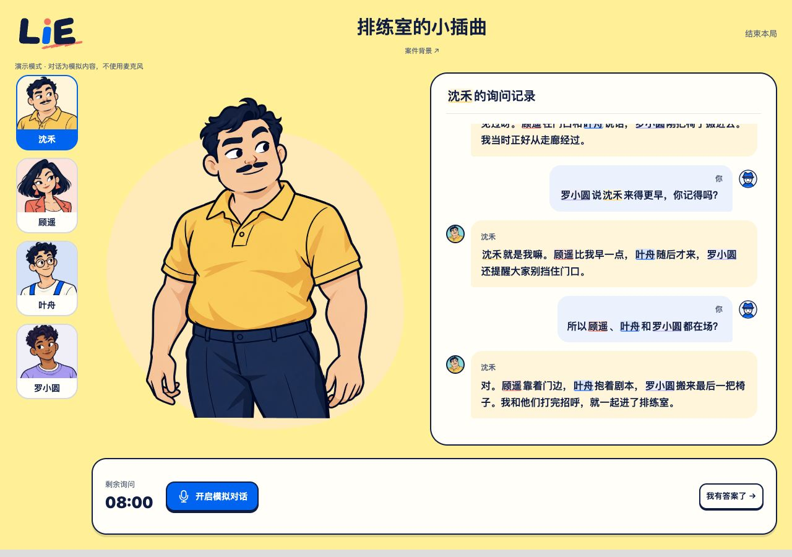
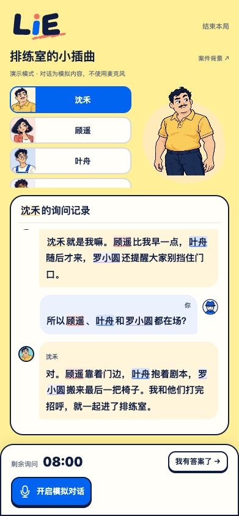
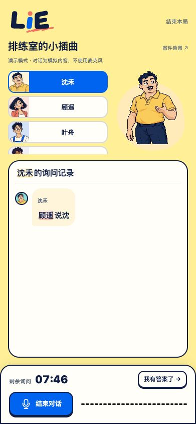

# 调查转写正文的角色姓名高亮

2026-10-30，状态：实现与独立验收完成，待发起方最终 review、总协调串行合入。本任务未更新 main、未推送或部署。

用户原文：“调查页面的对话记录中（尤其是角色的回复信息）的角色名最好也能识别出来并加上角色对应的的底色和下划线”。来源：总协调 chat `01a18baa-4fac-71f2-a81f-c39be0640fe8`，human message `01a18d22-81e8-75d1-bd35-2c94f6125880`。执行 owner 为 `/root/transcript_names`，发起方 `/root` 负责最终 review，再交总协调唯一 integrator。

## 接口与范围

- `Transcript` 新增可选 `text` scoped slot，唯一参数为 `{ text: string }`，只传已经逐字揭示的前缀。没有 slot 时继续输出原来的纯文本；不暴露完整 message。原有 reveal、watch、滚动、空态、只读及 aria-live 条件均保留。
- `App` 在正文 slot 内复用 `CharacterNameText` 和既有全案 `characterNames`；玩家转写、角色回复和非当前角色姓名均适用。没有 UI 包对 Web 包的反向依赖。
- speaker label 保留原状，玩家仍为“你”。共享 matcher、样式、controller、voice、等待组件和 header 都未改。
- 同名冲突、重叠长短名、UGC 名字沿用既有规则。不会补出尚未揭示的字符；若前缀恰好也是另一完整短名，仍按既有 matcher 处理，没有新增猜测或延后规则。

消费者已审计：`App.vue`、UI `Demo.vue` 的默认 fallback、UI `index.ts` 的组件/类型 re-export，以及现有 transcript-follow/reveal 测试。默认消费者不需要接入 slot。

## 来源与检查

独立 managed worktree：`/Users/nighca/.codex/worktrees/transcript-character-names/lie`；分支 `codex/transcript-character-names`；reviewed 起点 `f75b5db858e20b596c0d6851fa13a602f87bc975`；无额外未审依赖，不以红点版本专项为依赖。源码提交 `d76e780ba1804902d94575350682b4a5513616bf`。

Node 24.22.1 / npm 11.19.1。独立 `npm ci`，本树实际 node_modules 目录与 `tmp/npm-cache`，未共享或复制 main 的安装目录。仅从旧任务 cache 复制公共 `_cacache` tarball 加速；npm 配置为空，不复制凭据。package-lock 未改。

- UI 正常 tsconfig 的 `vue-tsc --noEmit`：通过。
- Web 正常 tsconfig 的 `vue-tsc --noEmit`：通过。
- UI 全套：6 文件、60/60 通过，包含默认转写/逐字/跟滚原有测试，以及新 slot 前缀、aria-live、追加、暂停/恢复和跟滚断言。
- Web 关联：6 文件、51/51 通过：`transcript-character-names`、`characterNames`、`CharacterNameText`、`character-name-consumers`、`App`、`voice-connection-notice`。新增测试核四角色 roster、两方正文、非当前人物色、重名/重叠、文本转义与空格、未来字符不泄露、打断和同人重连。
- `npm run build --workspace @lie/web`：通过；82 张唯一源图编码，postbuild 严格检查 8 presets / 121 assets 通过。保留既有 Vite native-config 扩展名与 underline.svg 解析警告，未扩大修改范围。
- `git diff --check`：通过。

生成角色资源后直接执行 Vitest/vue-tsc，与包内正常脚本使用同一 runner、配置和完整正常 tsconfig；没有删除文件或缩小 tsconfig。UI 新增样本最初把句号替换误当追加，按现有 correction 行为修正样本后通过，未改产品 reveal 逻辑。

[identity.json](identity.json) 保存实际源码/锁/截图/重放 fixture 与 bundle 哈希，以及 dist 全文件清单摘要。build/native QA 时 HEAD 为起点 f75b5db，工作树含上述源码改动；之后源码提交未再修改这些文件。后续提交会改变重建时的 Git/version metadata，现有 dist 保持上述 build 身份，不能宣称为最终集成 SHA 的产物；总协调在当前 main 候选中重建最终版本，避免提交哈希自引用。

## 原生 fake 验收

新建后台 IAB tab `1`，未操作用户已有 tab、storage 或全局 viewport。子任务不支持 visible IAB，后台模式可用。实际 App/controller 使用 fake VoicePort，按真实转写事件驱动；角色资源走正式 preset loader。iframe 在加载 App 前以仅本 window 的 Map 替代 localStorage/sessionStorage，关闭后丢弃。四角色与台词均为无正式案件剧透的合成内容。

- 桌面 iframe 1280×900：两方正文均有对应底色/下划线，包括非当前人物顾遥、叶舟、罗小圆。log `scrollTop=145`、`scrollHeight=639`、`clientHeight=494`，新记录跟到底部。
- 手机 iframe 391×844：长记录 `325=648-323` 跟到底部；文档 clientWidth/scrollWidth 都是 391，没有横向溢出。没有改 sidebar 的既有可滚动布局。
- 流式先到“顾”：正文只有“顾”，无 mark；追加到“顾遥说沈”：只高亮顾遥，未补出“禾”；补完整句后四名都高亮。自动化还直接验证了完整未来 text 已到达而揭示前缀只有半名的情况。
- 同人重连后完整正文、四个姓名标记及“回答被打断”均保留。







IAB dev logs 在 QA HTML 热重载/手动刷新阶段有两条无 source URL 的 `MutationObserver.observe` 参数错误（14:42:46、14:42:55 UTC）。产品源码检索无此 API，后续上述交互没有新增错误；缺少可归因堆栈，未确认来源，因此不声称 console clean。没有跑真人语音、provider、麦克风或语音 WebSocket；fake 验收不代表真实语音集成或实体手机验证。

## 重放与服务核销

先确认 5176 的当前 owner、consumer、listener 并获得对应串行 turn，不能挤占其他服务。此附件不是常驻产品入口：

```sh
mkdir -p apps/web/tmp/transcript-names
cp docs/transcript-character-names/index.html docs/transcript-character-names/frame.html docs/transcript-character-names/fixture.ts apps/web/tmp/transcript-names/
npm run dev --workspace @lie/web
```

使用 Node 24.22.1，独立 npm ci 与角色资源生成后，访问 `http://127.0.0.1:5176/tmp/transcript-names/index.html`。toolbar 调 iframe 尺寸，依次点“半个名字 → 继续到第二个半名 → 补完整句 → 同人重连”；“完整样例”重置并产生足够滚动的双方记录。HTML/TS 必须复制到指定临时相对路径以复用实际 App import，不进入正式生产入口。截图是直接原生浏览器 capture 的 iframe 区域，未重画。

本次唯一服务：owner `/root/transcript_names`，源为上述独立 WT（dev cwd `apps/web`）；启动时 HEAD f75b5db、源码 dirty，与 identity 中源码一致；`127.0.0.1:5176` strictPort；listener PID `39747`，npm parent `39205`，原 PTY/session `79421`；consumer 为本人 IAB fake QA；stop condition 为原生验收结束。

已关闭本人 tab 1，IAB tabs=[]；原 PTY Ctrl-C 实际 exit **1**，随后 lsof 5176 无 listener、ps 精确 39747/39205 均空。没有常驻服务、viewport override 或遗留 tab。没有操作 8787/8788 或其他 owner 的服务。ignored 独立 deps/cache/dist/临时 QA 入口保留在本人 WT 供 review，不属于需要合入的文件。
