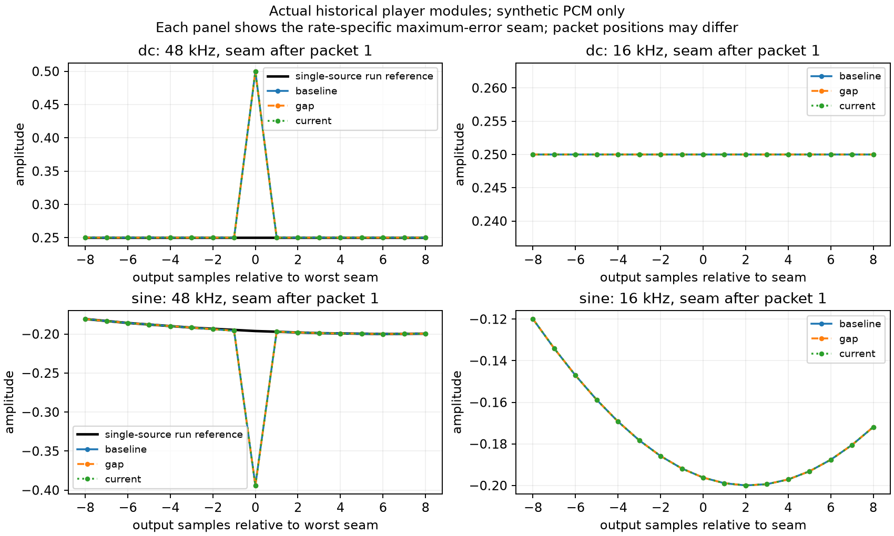

# PCM分片接缝：三代播放器原生离线比较

2026-10-30（Asia/Shanghai）。**调查与提案，未修改产品、参数或播放架构，未发布。** 工作树 `/Users/nighca/.codex/worktrees/lie-voice-audio-seams/lie`，分支 `codex/lie-voice-audio-seams`，基线 `12c4e4d29135c7e30083c8ecf08c2fc95bcaf150`。本任务独立于Worker CPU/断连调查。

## 结论

在本次Chrome155原生OfflineAudioContext比较中，可重复证实16k PCM按多个AudioBufferSource播放、输出48k时，在片段边缘相对相同连续run的单source参考存在差异；三代播放器都已具备该现象。16k输出没有超过1e-6的差异。

**本矩阵没有证明100ms缓冲新增或加重该边缘异常。** 相同起播时间的控制组中，三代输出逐样本完全一致；相同早到模式中，峰值、误差峰值、RMS及差异样本数也相同。旧版确有另一个排程问题：第二片在30ms到达时会插入10ms人工gap；gap-only与当前版均消除它。不能为减少相邻source边缘而把人为静默重新加回。

这些是合成信号/指定到包模式/本机Chrome离线渲染的证据，不是用户硬件“吱吱电流声”的根因证明，也不能否定用户真实体验变差。没有真实PCM、实时设备时钟、耳机/外放、麦克风、回声、供应商到包或CPU profile证据。

## 用户观察与边界

协调者转述：用户认为音爆仍在，主观感觉可能更严重；后来确认同一设备，本地8787连续约3:40多秒没有意外断开，但音爆同样存在，描述为“吱吱的像电流声一样”。浏览器、扬声器/耳机与音频输出配置未逐项确认。之前“都没有问题”不能解释为本地没有音爆；不中断和音频质量是两件事。用户观察未在本专项受控复现，不用它归因Cloudflare、Paid或缓冲参数。

第三方整段音频演示由另一专项研究；这里的单source参考只是诊断参照，不意味着把LIE改成收齐整段后再播放或录播互斥已经获准。

## 实际源码与方法

[source-manifest.json](source-manifest.json)记录完整commit、TS/PCM及生成JS的SHA256。源文件由`git show`读取，未重写播放器算法；Node24.22.1内置`stripTypeScriptTypes`仅去类型并将PCM相对import指向归档模块。原生运行时模块保留Node去类型生成的尾空格；入库前仅trim这些尾空格以通过格式检查，actual TS快照完全未变。manifest同时保存入库模块hash与rawModuleSha256，后者与verification中的nativeServedModuleSha256逐项相等；这是明确的非语义空白归一化，不冒称两种字节完全相同。PCM源码在三版本中完全相同。

| 标签 | 实际源码commit | player SHA256开头 |
| --- | --- | --- |
| baseline | `60c11f72b71ead4b8e744f2281d5dbecb796d11a` | `2d771427afa3e7ab` |
| gap | `5e97cda1bfe4e5621467bb4560cdfea2848b4591` | `b3bb00011d6de900` |
| current | `12c4e4d29135c7e30083c8ecf08c2fc95bcaf150` | `4b1bdfa0b506a02c` |

[TS与生成模块](sources/)都入库；即使fresh clone没有旧任务commit对象，fixture可直接运行。`generate-sources.mjs --snapshots`使用并核对已归档TS的hash再生成，不静默替换成其他版本。

矩阵为3版本×3信号×4模式×2输出率，共72case。每种输入是同一份连续3200样本/200ms PCM16LE，再切为10×20ms；正弦不会在每包重置相位。输入SHA256保存在原生JSON中。

- 信号：+0.25 DC；233Hz/0.2幅连续正弦；147/294/588Hz合成谐波加3.3Hz平滑包络。全为合成，无真人语音或下载音频。
- `all-early`：10包同一合成音频时刻到达，排程应连续。
- `second-at-30ms`：第一包0，剩余包在30ms成组到达，专门检验旧版每片20ms下限。
- `exhaustion`：前5包0，后5包150ms成组到达，确有耗尽；各版本应保留真实静默而非伪造连续信号。
- `matched-onset`：同样早到，但仅平移各版本的合成时钟基点，令首次start都为100ms；这是控制起播offset/render相位的独立控制组，不是宣称三版本首音延迟相同。
- 输出率16k和48k。44.1k未测，不把结果推广到该率或所有浏览器。

播放器调用的createBuffer/createBufferSource/connect/start均交给真实OfflineAudioContext；只包装currentTime为可控enqueue音频时钟，并记录真实node.start参数。未运行生产bridge或模拟真实主线程/声卡deadline，也未注入meter/diagnostics消费者。每段仅200ms，不是分钟级会话、GC或线程负载测试。当前版的pending timer由阈值/最终flush清理，本轮不重复既有timeout/STT/close生命周期验收；那些保护见[已批准100ms实现](../voice-playback-smoothness/prebuffer-implementation.md)。

每case有两个参考，均用相同量化后的PCM和该case自己的实际起播点：

1. **run reference**：将实际排程中严格相邻的包合成一个source；有真实/人工gap处断开，保留相同空隙。用它测跨source边缘差异，不把真实断流或整体起播错位算成声学异常。
2. **continuous reference**：整个输入一次source播放，起点仍对齐；它的差异包含gap/时长拉伸，因此不能单独拿它的误差宣称播放器波形回归。

记录全buffer误差、内部接缝±32输出sample窗口、峰值、RMS、sampleCount/start/end、gap和一个最坏窗口。没有将“不是bit-identical”直接等同可听爆音。

## 原生结果

[完整72case原生JSON](native-results.json)、[重复与身份核验](verification.json)、[独立证据检查](verify-evidence.py)。Chrome UA记录155.0.0.0；两次完整执行结果逐字一致，SHA256为 `f0443ff6c4ceda92b73404ff1f9bfb61e27e41fd75a4c28c8610603d97fc34db`，两次原生capture的漂亮格式hash为上述值；入库JSON只做无损紧凑格式化，当前文件hash另见verification，Node将其parse后再以2空格JSON.stringify加换行可精确重建原capture hash。72个context均closed，所有10片排程/sample时长核对一致。无浏览器warn/error日志。

以下为48k `all-early`相对run reference，**每一行的三代数值均相同**：

| 合成信号 | 实际峰值绝对值 | 最大误差 | 全buffer差异sample | 内部9接缝窗口差异sample总数 |
| --- | ---: | ---: | ---: | ---: |
| DC 0.25 | 0.5 | 0.25 | 10 | 9 |
| 正弦 | 0.394012451 | 0.197814941 | 28 | 27 |
| 语音式包络 | 0.401031494 | 0.200805664 | 28 | 27 |

全buffer与内部接缝窗口计数相差的1个sample没有在本JSON存完整位置列表；不把它更细地指定为某一端点。16k所有case的差异sample数为0，最大误差约1.03e-15，是低于阈值的数值噪声。`matched-onset`中gap/current对baseline的直接完整波形比较为0差异sample、0最大误差。

`second-at-30ms`旧版总gap10ms，gap/current为0；其DC内部相邻接缝数从8变9，因此差异sample计数从8变9并不证明单个接缝更严重，也不能反推整体听感。`exhaustion`三代都保留50ms总gap，所有参考都按此断开，没有拿本来应有的静默做“错误”。



图由[matplotlib脚本](plot-results.py)从原生JSON导出。每列取该输出率自己的最大误差接缝，包位置写在标题中，不能直接比较两列的相位/斜率；每列内三代相位与起点相同。图中48k的DC尖峰并未达到数字full-scale，不能称客户端clipping；正弦自然斜率也与相对参考误差分开。

## 最小修复提案（都未实施，需用户确认实验）

### 优先做16k播放context的有界原型，不先改流播放架构

当前production bridge默认`new AudioContext()`，而已知输入固定16k。最小、可解释的实验是只请求播放context的`sampleRate: 16000`，保留全部播放器排程/100ms样本储备/短尾flush/立即打断、close与scope隔离接口。这里的依据是同一actual player在本次16k graph下边界一致，**只是合理假设，不是实时硬件已验证修复**。

[W3C AudioContext构造规则](https://www.w3.org/TR/webaudio-1.0/#dom-audiocontext-audiocontext)要求指定context rate与设备不同则对最终输出重采样，并明确提醒可能增加输出延迟；[sampleRate成员](https://www.w3.org/TR/webaudio-1.0/#dom-audiocontextoptions-samplerate)规定不支持的值须抛NotSupportedError。该实验可能把每片16→设备率转换变成context最终输出的连续转换，但本报告没有验证实现内部的精确重采样路径、延迟或听感。

必须读取实际context.sampleRate，明确unsupported/创建失败的原有错误收口，不能静默回48k又声称目标满足。16k时已有256-frame提交余量约16ms，48k约5.33ms，首音/恢复可能再多约10.7ms工程余量；还须测实际baseLatency/outputLatency与主线程压力，不能只算这一差值。

保护计划：factory注入/配置契约自动化；同样72case保持排程，短回答/timeout flush、normal TTS stop真drain、STT/aborted/切人/close清资源、过期timer/ended/error隔离保持；经用户批准后用受控合成实时播放检查耳机/外放与手机，并做短暂真实同输入对照。不能让播放context选择影响现有独立麦克风采样/重采样、网关CPU或会话预算。当前scope明确禁止修改参数，所以本轮未创建真实AudioContext、未做扬声器播放。

### 备选：合并当前pending batch，收益有限

把已缓冲的几包在schedule前concat成一个AudioBuffer，可减少初始/耗尽恢复batch内部的source边界，API不必改；短flush仍立即排剩余、30秒上界按样本总数、stop仍清全部，额外复制与onIdle资源数变化要测。但未来队列上逐包到达时仍是独立source，不能独自消除整段连续对话的全部边缘差异。不得为了合并而额外延长已批准的100ms等待，也不能改为整段TTS收完才播放。

### 后续才评估连续流重采样/Worklet；不建议用回滚或淡出掩盖

若小原型在真实设备上失败，连续流重采样或ring-buffer/AudioWorklet可作为独立架构方案。它们需要新队列、render线程/重采样状态、stop代际、flush末尾及ready/idle协议与独立验证，不是本轮已批准实现。单source参考只证明较少边界在这些离线样本里更接近连续波形，不证明必须采用某种实现。

回滚100ms没有消除本轮已在旧版存在的异常的证据支持；重新加gap会恢复已知缺陷。每片交叉淡入淡出会改变连续PCM，且无法由本次结果证明能修复设备电流声。强制中断本身的click、源PCM异常、设备中断、实时渲染抢占、回声误打断等仍需另外证据，不能由此认定已排除。

## 复验、环境与服务清理

仅docs变更，不跑无关应用types/tests/build，不安装项目依赖、不改lock。Node24.22.1只读使用现有已核工具链。plot工具独立安装在本WT ignored venv（matplotlib3.11.2），依赖与缓存不入库、不改全局Python。所有临时数据在本WT ignored `tmp/voice-audio-seams/`。

```sh
# 本目录已有实际源快照及浏览器模块，可直接启动纯静态fixture。
node docs/voice-audio-seams/serve.mjs
# 在获准的本机5544窗口打开 /native.html，按 Run native comparison；结果只POST回本地固定JSON文件。
# 验收结束原PTY Ctrl-C，核进程/5544释放。
python3 docs/voice-audio-seams/verify-evidence.py

# 原Git对象仍在时重取实际源码；否则用 --snapshots 验hash后重生成。
node docs/voice-audio-seams/generate-sources.mjs --snapshots
# 使用自己环境中的标准matplotlib生成图；不需要项目依赖。
python3 docs/voice-audio-seams/plot-results.py
```

本轮独立源码hash校验、72case排程/总样本/控制组检查、两次byte-identical核对、生成器snapshot模式、JS/Python语法、JSON与diff whitespace检查通过。初次绘图图注引号曾产生Python SyntaxError，修正图注后重新导图成功；首次暂存检查也发现Node去类型产生的尾空格，按上文归一化后通过。两者不涉及原生矩阵逻辑或产品代码。Node内置stripTypeScriptTypes有experimental提示，未用它冒充实时硬件验收。

服务owner `/root/page_version`，source本WT/HEAD12c4e4d加本目录dirty证据，所服务模块hash见manifest。总协调明确分配5544，起前再核无listener，Node仅绑定127.0.0.1:5544，PID25110、原PTY/session19864，唯一消费者ownChrome1910332068。IAB实际不可用后才fallbackChrome。完成两轮后关own tab、原PTY Ctrl-C exit130，再经批准只读ps25110为空、lsof5544无listener；5544已交回，无保留consumer。

没有碰已恢复的8787/8788用户环境、5176等待提示demo、5198未知服务、现有用户tab/storage/global viewport、任何provider/mic/真人音频/WS/profile/账号或CPU配置。必要快照、生成源、fixture、原生JSON、图和提案均在本目录，不以chat或ignored临时文件作为唯一副本。源分支提交后交总协调实际review，本专项不main/push；线上发布仍按用户测试窗口门禁暂停。
