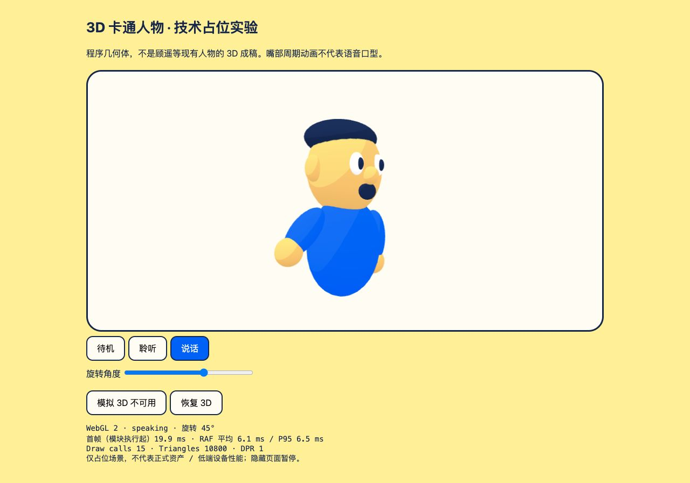

# LIE 卡通 3D 技术实验

独立候选，未接入产品。程序球体人物不是现角色的 3D 稿；说话动效不是口型同步。研究及实际验证边界见 `../../docs/cartoon-3d-investigation.md`。

```sh
cd spikes/cartoon-3d
npm ci --ignore-scripts
npm run check
npm run build
python3 -m http.server 5199 --bind 127.0.0.1 --directory dist
```

在 Codex 内置浏览器访问 `http://127.0.0.1:5199/`。资源均来自本地安装和构建，不需要 CDN、供应商账号、麦克风或 API key。`npm run dev` 使用 5198；若端口被占用，Vite 会提示实际端口。静态服务器可换空闲端口。

人工验收：待机 → 聆听（抬手/倾头）→ 说话（周期嘴部动作），拖动旋转滑块查看侧面；模拟 3D 不可用应出现静态占位，恢复应重新显示 3D。页面公开显示粗略首帧/RAF/draw calls/三角形数据，不能视为正式角色性能。



`node_modules`、`dist` 忽略；不修改根 workspace lock 或配置。Three.js 的 MIT license 位于安装包的 LICENSE，若将其正式分发，保留对应第三方许可。当前截图和程序几何体仅供技术验证，不作为已批准品牌素材。
